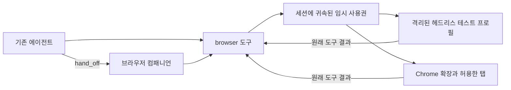

# 브라우저 협업과 헤드리스 테스트

[English](BROWSER_COLLABORATION_DESIGN.md) · [브라우저 매뉴얼](../clients/browser/README.ko.md)

사용자는 기존 에이전트가 브라우저 도구를 투명하게 직접 사용하는 방식과 브라우저 컴패니언이 독립적으로 테스트하는 방식을 모두 요청했습니다. 테스트는 기본으로 격리된 헤드리스 브라우저를 사용합니다. 사용자의 Chrome 탭은 확장 모드를 명시해서 사용하며 기존 협업·세션 소유권 계약을 유지합니다.

## 실행 경로

`hand_off`의 기존 요청·목적·답변 양식 계약, 비동기 접수증, 요청자별 곁세션, 완료 전달과 큐를 유지합니다. 브라우저 컴패니언은 곁세션에서 같은 브라우저 진입점을 사용하며 부모 대화나 브라우저 사용권을 상속하지 않습니다. `looking:true`는 조작 권한을 제한하므로 상호작용 테스트에는 적합하지 않습니다. 기존 명단·`companions`·`companion_can`으로 컴패니언을 찾습니다.

직접 사용은 두 번째 모델을 호출하지 않습니다. 원래 도구 인자를 연결된 백엔드에 전달하고 JSON 결과를 돌려줍니다. 결과는 관찰한 API 조작을 나타내며 업무 완료는 새 페이지 조회로 확인합니다. 독립 테스트를 위임하면 브라우저 컴패니언의 모델 판단과 완료 보고가 추가됩니다.

## 컨텍스트 계약

`internal/app/prompt_frozen.go`는 모델의 프롬프트 캐시를 유지하려고 세션의 도구 정의를 고정합니다. 실행 중인 세션에 새 MCP 도구를 붙여도 그 세션의 모델 목록에는 추가되지 않습니다. 따라서 connect·call·release 작업을 가진 작은 `browser` 진입점을 고정합니다. connect는 현재 백엔드 도구 명세를 결과로 반환하고 call은 선택한 도구를 전달합니다. 매 스텝 도구 목록을 바꾸거나 전역 브라우저 도구 권한을 추가하지 않습니다. 세션의 첫 모델 요청 전에 연결하는 통합에는 명시적 세션별 MCP 연결도 제공합니다.

전체 도구 명세는 요청할 때만 컨텍스트에 들어갑니다. 반환된 정의와 호출 결과는 일반 압축 전까지 대화 이력에 남으며 release로 이력을 지우지는 않습니다. 스냅샷은 본문 32,000자·요소 100개·텍스트 필드 값 4,000자로 제한하고 비밀번호 값은 제외합니다.

## 권한과 수명

헬퍼는 인증된 루프백 연결 자격 증명을 소유자 전용 런타임 파일에 발행합니다. 모델은 모드만 고르며 엔드포인트·토큰·소켓·소유 세션을 지정하지 않습니다. 코어가 자신의 소켓과 세션을 결정합니다. 헬퍼가 로컬 데몬 소켓과 세션의 존재를 확인한 뒤 불투명 사용권을 발급합니다. HTTP 호출은 해당 사용권의 소켓·세션과 일치해야 합니다. 5분간 사용하지 않으면 만료하며 활성 사용권은 최대 20개입니다. 부모 브라우저 연결을 닫거나 교체하면 사용권과 대기 호출을 취소합니다. 명시적 해제는 사용권의 헤드리스 프로필도 닫습니다.

확장 호출은 원래 패널 큐로 전달하되 요청 세션과 사용권을 함께 기록합니다. 실행 전에 패널이 헬퍼에 호출 유효성을 확인하고 결과를 받을 때도 소유권을 검사합니다. 확장 조작은 한 번에 하나만 실행하며 겹친 호출을 대기시켰다가 재실행하지 않습니다. 페이지가 바뀌면 스냅샷 ID를 무효화합니다. 이미 실행 중인 조작을 해제로 되돌릴 수는 없습니다. 시간 초과·취소는 결과가 불확실할 수 있으므로 자동 재시도하지 않습니다.

헤드리스 사용권은 사용자 Chrome이나 다른 사용권과 프로필을 공유하지 않습니다. 시작 시 정확한 허용 origin과 조작 정책을 지정합니다. 그 범위 밖의 이동·하위 자원·리다이렉트를 차단하고 로그인 쿠키·공유 프로필·WebSocket·서비스 워커는 제외합니다. 전용 테스트 컴패니언은 브라우저 역할과 범위 제한 백엔드가 시작 시 승인을 강제하므로 core permission=allow로 기동할 수 있습니다. 기존 코딩·앱 에이전트의 코어 승인 정책은 그대로 유지합니다.

## 검증과 남은 인수

회귀 검증에는 세션 불일치·미등록 소켓·만료·부모 연결 종료·늦은 결과·동시 확장 호출·조건부 MCP 정리·명세의 지연 조회와 결과 전달·스냅샷 무효화·헤드리스 프로필 격리를 포함합니다. 브라우저 변경마다 JS·Playwright를 실행하고 백엔드 변경은 실제 헤드리스 픽스처로 확인합니다. 코어·헬퍼 빌드와 관련 Go race 테스트도 수행합니다.

실제 헤드리스 픽스처 테스트는 격리된 Chromium 프로세스의 실행 증거입니다. 설치된 Chrome 확장의 인수나 실제 모델의 위임 테스트를 확인한 것은 아닙니다. 다음 실물 인수는 갱신한 헬퍼·코어를 시작해 코딩 에이전트가 폐기 가능한 로컬 폼에서 `browser`를 직접 사용하게 한 뒤 같은 테스트를 브라우저 컴패니언에 위임하는 것입니다. 서로 다른 세션·프로필 ID, 부모 대화 유지, 완료 전달, 범위 밖 이동 거절과 정리를 확인합니다. 확장도 허용한 탭에서 인수하되 실제 발송·결제는 수행하지 않습니다. 모델·제공자 실패와 브라우저 전송 결과는 구분해 기록합니다.

## 검증 기록 (2026-10-12)

Go 코어·CLI 테스트, 브라우저·appbridge race 테스트, vet, 브라우저 JS·Playwright와 전체 VS Code 전사 Playwright가 통과했습니다. 실제 헤드리스 race 검증은 Playwright Chromium과 설치된 Google Chrome에서 모두 통과했습니다. 실제 데몬·appbridge·프록시·Chromium 통합 테스트로 원래 결과 전달, 요청 세션에 전체 도구 명세가 노출되지 않는 점, handoff 출처 곁세션의 별도 프로필을 확인했습니다. 모델·제공자·계정은 사용하지 않았으므로 실제 모델의 hand_off 전체 인수는 별도 항목입니다.

교차 검토에서 코어 도구와 MCP 서버 이름 충돌, 세션별 연결 상태의 잔류를 발견해 보완했습니다. MCP는 `browser_runtime`, 진입점은 `browser`를 사용합니다. 해제·만료된 로컬 연결 상태를 제거하고 헬퍼 실패 시에는 재연결 안내와 함께 로컬 사용권을 정리합니다. 일반 페이지·도구 오류는 사용권을 유지하므로 오래된 스냅샷을 다시 조회할 때 프로필이 사라지지 않습니다.
