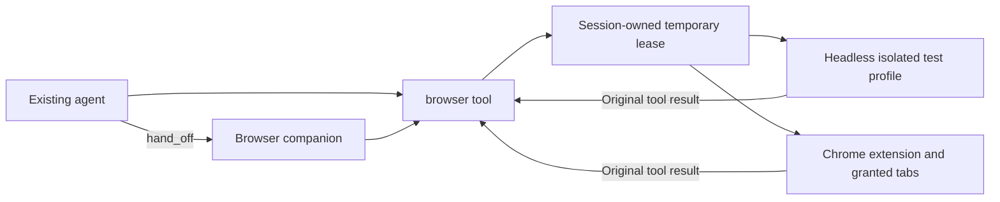

# Browser cooperation and headless testing

[한국어](BROWSER_COLLABORATION_DESIGN.ko.md) · [Browser manual](../clients/browser/README.md)

The user requested both transparent browser tool access from an existing agent and independent test execution by a browser companion. Tests use isolated headless browsing by default. User-owned Chrome tabs use an explicitly selected extension mode. Existing collaboration and session ownership contracts remain in place.

## Execution paths

`hand_off` retains its existing request, purpose and answer-format contract, asynchronous receipt, per-requester side session, completion delivery and queue. A browser companion uses the same browser entry point from its side session; no parent conversation or browser lease is inherited. `looking:true` is unsuitable for interaction tests because that role restricts actions. Companion discovery is through the existing roster, `companions` and `companion_can`.

The direct path does not invoke a second model. It passes the original tool arguments to the bound backend and returns its JSON result. Tool results report observed API effects; application-level completion requires a fresh page inspection. Independent delegated testing adds the browser companion's model reasoning and its completion report.

## Context contract

`internal/app/prompt_frozen.go` freezes tool definitions per session to preserve the model's cached prefix. Attaching a new MCP tool during a running session would not advertise it to that session's model. Therefore `browser` is a compact, stable entry point with connect/call/release actions. Connect returns the current backend schemas as a tool result; call forwards a selected tool. No per-step tool-catalog mutation or global browser-tool permission is introduced. Explicit session-owned MCP attachment remains available for integrations that attach before the session's first request.

Complete browser schemas are paid only when requested. Their returned definitions and call results remain in conversation history until normal compaction; release does not erase history. Snapshots cap text at 32,000 characters, elements at 100 and text field values at 4,000 characters. Password values are excluded.

## Authority and lifetime

A helper publishes authenticated loopback credentials in owner-only runtime files. The model selects only a mode, never an endpoint, bearer token, socket or owning session. The core derives its socket and session. The helper validates local daemon sockets and session membership, then creates an opaque lease. HTTP calls must match that lease's socket/session. Idle leases expire after five minutes, with a maximum of 20 active leases. Closing or replacing the parent browser connection cancels its leases and queued calls. Explicit release closes the lease's headless profile.

Extension calls return through the original panel queue while carrying the source session and lease identity. Before execution, the panel checks current call validity with the helper. Result acceptance checks ownership again. One extension operation runs at a time; overlap is rejected rather than replayed. Page changes invalidate snapshot IDs. Release cannot reverse a browser action already executing; timeout or cancellation may leave an uncertain outcome. No automatic retry is allowed.

Headless lease profiles are separate from user Chrome and from each other. Startup specifies the exact allowed origins and action policy. Navigation, subresources and redirects outside those origins are blocked. Login cookies, shared profiles, WebSockets and service workers are excluded. The dedicated test companion may use core permission=allow because its browser role and scoped backend enforce the startup authorization. An existing coding or application agent retains its own core permission policy.

## Verification and remaining acceptance

Regression coverage must include session mismatch, unknown sockets, idle expiry, parent teardown, late results, overlapping extension calls, conditional MCP cleanup, lazy schema/result forwarding, snapshot invalidation and headless profile isolation. Run the browser JS and Playwright suites for every browser change, and real headless fixture tests for backend changes. Build the core/helper and run relevant Go race tests.

Real headless fixture tests are execution evidence for an isolated Chromium process, not evidence of installed Chrome-extension acceptance or a real model's delegated test. The next live acceptance is to start the updated helper/core, ask a coding agent to use `browser` directly on a disposable local form, then hand the same test to the browser companion. Check separate session/profile IDs, unchanged parent conversation, completion delivery, denied out-of-origin navigation and cleanup. Repeat extension acceptance on granted tabs without real sending or purchases. Record any model/provider failure separately from browser transport results.

## Verification record (2026-10-12)

Go core and CLI tests, browser/appbridge race tests, vet, browser JS/Playwright and the full VS Code transcript Playwright suite passed. Live headless race tests passed with both Playwright Chromium and installed Google Chrome. The real daemon/appbridge/proxy/Chromium integration test verifies original results, no full schema leakage to the requesting session, and a separate profile for a handoff-origin side session. It uses no model/provider/account; a real model's end-to-end hand_off is still a separate acceptance item.

Cross-review caught a core-tool/MCP-server name collision and retained per-session access state. MCP uses `browser_runtime` while the entry point remains `browser`; released/expired local access state is removed and helper failures retire local access with reconnect guidance. Ordinary page/tool errors preserve the current lease so a stale snapshot can be refreshed without losing the profile.

## Real-model direct acceptance (2026-10-12)

Using local `qwen3-coder:30b` with isolated config/data/socket directories and a disposable loopback form, both coding and mail-role agents called the lazy browser entry point, filled their own profiles, clicked Save with a fresh snapshot, reread `Saved: Direct-A` / `Saved: Mail-A`, released access, and reported PASS. The raw session logs verify actual operations. Earlier `gpt-oss:20b` attempts confused the wrapper fields or reused an invalidated snapshot and did not pass; they are not counted as acceptance. Model choice and explicit target instructions affected these results.

This run also exposed a first-start socket mismatch when a symlinked config root's child workspace did not yet exist. The helper now creates the workspace before computing its canonical socket identity. A symlink regression test covers that order. Browser wrapper descriptions include concrete call examples, and fill explicitly requires a fresh snapshot before the next click.

## Real-model handoff acceptance (2026-10-12)

A coding requester used `companions`/`companion_can` and `hand_off` to dispatch the local form test to a browser companion. The receiver's own side session used browser connect/read/fill/read/click/read/release, verified `Saved: Delegated-A`, and finished with PASS. The existing completion mechanism delivered the report verbatim into the requester's conversation. Local `qwen3-coder:30b` and installed headless Chrome were used.

The existing handoff permission floor still requires per-call human approval even when the recipient's normal policy is allow. This acceptance approved only the explicitly authorized fixture browser calls. It verifies approved delegation, not fully unattended test delegation. An earlier unapproved attempt timed out and reported FAIL. A future unattended-test policy must authorize only startup-scoped headless browser leases and must preserve the handoff floor for extension tabs and every other tool; do not disable the general floor.
