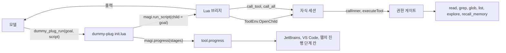
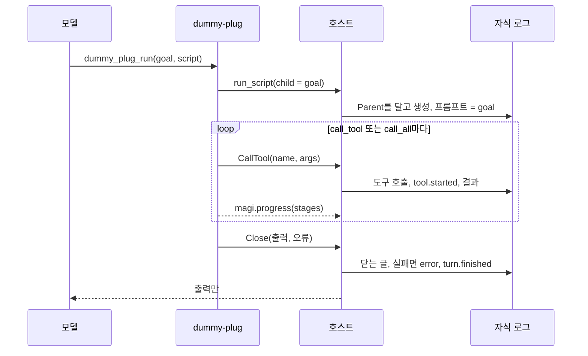

# magi — 더미 플러그 (코드 모드)

[English](DUMMY_PLUG.md) · [한국어](DUMMY_PLUG.ko.md) · [↑ 문서](README.ko.md)

더미 플러그의 설계 기록입니다. 왜 만들었는지, 지금 어떻게 만들어져 있는지, 무엇을 약속하는지, 아직 하지 않는 것은 무엇인지, 그리고 어떤 설계를 대체했는지를 적습니다. 구현됨으로 적은 것은 모두 커밋 `f245a8413`의 코드에서 읽었고, 계획으로 적은 것은 아직 코드가 없습니다. 플러그인 작성자용 API(`magi.run_script`, `magi.progress`, `ToolEnv.OpenChild`)는 [EXTENDING](EXTENDING.ko.md)에 있고, 이 문서는 그 조각들이 이 플러그인 하나에서 어떻게 맞물리는지 설명합니다.

## 0. 용어

| 용어 | 뜻 |
|---|---|
| 더미 플러그 | `plugins/dummy-plug` 플러그인. 도구 `dummy_plug_run` 하나가 모델이 쓴 Lua 스크립트를 받아 실행합니다. |
| 스크립트 | 모델이 쓴 Lua 소스. 도구를 부르고, 모델이 볼 것만 출력합니다. |
| 바깥 호출 | 모델 자신의 `dummy_plug_run` 호출. 대화에 기록됩니다. |
| 안쪽 호출 | 스크립트가 하는 도구 호출(`call_tool`, `call_all`). 호스트가 다른 호출과 똑같이 실행합니다. |
| 자식 세션 | 스크립트 실행 한 번을 위해 여는 세션. 대화를 부모로 두며, 모델이 구동하지 않습니다. 다만 스크립트가 부르는 도구는 자기 모델을 쓸 수 있습니다(`explore`는 모델이 구동하는 서브에이전트를 띄웁니다). |
| 단계 | 사람이 보는 실행의 한 걸음(`plan`, `stage`). 구조화된 데이터로 알립니다. |

## 1. 왜 만들었나

파일 스무 개를 읽으려는 모델은 왕복을 스무 번 하고, 결과는 필요하든 아니든 모두 컨텍스트에 들어옵니다. 더미 플러그를 쓰면 모델은 그 반복을 한 번만 씁니다. 스크립트가 읽고 거르고 세며, 출력한 것만 돌아옵니다. 2026-11-21에 문서 35개를 나열하고 그중 8개를 병렬로 읽은 뒤 기억을 조회(답 21,894바이트)한 스크립트는 모델 스텝 하나로 끝났고, 짧은 줄 네 개만 돌려줬습니다.

절약은 두 곳에서 나옵니다. 모델 왕복이 줄고, 모델이 보기 전에 스크립트가 결과를 거릅니다. 파일이라면 bash 스크립트도 두 번째 일을 할 수 있지만, `explore`나 `recall_memory` 같은 하네스 도구는 부를 수 없고 magi의 권한 게이트도 거치지 않습니다. 모델이 구동하는 서브에이전트는 둘 다 할 수 있지만 스텝마다 모델 호출 비용을 냅니다. 더미 플러그는 그 사이에 있습니다. 흐름은 코드이고, 도구는 하네스의 것이며, 흐름을 정하는 모델은 없습니다. 스크립트가 `explore`를 부르면 그 서브에이전트의 모델 스텝 비용은 따로 듭니다. 위의 실행은 `explore`를 부르지 않았습니다.

커밋 `0d483d59d`부터 스크립트는 자식 세션에서 돕니다. 이로써 가치가 하나 더 생겼습니다. 대화에는 결과만 남고, 사람은 자식을 열어 스크립트가 한 호출과 그 반환값을 모두 볼 수 있습니다.

## 2. 구조

| 조각 | 위치 | 하는 일 |
|---|---|---|
| `dummy_plug_run` | `plugins/dummy-plug/init.lua:129` | 유일한 도구. 설명에 스크립트가 쓸 수 있는 것을 적어 둡니다. `goal`이 자식의 이름이 됩니다. |
| `track` | `plugins/dummy-plug/init.lua:47` | `plan`, `stage`, 호출마다의 시작·끝으로 실행의 단계를 유지하고 알립니다. |
| `magi.run_script` | `internal/adapter/plugin/lua/bridge_script.go:34` | 별도 Lua 상태에서 스크립트를 실행합니다. `child`가 있으면 자식을 열고(`:57`) 출력과 함께 닫습니다(`:72`). |
| `ToolEnv.OpenChild` | `internal/port/port.go:515`, `ChildRun`은 `:1006` | 호스트의 범용 지점. 더미 플러그라는 낱말이 없습니다. |
| `openChild` | `internal/app/open_child.go:23` | 서브에이전트 자식과 같은 방식으로 자식을 만들고, 그 자식에 묶인 `CallTool`을 돌려줍니다. |
| `callInner` | `internal/app/inner_call.go:53` | 안쪽 호출을 기록하고, 모델 호출과 같은 경로인 `executeTool`로 실행합니다. |
| `magi.progress` | `internal/adapter/plugin/lua/bridge_script.go:124` | 알림과 단계 목록을 `ToolEnv.EmitStages`(`internal/port/port.go:570`)로 보냅니다. |

코어는 더미 플러그를 모릅니다. 호스트는 범용 기능 네 가지(스크립트 실행, 자식 열기, 스크립트에서 도구 부르기, 단계 알리기)를 내놓고, 플러그인이 그것을 조합합니다. 이 규칙은 2026-11-20 검토에서 코어에 플러그인 전용 개념(플러그인 이름을 적은 허용 목록, 그래프 생성기, 아이콘 목록)이 들어간 것을 찾아 밖으로 옮기면서 생겼습니다.

## 3. 실행 한 번의 순서

자식은 스크립트가 도는 동안 서브에이전트 줄에 나타났다가 끝나면 사라집니다. 단계 목록은 바깥 호출의 행에 실리므로, 사람은 `dummy_plug_run` 행 아래의 칸에서 실행을 지켜봅니다.

## 4. 무엇이 어디에 기록되나

| 기록 | 남는 곳 | 읽는 쪽 |
|---|---|---|
| 바깥 호출과 스크립트의 출력 | 대화 로그 | 모델(도구 결과로) |
| goal(자식의 프롬프트로) | 자식 로그 | 복구, 서브에이전트 줄 |
| 안쪽 호출마다의 호출·시작 사실·결과 | 자식 로그 | 복구, 자식을 여는 사람 |
| 스크립트의 출력(닫는 글로) | 자식 로그 | 자식을 여는 사람 |
| 스크립트가 실패하면 `error`("the script stopped: ...") | 자식 로그(`internal/app/open_child.go:60`) | 복구, 화면 |
| 자식을 닫을 때 `turn.finished` | 자식 로그(`internal/app/open_child.go:65`) | 복구 |
| 단계 목록 | `tool.progress`, 저장하지 않음 | 화면만 |

안쪽 호출은 바깥 호출을 `Parent`로 적고, `reconstruct`는 `Parent`가 있는 호출을 모델 이력에서 뺍니다(`internal/app/reconstruct.go:202`). 이제 호출은 자식 로그에 있으므로 이 거르기는 두 번째 안전장치입니다. `0d483d59d` 전에는 이것 하나뿐이었습니다.

## 5. 안전 규칙

- **선언한 도구만.** 매니페스트가 스크립트가 부를 수 있는 도구를 적습니다: `read`, `grep`, `glob`, `list`, `explore`, `recall_memory`(`plugins/dummy-plug/plugin.toml:6`). 그 밖의 도구 호출은 호스트에 닿기 전에 거절됩니다. 자기 도구를 적은 플러그인은 불러올 때 거절됩니다(`internal/adapter/plugin/lua/host.go:434`).
- **호스트는 도구의 성질로 정합니다.** `scriptFree`(`internal/app/inner_call.go:20`)는 보기만 하는 도구, 외부 효과가 없는 도구, 자식이 보기만 하는 서브에이전트 도구만 묻지 않고 실행하게 합니다. 그 밖의 도구는 어떤 권한 모드에서도 사람에게 묻고, 물을 사람이 없으면 거절합니다. 더미 플러그가 선언한 도구는 모두 이 조건을 통과하므로 지금은 묻는 일이 없습니다.
- **상한.** 바깥 호출 하나당 안쪽 호출은 200번까지입니다(`internal/app/inner_call.go:47`). 스크립트는 기본 60초, 최대 300초 돌고, 출력은 기본 16,000바이트, 최대 64,000바이트까지 남깁니다(`internal/adapter/plugin/lua/bridge_script.go:21-24`). `call_all`은 한 번에 최대 8개를 실행합니다(`:94`).
- **변환할 수 없는 값.** 자기 자신을 품은 테이블이나 100단계를 넘게 중첩된 테이블(`internal/adapter/plugin/lua/convert.go:64`)은 Go 스택을 고갈시키지 않고 사유와 함께 거절됩니다. `7524a373c` 전에는 프로세스가 죽었습니다.
- **실행 중인 플러그인으로 되돌아오는 호출 금지.** 도구는 플러그인 잠금을 쥐는 동안 호출 문맥에 그 플러그인을 표시합니다(`internal/adapter/plugin/lua/plugin.go:236`). 직접이든 다른 플러그인의 도구를 거쳐서든 그 플러그인으로 되돌아오는 호출은 바로 거절됩니다(`internal/adapter/plugin/lua/luatool.go:52`). `d14da185a` 전에는 그런 호출이 끝없이 기다렸습니다.

## 6. 자식 세션 계약

자식은 서브에이전트 자식과 같은 방식으로 만들어집니다. 대화를 `Parent`로 두고, goal을 프롬프트로 하며, 서브에이전트 줄에 자리를 가집니다. 다른 점은 구동하는 주체입니다. 안에서 루프가 돌지 않으므로 스스로 끝을 쓰는 것이 없고, 그래서 `Close`가 써야 합니다.

복구는 세션 로그를 읽어 열린 턴이 있는지 판단합니다(`unfinishedTurn`, `internal/app/unfinished.go:43`). 프롬프트 뒤에 `turn.finished`도, 포기도, 회복되지 않은 오류도 없으면 열린 턴입니다. 그래서 세 경우로 나뉩니다.

| 스크립트가 끝난 방식 | 자식 로그의 마지막 | 복구가 보는 것 |
|---|---|---|
| 정상 완료 | 닫는 글, `turn.finished` | 끝남 |
| 실패 | 사유를 담은 `error`, `turn.finished` | 끝남(사유 포함) |
| 스크립트 도중 프로세스 종료 | 마지막 안쪽 호출, 결과가 없을 수 있음 | 열린 턴, 복구가 정리 |

`f245a8413` 전에는 `Close`가 끝을 쓰지 않아, 정상 완료한 자식도 재시작 뒤 끊긴 턴으로 읽혔습니다. 검토에서 재현됐고, 이제 시험 `TestAToolRunsItsCallsInAChildSessionItDrives`, `TestAFailedChildEndsWithItsReason`, `TestAChildNeverClosedIsLeftForRecovery`가 세 경우를 모두 지킵니다.

## 7. 진행 단계 계약

단계 하나는 `{id, label, kind, state, done, total, running}`입니다(`internal/core/event/payload.go:511`).

- `id`는 실행 내내 고정이므로, 화면은 단계마다 노드 하나를 유지하고 바뀐 것만 고칩니다.
- `kind`는 단계가 하는 일입니다(`tool`, `mcp`, `web`, `harness`, `subagent`). 표시는 화면마다 고릅니다. 플러그인은 도구 이름으로 종류를 정합니다(`plugins/dummy-plug/init.lua:22`).
- `state`는 `waiting`, `running`, `done`, `failed` 중 하나입니다.
- `plan({...})`은 첫 호출 전에 모든 단계를 적으므로, 첫 보고부터 단계가 모두 보입니다. 없으면 `stage(name)`이 열 때마다 하나씩 나타납니다.
- 바로 앞과 같은 보고는 보내지 않고, 강제가 아닌 두 보고 사이에는 100ms 이상 둡니다(`internal/adapter/plugin/lua/bridge_script.go:111`). 단계 열기, 묶음의 시작과 끝, 실행 종료는 보고를 강제합니다. 2026-11-21 탐침에서 스크립트 셋(빠른 것, 묶음 직후 끝나는 것, 실패하는 것)을 돌렸고, 마지막 보고에는 언제나 최종 상태가 실렸습니다.

화면은 단계를 32px 표시 아래에 이름을 단 노드로 그리고, 노드 사이를 화살표로 잇습니다. JetBrains `ProgressStages`(`clients/jetbrains/plugin/intellij/src/main/kotlin/dev/sayaya/magi/ide/ui/ProgressStages.kt:34`), VS Code `updateStages`(`clients/vscode/src/web/chat_adapter.ts:1720`), 웹 `StageStrip`(`clients/web/ui/coding-agent-ui/src/main/java/dev/sayaya/magi/client/interfaces/StageStrip.java:24`)입니다. 시작과 끝도 단계의 상태를 따릅니다. 시작은 어느 단계든 진행 중이거나 대기 중이면 `running`, 그 뒤로는 `done`입니다. 끝은 모든 단계가 끝날 때까지 기다리고, 실패가 있으면 `failed`를 보입니다.

## 8. 하지 않는 것

- **쓰기 도구는 닫혀 있습니다.** `bash`, `edit`, `multiedit`, `write`는 선언되지 않아서 스크립트는 아무것도 바꿀 수 없습니다.
- **자식 안의 질문은 사람에게 닿지 않습니다.** 안쪽 호출의 권한 질문은 자식 세션 키로 생기고, 대화 화면은 그것을 보이지 않습니다. 지금 묻는 일이 없는 것은 선언한 도구가 모두 묻지 않고 실행되기 때문일 뿐입니다.
- **대화가 자식을 가리키지 않습니다.** 바깥 호출의 결과에 자식 세션 ID가 없으므로, 사람은 실행 중에만 서브에이전트 줄에서 자식을 찾을 수 있습니다.
- **끊긴 실행이 두 안건으로 나뉩니다.** 크래시 뒤 복구는 바깥 호출과 자식의 불확실한 호출을 따로 다룹니다.
- **안쪽 호출마다 자식 로그를 다시 읽습니다**(`internal/app/inner_call.go:77`). 자식 로그가 짧아 지금은 싸지만, `0d483d59d` 전에는 대화 로그 전체를 읽었습니다.
- **스크립트가 도는 동안 플러그인 잠금을 쥡니다.** 같은 플러그인의 다른 도구는 기다립니다.
- **자체 판단이 없습니다.** 스크립트에는 모델에게 짧게 묻고 범위가 정해진 답을 받는 호출이 없습니다. 모델에 닿는 길은 `explore`뿐이고, 이는 질문 하나에 읽기 전용 서브에이전트 전체(여러 모델 스텝과 요약 보고)를 띄웁니다. §10을 보십시오.

## 9. 대체한 설계

| 예전 설계 | 버린 이유 | 대체한 것 |
|---|---|---|
| `dummy_plug_enter` / `dummy_plug_exit`와 세션별 모드 | 왕복을 줄이려는 도구에 쓸 때마다 모델 왕복이 두 번 더 듦. 모드가 상태를 늘림 | 바로 실행되는 도구 하나(`0d483d59d`) |
| 안쪽 호출을 대화 로그에 두고 `Parent`로 모델에게서 숨김 | 거르기가 지켜질 때만 맞음. 스크립트마다 로그가 커짐 | 자식 세션(`0d483d59d`) |
| 보고마다 다시 그리는 Mermaid 실행 그래프 | 깜빡임, 노드가 하나씩 늘어남, 라벨이 가운데에서 벗어남, IDE 자체 Mermaid가 아이콘을 `?`로, 키를 `{{start}}`로 그림 | 단계 목록과 클라이언트별 진행 단계 칸(`9ff409c94`, `6769583ea`로 스쿼시) |
| 빌드 때 굽는 Font Awesome Pro 아이콘, `%% magi-i18n` 키 | 그래프에만 필요했음. 빌드 단계와 절대 커밋하면 안 되는 파일이 생김 | 클라이언트가 직접 그리는 표시, 클라이언트 언어 팩의 낱말 |
| 이름 앞의 기호(`⚙`, `✦`) | 이모지처럼 읽히고 표시가 너무 작음 | 이름 위의 32px 표시(`0d483d59d`) |

## 10. 계획 (미구현)

1. **루틴을 스킬로.** 스킬 본문에 Lua 블록을 두고 사람이 해시로 한 번 승인합니다. 모델은 이름으로 루틴을 실행하며 스크립트를 쓰는 비용을 내지 않습니다.
2. **기억.** 같은 순서가 반복되면 Engram이 루틴을 제안합니다.
3. **자식 가리키기.** 바깥 호출의 결과에 자식 세션 ID를 싣고, 화면이 도구 행에서 자식을 엽니다.
4. **질문을 대화로.** 자식의 권한 질문을 부모 화면에 띄우고 답을 자식으로 돌려보냅니다. 쓰기 도구보다 먼저 해야 합니다.
5. **쓰기 도구.** `bash`, `edit`, `multiedit`, `write`를 설정 뒤에 두고, 새 루틴의 실행마다 사람이 승인합니다.
6. **판단.** `judge(질문, 선택지 또는 스키마)` 블록이 정해진 지점(분류, 선택, 추출, 예/아니오)에서 작은 전용 모델에 묻습니다. 답은 선택지나 스키마로 제한해서 스크립트가 바로 분기에 쓰게 합니다. 판단 하나하나는 자식 로그의 모델 스텝이며 상한에 셉니다. 비용은 서브에이전트 자식이 `Metrics`를 돌려주는 방식으로 바깥 호출에 합칩니다. 더미 플러그를 그냥 스크립트와 가르는 것이 이것입니다. 흐름은 코드로 남고, 그 안의 작은 결정은 모델이 내립니다.

## 11. 검증하지 않은 것

- 실제 데몬에서 더미 플러그 자식이 서브에이전트 줄에 뜨는지, 재시작 뒤 실제 복구에서 끝남으로 읽히는지. 시험으로만 확인했습니다.
- 마지막 단계 보고가 실제 클라이언트에 닿는지. `tool.progress`는 저장하지 않는 일시 이벤트이고, 이 구간은 처음부터 끝까지 돌려 보지 않았습니다.
- 실제 JetBrains, VS Code, 웹 화면과 다크 테마에서의 진행 단계 칸. 헤드리스 시험으로 배치(표시 높이, 화살표 위치, 색)만 쟀습니다.
- 웹 표시는 구운 스프라이트(`data-i`, `Icons.dress`)를 쓰지 않고 언제나 직접 그린 도형입니다.
