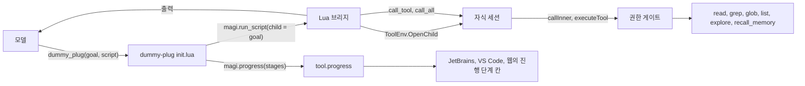
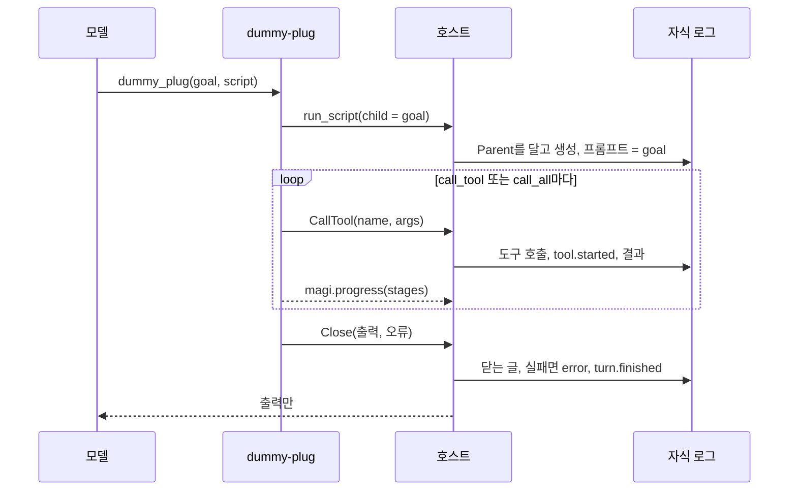

# magi — 더미 플러그 (코드 모드)

[English](DUMMY_PLUG.md) · [한국어](DUMMY_PLUG.ko.md) · [↑ 문서](README.ko.md)

더미 플러그의 설계 기록입니다. 왜 만들었는지, 지금 어떻게 만들어져 있는지, 무엇을 약속하는지, 아직 하지 않는 것은 무엇인지, 그리고 어떤 설계를 대체했는지를 적습니다. 구현됨으로 적은 것은 모두 커밋 `f245a8413`의 코드에서 읽었고, 계획으로 적은 것은 아직 코드가 없습니다. 플러그인 작성자용 API(`magi.run_script`, `magi.progress`, `ToolEnv.OpenChild`)는 [EXTENDING](EXTENDING.ko.md)에 있고, 이 문서는 그 조각들이 이 플러그인 하나에서 어떻게 맞물리는지 설명합니다.

## 0. 용어

| 용어 | 뜻 |
|---|---|
| 더미 플러그 | `plugins/dummy-plug` 플러그인. 도구 `dummy_plug` 하나가 모델이 쓴 Lua 스크립트를 받아 실행합니다. |
| 스크립트 | 모델이 쓴 Lua 소스. 도구를 부르고, 모델이 볼 것만 출력합니다. |
| 바깥 호출 | 모델 자신의 `dummy_plug` 호출. 대화에 기록됩니다. |
| 안쪽 호출 | 스크립트가 하는 도구 호출(`call_tool`, `call_all`). 호스트가 다른 호출과 똑같이 실행합니다. |
| 자식 세션 | 스크립트 실행 한 번을 위해 여는 세션. 대화를 부모로 두며, 모델이 구동하지 않습니다. 다만 스크립트가 부르는 도구는 자기 모델을 쓸 수 있습니다(`explore`는 모델이 구동하는 서브에이전트를 띄웁니다). |
| 단계 | 사람이 보는 실행의 한 걸음(`plan`, `stage`). 구조화된 데이터로 알립니다. |

## 1. 왜 만들었나

파일 스무 개를 읽으려는 모델은 왕복을 스무 번 하고, 결과는 필요하든 아니든 모두 컨텍스트에 들어옵니다. 더미 플러그를 쓰면 모델은 그 반복을 한 번만 씁니다. 스크립트가 읽고 거르고 세며, 출력한 것만 돌아옵니다. 2026-11-21에 문서 35개를 나열하고 그중 8개를 병렬로 읽은 뒤 기억을 조회(답 21,894바이트)한 스크립트는 모델 스텝 하나로 끝났고, 짧은 줄 네 개만 돌려줬습니다.

절약은 두 곳에서 나옵니다. 모델 왕복이 줄고, 모델이 보기 전에 스크립트가 결과를 거릅니다. 파일이라면 bash 스크립트도 두 번째 일을 할 수 있지만, `explore`나 `recall_memory` 같은 하네스 도구는 부를 수 없고 magi의 권한 게이트도 거치지 않습니다. 모델이 구동하는 서브에이전트는 둘 다 할 수 있지만 스텝마다 모델 호출 비용을 냅니다. 더미 플러그는 그 사이에 있습니다. 흐름은 코드이고, 도구는 하네스의 것이며, 흐름을 정하는 모델은 없습니다. 스크립트가 `explore`를 부르면 그 서브에이전트의 모델 스텝 비용은 따로 듭니다. 위의 실행은 `explore`를 부르지 않았습니다.

커밋 `0d483d59d`부터 스크립트는 자식 세션에서 돕니다. 이로써 가치가 하나 더 생겼습니다. 대화에는 결과만 남고, 사람은 자식을 열어 스크립트가 한 호출과 그 반환값을 모두 볼 수 있습니다.

## 2. 구조

| 조각 | 위치 | 하는 일 |
|---|---|---|
| `dummy_plug` | `plugins/dummy-plug/init.lua:129` | 유일한 도구. 설명에 스크립트가 쓸 수 있는 것을 적어 둡니다. `goal`이 자식의 이름이 됩니다. |
| `track` | `plugins/dummy-plug/init.lua:47` | `plan`, `stage`, 호출마다의 시작·끝으로 실행의 단계를 유지하고 알립니다. |
| `magi.run_script` | `internal/adapter/plugin/lua/bridge_script.go:34` | 별도 Lua 상태에서 스크립트를 실행합니다. `child`가 있으면 자식을 열고(`:57`) 출력과 함께 닫습니다(`:72`). |
| `ToolEnv.OpenChild` | `internal/port/port.go:515`, `ChildRun`은 `:1006` | 호스트의 범용 지점. 더미 플러그라는 낱말이 없습니다. |
| `openChild` | `internal/app/open_child.go:23` | 서브에이전트 자식과 같은 방식으로 자식을 만들고, 그 자식에 묶인 `CallTool`을 돌려줍니다. |
| `callInner` | `internal/app/inner_call.go:53` | 안쪽 호출을 기록하고, 모델 호출과 같은 경로인 `executeTool`로 실행합니다. |
| `magi.progress` | `internal/adapter/plugin/lua/bridge_script.go:124` | 알림과 단계 목록을 `ToolEnv.EmitStages`(`internal/port/port.go:570`)로 보냅니다. |

코어는 더미 플러그를 모릅니다. 호스트는 범용 기능 네 가지(스크립트 실행, 자식 열기, 스크립트에서 도구 부르기, 단계 알리기)를 내놓고, 플러그인이 그것을 조합합니다. 이 규칙은 2026-11-20 검토에서 코어에 플러그인 전용 개념(플러그인 이름을 적은 허용 목록, 그래프 생성기, 아이콘 목록)이 들어간 것을 찾아 밖으로 옮기면서 생겼습니다.

## 3. 실행 한 번의 순서

자식은 스크립트가 도는 동안 서브에이전트 줄에 나타났다가 끝나면 사라집니다. 단계 목록은 바깥 호출의 행에 실리므로, 사람은 `dummy_plug` 행 아래의 칸에서 실행을 지켜봅니다.

## 4. 무엇이 어디에 기록되나

| 기록 | 남는 곳 | 읽는 쪽 |
|---|---|---|
| 바깥 호출과 스크립트의 출력 | 대화 로그 | 모델(도구 결과로) |
| goal(자식의 프롬프트로) | 자식 로그 | 복구, 서브에이전트 줄 |
| 안쪽 호출마다의 호출·시작 사실·결과 | 자식 로그 | 복구, 자식을 여는 사람 |
| 스크립트의 출력(닫는 글로) | 자식 로그 | 자식을 여는 사람 |
| 스크립트가 실패하면 `error`("the script stopped: ...") | 자식 로그(`internal/app/open_child.go:60`) | 복구, 화면 |
| 자식을 닫을 때 `turn.finished` | 자식 로그(`internal/app/open_child.go:65`) | 복구 |
| 단계 목록 | `tool.progress`, 저장하지 않음 | 화면만 |

안쪽 호출은 바깥 호출을 `Parent`로 적고, `reconstruct`는 `Parent`가 있는 호출을 모델 이력에서 뺍니다(`internal/app/reconstruct.go:202`). 이제 호출은 자식 로그에 있으므로 이 거르기는 두 번째 안전장치입니다. `0d483d59d` 전에는 이것 하나뿐이었습니다.

## 5. 안전 규칙

- **선언한 도구만.** 매니페스트가 스크립트가 부를 수 있는 도구를 적습니다: `read`, `grep`, `glob`, `list`, `explore`, `recall_memory`, `bash`, `edit`, `multiedit`, `write`(`plugins/dummy-plug/plugin.toml:6`). 그 밖의 도구 호출은 호스트에 닿기 전에 거절됩니다. 자기 도구를 적은 플러그인은 불러올 때 거절됩니다(`internal/adapter/plugin/lua/host.go:434`).
- **스크립트만의 권한이 아니라 대화의 권한을 따릅니다.** 스크립트는 자기를 부른 대화를 위해 돌기 때문에, 안쪽 호출은 모델 자신의 호출과 같은 게이트를 지납니다(`internal/app/execute.go`의 `gatePermission`). 권한 모드(`allow`, `auto`, `ask`, `deny`), 정책 규칙, 스캐너가 강제하는 질문, 복구 반복 가드가 모두 그대로 적용됩니다. 판정이 기대는 지속 상태(「항상 허용」, 위임 여부, 작업의 자동 승인)는 자식 사슬 맨 위의 대화에서 읽습니다(`internal/app/permission.go`의 `permissionHome`). 그래서 대화에서 준 「항상 허용」은 그 대화의 스크립트에도 적용되고, 스크립트의 질문에 「항상」으로 답하면 대화에 남습니다. 물어야 하는 호출은 대화에 뜨고(§8) 스크립트는 답을 기다립니다. 물을 사람이 없으면 모델 자신의 호출과 같은 방식으로 정해집니다. 5e43b5ed1까지는 보기만 하지 않는 호출을 어떤 모드에서든 물어서, 스크립트 안에서는 `allow`가 아무 뜻이 없었습니다.
- **상한.** 바깥 호출 하나당 안쪽 호출은 200번까지입니다(`internal/app/inner_call.go:47`). 스크립트는 기본 60초, 최대 300초 돌고, 출력은 기본 16,000바이트, 최대 64,000바이트까지 남깁니다(`internal/adapter/plugin/lua/bridge_script.go:21-24`). `call_all`은 한 번에 최대 8개를 실행합니다(`:94`).
- **변환할 수 없는 값.** 자기 자신을 품은 테이블이나 100단계를 넘게 중첩된 테이블(`internal/adapter/plugin/lua/convert.go:64`)은 Go 스택을 고갈시키지 않고 사유와 함께 거절됩니다. `7524a373c` 전에는 프로세스가 죽었습니다.
- **실행 중인 플러그인으로 되돌아오는 호출 금지.** 도구는 플러그인 잠금을 쥐는 동안 호출 문맥에 그 플러그인을 표시합니다(`internal/adapter/plugin/lua/plugin.go:236`). 직접이든 다른 플러그인의 도구를 거쳐서든 그 플러그인으로 되돌아오는 호출은 바로 거절됩니다(`internal/adapter/plugin/lua/luatool.go:52`). `d14da185a` 전에는 그런 호출이 끝없이 기다렸습니다.

## 6. 자식 세션 계약

자식은 서브에이전트 자식과 같은 방식으로 만들어집니다. 대화를 `Parent`로 두고, goal을 프롬프트로 하며, 서브에이전트 줄에 자리를 가집니다. 다른 점은 구동하는 주체입니다. 안에서 루프가 돌지 않으므로 스스로 끝을 쓰는 것이 없고, 그래서 `Close`가 써야 합니다.

복구는 세션 로그를 읽어 열린 턴이 있는지 판단합니다(`unfinishedTurn`, `internal/app/unfinished.go:43`). 프롬프트 뒤에 `turn.finished`도, 포기도, 회복되지 않은 오류도 없으면 열린 턴입니다. 그래서 세 경우로 나뉩니다.

| 스크립트가 끝난 방식 | 자식 로그의 마지막 | 복구가 보는 것 |
|---|---|---|
| 정상 완료 | 닫는 글, `turn.finished` | 끝남 |
| 실패 | 사유를 담은 `error`, `turn.finished` | 끝남(사유 포함) |
| 스크립트 도중 프로세스 종료 | 마지막 안쪽 호출, 결과가 없을 수 있음 | 열린 턴, 복구가 정리 |

`f245a8413` 전에는 `Close`가 끝을 쓰지 않아, 정상 완료한 자식도 재시작 뒤 끊긴 턴으로 읽혔습니다. 검토에서 재현됐고, 이제 시험 `TestAToolRunsItsCallsInAChildSessionItDrives`, `TestAFailedChildEndsWithItsReason`, `TestAChildNeverClosedIsLeftForRecovery`가 세 경우를 모두 지킵니다.

`dummy_plug(..., background = true)`는 시작 결과만 남기고 바로 반환합니다. 스크립트는 대화의 턴이 끝난 뒤에도 같은 자식에서 계속 돌므로, 모델은 다른 일을 하거나 대기 상태로 돌아갈 수 있습니다. 최상위 호출만 이렇게 할 수 있습니다(자식과 시험 실행에서는 `ToolEnv.StartBackground`가 nil). 작업은 대화의 중단과 종료에서 취소되고, 도는 동안에는 업데이트 재시작을 막습니다(`HoldForUpdate`). 끝나면 `tool.background` 사실과 `[background job finished]` 알림이 스크립트의 출력이나 실패 사유, 자식 줄을 싣고 새 턴을 엽니다(`wakeOnBackground`). 시작 결과를 저장하지 못하면 작업을 시작 전에 취소하고 `error`로 남깁니다. 시험은 `TestDummyPlugBackgroundReportsTheChildFailure`입니다.

## 7. 진행 단계 계약

단계 하나는 `{id, label, kind, state, done, total, running}`입니다(`internal/core/event/payload.go:511`).

- `id`는 실행 내내 고정이므로, 화면은 단계마다 노드 하나를 유지하고 바뀐 것만 고칩니다.
- `kind`는 단계가 하는 일입니다(`tool`, `mcp`, `web`, `harness`, `subagent`). 표시는 화면마다 고릅니다. 플러그인은 도구 이름으로 종류를 정합니다(`plugins/dummy-plug/init.lua:22`).
- `state`는 `waiting`, `running`, `done`, `failed` 중 하나입니다.
- `plan({...})`은 첫 호출 전에 모든 단계를 적으므로, 첫 보고부터 단계가 모두 보입니다. 없으면 `stage(name)`이 열 때마다 하나씩 나타납니다.
- 바로 앞과 같은 보고는 보내지 않고, 강제가 아닌 두 보고 사이에는 100ms 이상 둡니다(`internal/adapter/plugin/lua/bridge_script.go:111`). 단계 열기, 묶음의 시작과 끝, 실행 종료는 보고를 강제합니다. 2026-11-21 탐침에서 스크립트 셋(빠른 것, 묶음 직후 끝나는 것, 실패하는 것)을 돌렸고, 마지막 보고에는 언제나 최종 상태가 실렸습니다.

화면은 단계를 32px 표시 아래에 이름을 단 노드로 그리고, 노드 사이를 화살표로 잇습니다. JetBrains `ProgressStages`(`clients/jetbrains/plugin/intellij/src/main/kotlin/dev/sayaya/magi/ide/ui/ProgressStages.kt:34`), VS Code `updateStages`(`clients/vscode/src/web/chat_adapter.ts:1720`), 웹 `StageStrip`(`clients/web/ui/coding-agent-ui/src/main/java/dev/sayaya/magi/client/interfaces/StageStrip.java:24`)입니다. 시작과 끝도 단계의 상태를 따릅니다. 시작은 어느 단계든 진행 중이거나 대기 중이면 `running`, 그 뒤로는 `done`입니다. 끝은 모든 단계가 끝날 때까지 기다리고, 실패가 있으면 `failed`를 보입니다.

`call_graph({...})`는 선행 태스크가 성공하면 해당 태스크를 실행합니다. 각 태스크의 `id`와 `tool`을 지정하고, 필요에 따라 `args`, `label`, 앞서 선언한 태스크 ID 목록인 `after`를 넣습니다. 각 분기는 자기 선행 태스크가 끝나는 즉시 진행합니다. 호스트는 병렬 실행이 안전한 호출을 최대 8개까지 함께 실행하고, 단독 실행이 필요한 호출은 하나씩 실행합니다. 스크립트 안에서는 `bash`를 비롯한 위험 도구 목록의 도구도 병렬 실행이 안전한 호출로 봅니다. 승인이 필요하면 대화에는 승인 창이 한 번에 하나만 뜨고, 다음 창은 앞 창에 답한 뒤에 뜹니다. 파일을 쓰는 도구(`write`, `edit`, `multiedit`), `mcp__` 도구, `ask_user`, 쓰기 권한이 있는 서브에이전트는 계속 단독으로 실행합니다. 호스트는 도구 이름만으로 이를 판단하고 `bash` 명령이 무엇을 읽고 쓰는지는 보지 않습니다. 그래서 같은 파일을 바꾸는 `bash` 갈래 둘이 동시에 돌 수 있고, 나중에 저장한 쪽이 앞선 변경을 덮어쓸 수 있으며, 실행 전후 내용을 비교하는 변경 기록이 다른 갈래의 쓰기를 자기 변경으로 잡을 수 있습니다. 이런 갈래는 `after`로 순서를 정하십시오. 진행 이벤트에는 첫 태스크의 `after`를 빈 배열로, 나머지 태스크의 `after`를 선행 ID 목록으로 보냅니다. 완료한 태스크는 다른 분기가 진행 중이어도 성공 색으로 표시합니다.

태스크가 실패해도 독립 분기는 계속 진행할 수 있으며, 해당 태스크에 의존하는 후속 태스크는 `skipped`가 됩니다. 자식 세션에는 개별 도구 결과, 실패한 태스크 ID와 후속 태스크의 생략 사유를 담은 `error` 이벤트, `turn.finished`가 남습니다. 도구가 성공으로 응답했지만 결과가 기대와 다른 경우는 스크립트에서 결과를 검사하고 직접 오류를 발생시켜야 합니다.

플러그인은 실행 중 선언된 그래프를 모두 보관하고, 이후 모든 보고(마지막 보고 포함)에 단계와 함께 보냅니다. 그래서 그래프 앞뒤의 `stage()`가 그래프나 그 안의 `failed`, `skipped` 태스크를 지우지 않습니다. 그래프마다 ID 앞에 `g<N>:`을 붙이므로(`call_graph`가 주는 `graph_id`), 같은 태스크 ID를 쓰는 두 그래프나 단계와 이름이 같은 태스크(`s1`)도 섞이지 않습니다. 시험은 `TestDummyPlugKeepsGraphInFinalReportAfterStage`, `TestDummyPlugKeepsFailedAndSkippedGraphTasksAfterStage`, `TestDummyPlugKeepsSeparateGraphsWithReusedTaskIDs`입니다.

## 8. 하지 않는 것

- **대화로 오는 것은 권한 질문뿐입니다.** 자식 안에서 생긴 권한 질문은 부모 대화에도 함께 뜨고, 사유 앞에 "asked inside child <id>"가 붙습니다. 거기서 한 답은 자식에게 갑니다(`internal/app/permission.go`의 `relayAskLocked`, `RespondPermission`의 전달). 자식 안의 `ask_user` 질문은 전달하지 않습니다. 쓰기 도구가 열렸으므로, `ask` 모드에서 스크립트의 쓰기가 여기로 질문이 오는 흔한 경우입니다.
- **행은 첫째 자식만 엽니다.** 바깥 호출의 결과 끝에 `[child <id>, N tool call(s)]`(스크립트가 도중에 멈췄으면 그 이유도)가 붙습니다. 모델 서브에이전트가 남기는 줄과 같은 모양입니다. 모든 클라이언트가 이 줄을 읽어(`internal/app/child_named.go`의 `app.ChildrenNamed`, VS Code·JetBrains 접기에는 같은 규칙의 사본) 호출의 행에 「자식 열기」를 둡니다. TUI는 머리 줄 클릭, JetBrains는 행의 단추(고정 탭), VS Code는 행의 단추(패널이 자식으로 바뀜), 웹 콘솔은 행의 단추(자식 화면)입니다. 한 호출이 자식을 여럿 돌렸으면 행은 첫째를 열고, 나머지는 서브에이전트 목록에서 엽니다.
- **끊긴 실행이 두 안건으로 나뉩니다.** 크래시 뒤 복구는 바깥 호출과 자식의 불확실한 호출을 따로 다룹니다.
- **안쪽 호출마다 자식 로그를 다시 읽습니다**(`internal/app/inner_call.go:77`). 자식 로그가 짧아 지금은 싸지만, `0d483d59d` 전에는 대화 로그 전체를 읽었습니다.
- **스크립트가 도는 동안 플러그인 잠금을 쥡니다.** 같은 플러그인의 다른 도구는 기다립니다.
- **자체 판단이 없습니다.** 스크립트에는 모델에게 짧게 묻고 범위가 정해진 답을 받는 호출이 없습니다. 모델에 닿는 길은 `explore`뿐이고, 이는 질문 하나에 읽기 전용 서브에이전트 전체(여러 모델 스텝과 요약 보고)를 띄웁니다. §10을 보십시오.

## 9. 대체한 설계

| 예전 설계 | 버린 이유 | 대체한 것 |
|---|---|---|
| `dummy_plug_enter` / `dummy_plug_exit`와 세션별 모드 | 왕복을 줄이려는 도구에 쓸 때마다 모델 왕복이 두 번 더 듦. 모드가 상태를 늘림 | 바로 실행되는 도구 하나(`0d483d59d`) |
| 안쪽 호출을 대화 로그에 두고 `Parent`로 모델에게서 숨김 | 거르기가 지켜질 때만 맞음. 스크립트마다 로그가 커짐 | 자식 세션(`0d483d59d`) |
| 보고마다 다시 그리는 Mermaid 실행 그래프 | 깜빡임, 노드가 하나씩 늘어남, 라벨이 가운데에서 벗어남, IDE 자체 Mermaid가 아이콘을 `?`로, 키를 `{{start}}`로 그림 | 단계 목록과 클라이언트별 진행 단계 칸(`9ff409c94`, `6769583ea`로 스쿼시) |
| 빌드 때 굽는 Font Awesome Pro 아이콘, `%% magi-i18n` 키 | 그래프에만 필요했음. 빌드 단계와 절대 커밋하면 안 되는 파일이 생김 | 클라이언트가 직접 그리는 표시, 클라이언트 언어 팩의 낱말 |
| 이름 앞의 기호(`⚙`, `✦`) | 이모지처럼 읽히고 표시가 너무 작음 | 이름 위의 32px 표시(`0d483d59d`) |

## 10. 계획 (미구현)

1. **출력 의존 구간.** 흔적은 호출만 남기고 결과는 남기지 않습니다. 그래서 뒤 호출이 앞 결과의 값을 쓰는 구간은 TODO가 붙은 초안으로 저장되고(§12), 그 데이터 흐름은 사람이 씁니다. 병렬 묶음의 호출은 끝난 순서로 기록됩니다.
2. **Engram의 후보 제안.** 반복되는 순서는 Engram이 아니라 더미 플러그가 셉니다(§12). `propose_experience`는 검토 단계 없이 곧바로 저장하므로 쓰지 않습니다.
3. **`ask_user` 질문을 대화로.** 권한 질문은 이미 대화로 전달됩니다(§8). `ask_user` 질문은 아직 전달되지 않습니다.
4. **판단.** `judge(질문, 선택지 또는 스키마)` 블록이 정해진 지점(분류, 선택, 추출, 예/아니오)에서 작은 전용 모델에 묻습니다. 답은 선택지나 스키마로 제한해서 스크립트가 바로 분기에 쓰게 합니다. 판단 하나하나는 자식 로그의 모델 스텝이며 상한에 셉니다. 비용은 서브에이전트 자식이 `Metrics`를 돌려주는 방식으로 바깥 호출에 합칩니다. 더미 플러그를 그냥 스크립트와 가르는 것이 이것입니다. 흐름은 코드로 남고, 그 안의 작은 결정은 모델이 내립니다.

## 11. 검증하지 않은 것

- 실제 데몬에서 더미 플러그 자식이 서브에이전트 줄에 뜨는지, 재시작 뒤 실제 복구에서 끝남으로 읽히는지. 시험으로만 확인했습니다.
- 마지막 단계 보고가 실제 클라이언트에 닿는지. `tool.progress`는 저장하지 않는 일시 이벤트이고, 이 구간은 처음부터 끝까지 돌려 보지 않았습니다.
- 실제 JetBrains, VS Code, 웹 화면과 다크 테마에서의 진행 단계 칸. 헤드리스 시험으로 배치(표시 높이, 화살표 위치, 색)만 쟀습니다.
- 실제 데몬에서의 백그라운드 실행. 완료 턴, 스크립트 도중의 중단·재시작, 화면이 시작 결과를 그리는 방식은 시험으로만 확인했습니다.
- 웹 표시는 구운 스프라이트(`data-i`, `Icons.dress`)를 쓰지 않고 언제나 직접 그린 도형입니다.
- 실제 데몬에서의 흔적 루틴(§12). 실제 `tool_finished` 이벤트로 쌓인 흔적, 클라이언트별 `/routine-*` 명령 출력, 실제 화면에서 쓰는 루틴의 권한 창은 확인하지 않았습니다. 시험은 이벤트를 직접 보냅니다.
- 실제 데몬에서의 루틴(§12). 실제 JetBrains, VS Code, 웹 화면의 승인 창과 실제 `explore`로 돌린 예제 루틴은 대역 도구를 쓴 시험으로만 확인했습니다.

## 12. 루틴

루틴은 더미 플러그 스크립트를 스킬로 보관해 `run_routine{name, args}`로 이름으로 다시 실행하는 것입니다.

- **형식.** 스킬 파일(`.magi/skills/<name>.md` 또는 `.claude/skills/<name>/SKILL.md`)의 frontmatter에 `kind: routine`, `tools:`(스크립트가 부를 도구, 쉼표로 구분), `inputs:`(한 줄 JSON Schema)를 둡니다. 스크립트는 본문의 첫 `lua` 블록이고 인자는 `input`에서 읽습니다. `kind: routine`이 없는 스킬은 실행하지 않습니다.
- **실행.** `dummy_plug`처럼 `magi.run_script`로 실행합니다. 각 호출은 자식 세션에 기록되고, 스크립트가 출력한 것만 돌아옵니다. `run_script`의 `tools` 선택지가 실행을 목록의 도구로 제한합니다. 인자는 먼저 `inputs`로 검사합니다(필수 키, 형식, 모르는 키).
- **승인.** 첫 실행과, 스크립트·`inputs`·`tools` 중 하나가 바뀐 뒤의 실행에서 셋을 대화의 권한 창(`magi.approve`)에 보여 줍니다. 승인한 지문(셋의 sha256)은 플러그인 저장소에 남아 재시작 뒤에도 유지됩니다. 이 승인은 사람만 할 수 있습니다. `run_routine`에 대한 「항상」 허가도, 권한 모드도 이 승인을 대신하지 않습니다. 물을 사람이 없거나(헤드리스) 제때 답이 없으면 `allow` 모드에서도 승인되지 않고 아무것도 저장하지 않습니다. 「항상」이나 「영구」로 답해도 그 루틴 판만 승인하며, 세션 허가나 프로젝트 허용 규칙은 추가하지 않습니다. 승인은 다른 것을 허가하지 않습니다. 각 호출은 여전히 권한 게이트를 지나고, `tools` 밖의 호출은 거부됩니다.
- **쓰기.** 루틴은 더미 플러그의 `call_tools`에 있는 도구라면 `bash`, `edit`, `multiedit`, `write`까지 부를 수 있습니다. 승인 창은 쓰는 도구를 따로 보여 줍니다(`writes`). 승인은 루틴을 실행하게 할 뿐 쓰기를 허가하지 않습니다. 각 쓰기는 여전히 자기 권한 게이트를 지나고(`ask` 모드면 묻습니다), 쓰는 도구는 한 번에 하나씩 실행합니다(`run_script`의 `serial`). `call_tools` 밖의 도구(`coding_task`, `wait_for` 등)는 루틴에 넣을 수 없습니다.
- **흔적과 초안.** `/routine-trace`는 최근 호출을 최대 300건까지 번호·턴·도구·성공 여부와 함께 보여 줍니다. 흔적에 호출 인자와 사용자 메시지 본문은 저장하지 않습니다. `/routine-draft <name> <from>-<to>`는 단계별 인자 객체(`input.step1`, `input.step2` 등)가 있는 초안을 저장합니다. 인자를 채우고 호출 순서와 의존성을 검토한 뒤 `status: draft`를 지웁니다. `run_routine`은 초안을 실행하지 않습니다. 추적 목록은 병렬 묶음과 순서 미확인 호출을 표시합니다. 이 호출은 한 건씩 초안으로 만들 수 있습니다. 여러 호출을 묶으려면 모두 순차 실행이 확인되어야 합니다. `/routine-draft <name> run:<id>`는 고른 `dummy_plug` 스크립트를 실행한 그대로 저장합니다.
- **건조 대조.** 흔적에서 만든 초안은 합성 인자로 검사합니다. `dry_check:`에는 관측된 완료 순서대로 예상한 도구 호출이 나왔는지 기록합니다. 검사 중 실제 도구는 실행하지 않습니다. `dummy_plug`에서 가져온 스크립트는 건조 실행이 어디까지 진행됐는지 표시합니다.
- **후보.** 턴이 끝나면 순차 호출의 도구 이름을 비교해 반복 구간을 찾습니다. 병렬 호출, 순서 미확인 호출, 판단성 호출, 실패가 구간의 경계입니다. 턴 첫머리가 `read`, `list`, `glob`만으로 이루어졌으면 제외합니다. `/routine-candidates`가 후보를 보여 주고 `/routine-register <id> <name>`으로 고른 후보를 저장합니다. 같은 도구 순서가 세 번 성공한 `dummy_plug` 스크립트는 해당 스크립트가 후보가 됩니다.
- **과거 흔적.** 플러그인을 로드할 때 저장된 모든 세션 흔적과 반복 후보에서 예전에 복제한 인자·메시지를 제거합니다. `/routine-trace-clean`은 이 정리를 다시 실행하고 과거 인자가 들어 있을 수 있는 작업공간 초안의 경로를 보여 줍니다. 저장된 파일은 그대로 둡니다.
- **쓰기 비교.** `routine_compare_writes{name, script, files, args}`는 동일한 텍스트 픽스처(`files`)를 넣은 임시 디렉터리 두 곳에서 활성판과 후보판을 각각 실행합니다. `read`, `write`, `edit`, `multiedit`을 지원합니다. 최종 파일 해시와 달라진 경로, 스크립트 오류와 도구 실패를 보여 줘 실패 전에 남긴 변경도 비교할 수 있습니다. 호스트가 임시 디렉터리를 정리합니다. 이 비교는 제공된 파일만 사용합니다. 픽스처를 만들거나 파일 도구를 호출하기 전에 입력 경로와 정규화된 작업공간 상대·절대 경로에 도구 정책을 적용합니다. 정책이 거부하거나 승인을 요구하면 해당 작업을 차단합니다. 이 비교에서는 승인 창을 띄우지 않으며, 채택은 별도 명령으로 진행합니다.
- **개선.** 루틴의 평가 기준은 `.magi/routines/<name>/`에 둡니다. `contract.json`은 고정 픽스처로 건조 실행하는 계약 사례입니다(제어 흐름: 회상한 정책이 각 `explore`에 전달되는지, 빈 응답이나 실패를 「답 없음」으로 보고하는지, 픽스처가 없는 분기는 미검증으로 남는지). `tasks.json`은 평가 과제입니다(`split: dev|holdout`, `protected`, 픽스처, 기대 근거). 사람이 `/routine-evals-freeze <name>`으로 동결하며, 동결 뒤 바뀐 평가 기준으로는 `routine_improve`가 비교하지 않습니다. `routine_improve`는 후보 스크립트와 문제·가설을 받습니다. 도구나 입력을 바꾼 후보는 기각하고, 계약을 검사한 뒤 통과한 후보만 활성 버전과 같은 과제에서 짝지어 돌립니다(반복 `repeats`, 기본 3). 과제마다 새로 해결, 새 회귀, 실패 유지, 성공 유지, 불안정, 미검증으로 따로 판정합니다. 계약 위반이나 보호 과제의 회귀는 기각합니다. 그 밖의 회귀나 결론 나지 않은 과제는 보류합니다. 품질 개선과 품질을 유지한 호출 수 절감 모두 holdout 과제로만 단측 부호 검정(p ≤ 0.10)을 합니다. 건조 호출 수에는 모의 explore 호출이 포함되며 실제 모델 사용량은 0입니다. 채택할 때 비교한 파일이 바뀌었는지도 확인합니다. 시도마다 기준·후보 버전, 문제, 가설, 조건, 과제별 결과, 판정과 이유를 `attempts.jsonl`에 덧붙이고, 기각도 남깁니다. `routine_history`가 다음 후보를 위해 이를 읽어 줍니다. `from_run`(`/routine-trace`의 실행)과 `previous`(앞선 시도)는 시도를 출발한 실행과 이어받은 시도에 연결하며, 둘 다 실제로 있어야 합니다. 적용 가능한 후보는 사람이 `/routine-adopt <name> <version>`으로 채택합니다. 교체된 버전은 보관되고 `/routine-rollback <name>`으로 되돌릴 수 있으며, 둘 다 `decisions.jsonl`에 남습니다. 채택된 버전은 다음 실행에서 승인을 묻습니다. 이 비교는 픽스처 위의 제어 흐름만 확인하며, 실제 `explore` 답의 정확도, 파일에 대한 효과, 새 과제로의 일반화는 확인하지 않습니다. Engram과 모델은 필요 없습니다.
- **위임 자동 적용.** `/routine-auto <name>`으로 사람이 한 번, 읽기 전용 루틴의 적용 가능 후보를 묻지 않고 적용하도록 허용합니다. 위임에는 루틴의 도구, 입력 스키마, 동결한 평가 기준이 기록되며, 쓸 수 있는 루틴은 위임할 수 없습니다. `routine_improve`가 적용 가능으로 판정한 후보가 그 범위 안(쓰기 도구 없음, 같은 도구·입력, 같은 평가 기준)이면 `adopt`와 같은 방식으로 적용하고, `decisions.jsonl`에 `auto-applied`(`by: auto`, `run_approval: not granted`)로 기록하며, `/routine-rollback <name>`을 붙인 한 줄 알림을 보냅니다. 기각·보류된 후보는 `attempts.jsonl`에만 남고 알리지 않습니다. 범위 밖(평가 기준을 다시 동결함, 도구·입력이 바뀜)의 적용 가능 후보는 사람에게 남깁니다. 적용은 실행 승인이 아니므로 적용된 버전은 다음 실행에서 승인을 묻습니다. `/routine-auto <name> off`로 철회합니다. Engram은 필요 없습니다.
- **데이터 접근 범위.** 비교할 때마다 두 버전이 과제에서 `read`, `grep`, `glob`, `list`, `recall_memory`에 넘기는 인자(`path`, `pattern`, `query` 등)를 기록합니다. 활성 버전이 쓰지 않은 인자를 더한 후보는 위임 범위 밖이므로 사람에게 남깁니다. `explore`는 자유 문장을 받으므로 인자를 통째로 비교합니다. explore 질문이 달라진 후보도 사람에게 남기며, `/routine-auto <name> explore-text <directory>`로 위임한 경우에는 자동 적용된 버전의 `explore` 자식이 해당 디렉터리 안에서만 파일 도구를 사용합니다. 위임을 철회해도 이미 적용된 버전의 범위는 유지됩니다. 결정 기록에는 `explore_scope`가 남습니다. 디렉터리 없이 설정한 이전 위임은 갱신해야 합니다.
- **실제 explore 비교.** `routine_compare_explore{name, script, directory, split}`은 같은 동결 과제로 활성판과 후보판을 실행합니다. 기본 분할은 `dev`입니다. 고른 후보를 홀드아웃에서 평가하려면 `split: holdout`을 지정합니다. `expect.evidence`의 경로는 `directory` 기준으로 적습니다. 필수 인용은 루틴 출력과 성공한 `explore` 응답 양쪽에 있어야 하며, 해당 파일과 줄도 실제로 존재해야 합니다. 누락·잘못된 인용, 보호 사례 회귀, 소요 시간, `explore` 호출 수를 보고합니다. `live-explore.jsonl`에는 시작과 결과, 동일한 홀드아웃 과제 해시를 사용한 횟수가 남습니다. 두 실험군은 작업 트리의 임시 Git 스냅샷과 실제 explore 모델·제공자를 공유합니다. 보고서에는 스냅샷 커밋과 트리, 백엔드 요청 수, 제공자가 보고한 토큰 사용량이 남습니다. 개발 과제에서 `aa: true`를 지정하면 활성 스크립트를 양쪽에 실행해 결과 변동을 볼 수 있습니다. 과제마다 각 실험군을 한 번 실행하고, 채택은 별도 명령으로 진행합니다.
- **후보 생성.** `routine_autoimprove{name, problem, rounds}`는 라운드마다 활성 스크립트, 문제, 이번 실행의 개발 사례 검사 결과를 사이드카 모델(`magi.analyze`)에 넘깁니다. 계약과 개발 사례를 처음 통과한 후보를 홀드아웃까지 한 번 평가한 뒤, 판정에 관계없이 실행을 끝냅니다. 전체 평가 결과는 `attempts.jsonl`에 남기고 이후 후보 생성 요청에서는 제외합니다. 후보 생성에는 모델 호출이 들고, 픽스처 비교는 건조 실행으로 이루어집니다.
- **되돌린 버전.** `/routine-rollback <name>`으로 제거한 버전은 위임을 갱신해도 자동으로 다시 적용되지 않습니다. 채택 조건을 충족하면 `/routine-adopt <name> <version>`으로 직접 복원할 수 있습니다.
- **예제.** `plugins/dummy-plug/routines/recovery-policy-evidence.md`는 복구 정책을 한 번 회상해 질문마다 `explore` 하나에 넘기고, 답을 질문 아래에 출력합니다.
