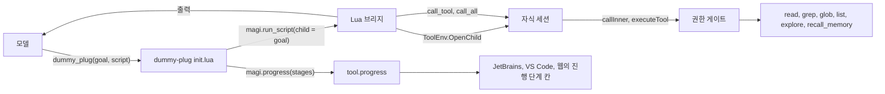
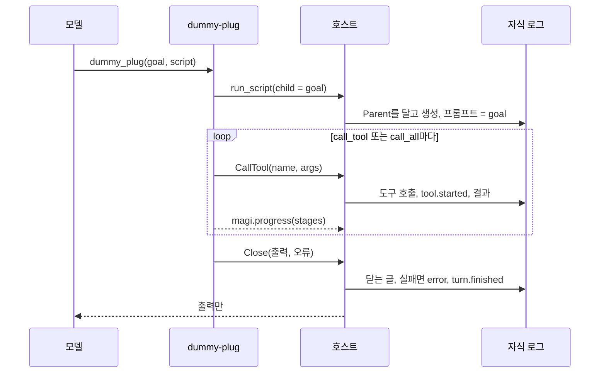

# magi — 더미 플러그 (코드 모드)

[English](DUMMY_PLUG.md) · [한국어](DUMMY_PLUG.ko.md) · [↑ 문서](README.ko.md)

더미 플러그의 설계 기록입니다. 왜 만들었는지, 지금 어떻게 만들어져 있는지, 무엇을 약속하는지, 아직 하지 않는 것은 무엇인지, 그리고 어떤 설계를 대체했는지를 적습니다. 구현됨으로 적은 것은 모두 커밋 `f245a8413`의 코드에서 읽었고, 계획으로 적은 것은 아직 코드가 없습니다. 플러그인 작성자용 API(`magi.run_script`, `magi.progress`, `ToolEnv.OpenChild`)는 [EXTENDING](EXTENDING.ko.md)에 있고, 이 문서는 그 조각들이 이 플러그인 하나에서 어떻게 맞물리는지 설명합니다.

## 0. 용어

| 용어 | 뜻 |
|---|---|
| 더미 플러그 | `plugins/dummy-plug` 플러그인. 도구 `dummy_plug` 하나가 모델이 쓴 Lua 스크립트를 받아 실행합니다. |
| 스크립트 | 모델이 쓴 Lua 소스. 도구를 부르고, 모델이 볼 것만 출력합니다. |
| 바깥 호출 | 모델 자신의 `dummy_plug` 호출. 대화에 기록됩니다. |
| 안쪽 호출 | 스크립트가 하는 도구 호출(`call_tool`, `call_all`). 호스트가 다른 호출과 똑같이 실행합니다. |
| 자식 세션 | 스크립트 실행 한 번을 위해 여는 세션. 대화를 부모로 두며, 모델이 구동하지 않습니다. 다만 스크립트가 부르는 도구는 자기 모델을 쓸 수 있습니다(`explore`는 모델이 구동하는 서브에이전트를 띄웁니다). |
| 단계 | 사람이 보는 실행의 한 걸음(`plan`, `stage`). 구조화된 데이터로 알립니다. |

## 1. 왜 만들었나

파일 스무 개를 읽으려는 모델은 왕복을 스무 번 하고, 결과는 필요하든 아니든 모두 컨텍스트에 들어옵니다. 더미 플러그를 쓰면 모델은 그 반복을 한 번만 씁니다. 스크립트가 읽고 거르고 세며, 출력한 것만 돌아옵니다. 2026-11-21에 문서 35개를 나열하고 그중 8개를 병렬로 읽은 뒤 기억을 조회(답 21,894바이트)한 스크립트는 모델 스텝 하나로 끝났고, 짧은 줄 네 개만 돌려줬습니다.

절약은 두 곳에서 나옵니다. 모델 왕복이 줄고, 모델이 보기 전에 스크립트가 결과를 거릅니다. 파일이라면 bash 스크립트도 두 번째 일을 할 수 있지만, `explore`나 `recall_memory` 같은 하네스 도구는 부를 수 없고 magi의 권한 게이트도 거치지 않습니다. 모델이 구동하는 서브에이전트는 둘 다 할 수 있지만 스텝마다 모델 호출 비용을 냅니다. 더미 플러그는 그 사이에 있습니다. 흐름은 코드이고, 도구는 하네스의 것이며, 흐름을 정하는 모델은 없습니다. 스크립트가 `explore`를 부르면 그 서브에이전트의 모델 스텝 비용은 따로 듭니다. 위의 실행은 `explore`를 부르지 않았습니다.

커밋 `0d483d59d`부터 스크립트는 자식 세션에서 돕니다. 이로써 가치가 하나 더 생겼습니다. 대화에는 결과만 남고, 사람은 자식을 열어 스크립트가 한 호출과 그 반환값을 모두 볼 수 있습니다.

## 2. 구조



| 조각 | 위치 | 하는 일 |
|---|---|---|
| `dummy_plug` | `plugins/dummy-plug/init.lua:129` | 유일한 도구. 설명에 스크립트가 쓸 수 있는 것을 적어 둡니다. `goal`이 자식의 이름이 됩니다. |
| `track` | `plugins/dummy-plug/init.lua:47` | `plan`, `stage`, 호출마다의 시작·끝으로 실행의 단계를 유지하고 알립니다. |
| `magi.run_script` | `internal/adapter/plugin/lua/bridge_script.go:34` | 별도 Lua 상태에서 스크립트를 실행합니다. `child`가 있으면 자식을 열고(`:57`) 출력과 함께 닫습니다(`:72`). |
| `ToolEnv.OpenChild` | `internal/port/port.go:515`, `ChildRun`은 `:1006` | 호스트의 범용 지점. 더미 플러그라는 낱말이 없습니다. |
| `openChild` | `internal/app/open_child.go:23` | 서브에이전트 자식과 같은 방식으로 자식을 만들고, 그 자식에 묶인 `CallTool`을 돌려줍니다. |
| `callInner` | `internal/app/inner_call.go:53` | 안쪽 호출을 기록하고, 모델 호출과 같은 경로인 `executeTool`로 실행합니다. |
| `magi.progress` | `internal/adapter/plugin/lua/bridge_script.go:124` | 알림과 단계 목록을 `ToolEnv.EmitStages`(`internal/port/port.go:570`)로 보냅니다. |

코어는 더미 플러그를 모릅니다. 호스트는 범용 기능 네 가지(스크립트 실행, 자식 열기, 스크립트에서 도구 부르기, 단계 알리기)를 내놓고, 플러그인이 그것을 조합합니다. 이 규칙은 2026-11-20 검토에서 코어에 플러그인 전용 개념(플러그인 이름을 적은 허용 목록, 그래프 생성기, 아이콘 목록)이 들어간 것을 찾아 밖으로 옮기면서 생겼습니다.

## 3. 실행 한 번의 순서



자식은 스크립트가 도는 동안 서브에이전트 줄에 나타났다가 끝나면 사라집니다. 단계 목록은 바깥 호출의 행에 실리므로, 사람은 `dummy_plug` 행 아래의 칸에서 실행을 지켜봅니다.

## 4. 무엇이 어디에 기록되나

| 기록 | 남는 곳 | 읽는 쪽 |
|---|---|---|
| 바깥 호출과 스크립트의 출력 | 대화 로그 | 모델(도구 결과로) |
| goal(자식의 프롬프트로) | 자식 로그 | 복구, 서브에이전트 줄 |
| 안쪽 호출마다의 호출·시작 사실·결과 | 자식 로그 | 복구, 자식을 여는 사람 |
| 스크립트의 출력(닫는 글로) | 자식 로그 | 자식을 여는 사람 |
| 스크립트가 실패하면 `error`("the script stopped: ...") | 자식 로그(`internal/app/open_child.go:60`) | 복구, 화면 |
| 자식을 닫을 때 `turn.finished` | 자식 로그(`internal/app/open_child.go:65`) | 복구 |
| 단계 목록 | `tool.progress`, 저장하지 않음 | 화면만 |

안쪽 호출은 바깥 호출을 `Parent`로 적고, `reconstruct`는 `Parent`가 있는 호출을 모델 이력에서 뺍니다(`internal/app/reconstruct.go:202`). 이제 호출은 자식 로그에 있으므로 이 거르기는 두 번째 안전장치입니다. `0d483d59d` 전에는 이것 하나뿐이었습니다.

## 5. 안전 규칙

- **선언한 도구만.** 매니페스트가 스크립트가 부를 수 있는 도구를 적습니다: `read`, `grep`, `glob`, `list`, `explore`, `recall_memory`, `bash`, `edit`, `multiedit`, `write`(`plugins/dummy-plug/plugin.toml:6`). 그 밖의 도구 호출은 호스트에 닿기 전에 거절됩니다. 자기 도구를 적은 플러그인은 불러올 때 거절됩니다(`internal/adapter/plugin/lua/host.go:434`).
- **스크립트만의 권한이 아니라 대화의 권한을 따릅니다.** 스크립트는 자기를 부른 대화를 위해 돌기 때문에, 안쪽 호출은 모델 자신의 호출과 같은 게이트를 지납니다(`internal/app/execute.go`의 `gatePermission`). 권한 모드(`allow`, `auto`, `ask`, `deny`), 정책 규칙, 스캐너가 강제하는 질문, 복구 반복 가드가 모두 그대로 적용됩니다. 판정이 기대는 지속 상태(「항상 허용」, 위임 여부, 작업의 자동 승인)는 자식 사슬 맨 위의 대화에서 읽습니다(`internal/app/permission.go`의 `permissionHome`). 그래서 대화에서 준 「항상 허용」은 그 대화의 스크립트에도 적용되고, 스크립트의 질문에 「항상」으로 답하면 대화에 남습니다. 물어야 하는 호출은 대화에 뜨고(§8) 스크립트는 답을 기다립니다. 물을 사람이 없으면 모델 자신의 호출과 같은 방식으로 정해집니다. 5e43b5ed1까지는 보기만 하지 않는 호출을 어떤 모드에서든 물어서, 스크립트 안에서는 `allow`가 아무 뜻이 없었습니다.
- **상한.** 바깥 호출 하나당 안쪽 호출은 200번까지입니다(`internal/app/inner_call.go:47`). 스크립트는 기본 60초, 최대 300초 돌고, 출력은 기본 16,000바이트, 최대 64,000바이트까지 남깁니다(`internal/adapter/plugin/lua/bridge_script.go:21-24`). `call_all`은 한 번에 최대 8개를 실행합니다(`:94`).
- **변환할 수 없는 값.** 자기 자신을 품은 테이블이나 100단계를 넘게 중첩된 테이블(`internal/adapter/plugin/lua/convert.go:64`)은 Go 스택을 고갈시키지 않고 사유와 함께 거절됩니다. `7524a373c` 전에는 프로세스가 죽었습니다.
- **실행 중인 플러그인으로 되돌아오는 호출 금지.** 도구는 플러그인 잠금을 쥐는 동안 호출 문맥에 그 플러그인을 표시합니다(`internal/adapter/plugin/lua/plugin.go:236`). 직접이든 다른 플러그인의 도구를 거쳐서든 그 플러그인으로 되돌아오는 호출은 바로 거절됩니다(`internal/adapter/plugin/lua/luatool.go:52`). `d14da185a` 전에는 그런 호출이 끝없이 기다렸습니다.

## 6. 자식 세션 계약

자식은 서브에이전트 자식과 같은 방식으로 만들어집니다. 대화를 `Parent`로 두고, goal을 프롬프트로 하며, 서브에이전트 줄에 자리를 가집니다. 다른 점은 구동하는 주체입니다. 안에서 루프가 돌지 않으므로 스스로 끝을 쓰는 것이 없고, 그래서 `Close`가 써야 합니다.

복구는 세션 로그를 읽어 열린 턴이 있는지 판단합니다(`unfinishedTurn`, `internal/app/unfinished.go:43`). 프롬프트 뒤에 `turn.finished`도, 포기도, 회복되지 않은 오류도 없으면 열린 턴입니다. 그래서 세 경우로 나뉩니다.

| 스크립트가 끝난 방식 | 자식 로그의 마지막 | 복구가 보는 것 |
|---|---|---|
| 정상 완료 | 닫는 글, `turn.finished` | 끝남 |
| 실패 | 사유를 담은 `error`, `turn.finished` | 끝남(사유 포함) |
| 스크립트 도중 프로세스 종료 | 마지막 안쪽 호출, 결과가 없을 수 있음 | 열린 턴, 복구가 정리 |

`f245a8413` 전에는 `Close`가 끝을 쓰지 않아, 정상 완료한 자식도 재시작 뒤 끊긴 턴으로 읽혔습니다. 검토에서 재현됐고, 이제 시험 `TestAToolRunsItsCallsInAChildSessionItDrives`, `TestAFailedChildEndsWithItsReason`, `TestAChildNeverClosedIsLeftForRecovery`가 세 경우를 모두 지킵니다.

`dummy_plug(..., background = true)`는 시작 결과만 남기고 바로 반환합니다. 스크립트는 대화의 턴이 끝난 뒤에도 같은 자식에서 계속 돌므로, 모델은 다른 일을 하거나 대기 상태로 돌아갈 수 있습니다. 최상위 호출만 이렇게 할 수 있습니다(자식과 시험 실행에서는 `ToolEnv.StartBackground`가 nil). 작업은 대화의 중단과 종료에서 취소되고, 도는 동안에는 업데이트 재시작을 막습니다(`HoldForUpdate`). 끝나면 `tool.background` 사실과 `[background job finished]` 알림이 스크립트의 출력이나 실패 사유, 자식 줄을 싣고 새 턴을 엽니다(`wakeOnBackground`). 시작 결과를 저장하지 못하면 작업을 시작 전에 취소하고 `error`로 남깁니다. 시험은 `TestDummyPlugBackgroundReportsTheChildFailure`입니다.

## 7. 진행 단계 계약

단계 하나는 `{id, label, kind, state, done, total, running}`입니다(`internal/core/event/payload.go:511`).

- `id`는 실행 내내 고정이므로, 화면은 단계마다 노드 하나를 유지하고 바뀐 것만 고칩니다.
- `kind`는 단계가 하는 일입니다(`tool`, `mcp`, `web`, `harness`, `subagent`). 표시는 화면마다 고릅니다. 플러그인은 도구 이름으로 종류를 정합니다(`plugins/dummy-plug/init.lua:22`).
- `state`는 `waiting`, `running`, `done`, `failed` 중 하나입니다.
- `plan({...})`은 첫 호출 전에 모든 단계를 적으므로, 첫 보고부터 단계가 모두 보입니다. 없으면 `stage(name)`이 열 때마다 하나씩 나타납니다.
- 바로 앞과 같은 보고는 보내지 않고, 강제가 아닌 두 보고 사이에는 100ms 이상 둡니다(`internal/adapter/plugin/lua/bridge_script.go:111`). 단계 열기, 묶음의 시작과 끝, 실행 종료는 보고를 강제합니다. 2026-11-21 탐침에서 스크립트 셋(빠른 것, 묶음 직후 끝나는 것, 실패하는 것)을 돌렸고, 마지막 보고에는 언제나 최종 상태가 실렸습니다.

화면은 단계를 32px 표시 아래에 이름을 단 노드로 그리고, 노드 사이를 화살표로 잇습니다. JetBrains `ProgressStages`(`clients/jetbrains/plugin/intellij/src/main/kotlin/dev/sayaya/magi/ide/ui/ProgressStages.kt:34`), VS Code `updateStages`(`clients/vscode/src/web/chat_adapter.ts:1720`), 웹 `StageStrip`(`clients/web/ui/coding-agent-ui/src/main/java/dev/sayaya/magi/client/interfaces/StageStrip.java:24`)입니다. 시작과 끝도 단계의 상태를 따릅니다. 시작은 어느 단계든 진행 중이거나 대기 중이면 `running`, 그 뒤로는 `done`입니다. 끝은 모든 단계가 끝날 때까지 기다리고, 실패가 있으면 `failed`를 보입니다.


`call_graph({...})`는 선행 태스크가 성공하면 해당 태스크를 실행합니다. 각 태스크의 `id`와 `tool`을 지정하고, 필요에 따라 `args`, `label`, 앞서 선언한 태스크 ID 목록인 `after`를 넣습니다. 각 분기는 자기 선행 태스크가 끝나는 즉시 진행합니다. 호스트는 병렬 실행이 안전한 호출을 최대 8개까지 함께 실행하고, 단독 실행이 필요한 호출은 하나씩 실행합니다. 스크립트 안에서는 `bash`를 비롯한 위험 도구 목록의 도구도 병렬 실행이 안전한 호출로 봅니다. 승인이 필요하면 대화에는 승인 창이 한 번에 하나만 뜨고, 다음 창은 앞 창에 답한 뒤에 뜹니다. 파일을 쓰는 도구(`write`, `edit`, `multiedit`), `mcp__` 도구, `ask_user`, 쓰기 권한이 있는 서브에이전트는 계속 단독으로 실행합니다. 호스트는 도구 이름만으로 이를 판단하고 `bash` 명령이 무엇을 읽고 쓰는지는 보지 않습니다. 그래서 같은 파일을 바꾸는 `bash` 갈래 둘이 동시에 돌 수 있고, 나중에 저장한 쪽이 앞선 변경을 덮어쓸 수 있으며, 실행 전후 내용을 비교하는 변경 기록이 다른 갈래의 쓰기를 자기 변경으로 잡을 수 있습니다. 이런 갈래는 `after`로 순서를 정하십시오. 진행 이벤트에는 첫 태스크의 `after`를 빈 배열로, 나머지 태스크의 `after`를 선행 ID 목록으로 보냅니다. 완료한 태스크는 다른 분기가 진행 중이어도 성공 색으로 표시합니다.

태스크가 실패해도 독립 분기는 계속 진행할 수 있으며, 해당 태스크에 의존하는 후속 태스크는 `skipped`가 됩니다. 자식 세션에는 개별 도구 결과, 실패한 태스크 ID와 후속 태스크의 생략 사유를 담은 `error` 이벤트, `turn.finished`가 남습니다. 도구가 성공으로 응답했지만 결과가 기대와 다른 경우는 스크립트에서 결과를 검사하고 직접 오류를 발생시켜야 합니다.

플러그인은 실행 중 선언된 그래프를 모두 보관하고, 이후 모든 보고(마지막 보고 포함)에 단계와 함께 보냅니다. 그래서 그래프 앞뒤의 `stage()`가 그래프나 그 안의 `failed`, `skipped` 태스크를 지우지 않습니다. 그래프마다 ID 앞에 `g<N>:`을 붙이므로(`call_graph`가 주는 `graph_id`), 같은 태스크 ID를 쓰는 두 그래프나 단계와 이름이 같은 태스크(`s1`)도 섞이지 않습니다. 시험은 `TestDummyPlugKeepsGraphInFinalReportAfterStage`, `TestDummyPlugKeepsFailedAndSkippedGraphTasksAfterStage`, `TestDummyPlugKeepsSeparateGraphsWithReusedTaskIDs`입니다.

### 범위가 정해진 질문 묻기

더미플러그가 일반 도구 `judge`를 등록합니다. 모델이 직접 `{"question":"다음 문의를 분류해 줘. 청구서가 두 번 왔어","choices":["청구","기술지원","모름"]}`으로 호출할 수 있고, 스크립트에서는 `local answer, err = judge(question, choices)`로 호출합니다. 저장된 루틴은 도구 목록에 `judge`를 선언합니다. 직접 호출하면 결과의 `answer` 필드에 값이 들어가고 Lua 함수는 그 값을 꺼내 반환합니다. 추출할 때는 두 번째 인자로 JSON Schema 객체를 넘깁니다. 예를 들어 `{type="boolean"}`이면 예/아니오 분기에 쓸 수 있습니다. 모델 응답은 계약에 맞는 JSON 값 한 개여야 합니다. 분기하기 전에 오류를 확인하십시오.

선택지가 하나면 모델 호출은 0회입니다. 그 밖의 유효한 요청은 질문과 출력 규격만 사이드카에 한 번 보냅니다. 운영 OpenAI 호환 요청의 출력 상한은 선택지 128토큰, 스키마 512토큰이며 공급자 설정이 더 낮으면 그 값을 따릅니다. 규격을 포함한 입력 상한은 16 KiB입니다. 작은 모델은 `[plugins.dummy-plug]`의 `judge_model`로 선택하며 생략하면 사이드카 기본 모델을 씁니다. 스크립트당 실제 판단 호출은 최대 4회이고 건조 실행은 픽스처를 사용합니다. 사이드카 사용량 기록에는 `judge` 라벨을 붙입니다.

완료된 스크립트를 루틴으로 저장할 때 Lua 소스를 파싱해 지역 변수에 받은 `explore` 결과를 바로 다음 `if`에서 문자열과 비교하는 줄을 표시합니다. 이식 후보를 찾는 단서입니다. 근거가 스크립트 안에 있으면 기존 질문을 재사용하고, 새 자료를 찾아야 하는 단계는 탐색을 유지합니다. 이 검사와 일반 루틴 매칭에 드는 모델 호출은 0회입니다.

## 8. 하지 않는 것

- **대화로 오는 것은 권한 질문뿐입니다.** 자식 안에서 생긴 권한 질문은 부모 대화에도 함께 뜨고, 사유 앞에 "asked inside child <id>"가 붙습니다. 거기서 한 답은 자식에게 갑니다(`internal/app/permission.go`의 `relayAskLocked`, `RespondPermission`의 전달). 자식 안의 `ask_user` 질문은 전달하지 않습니다. 쓰기 도구가 열렸으므로, `ask` 모드에서 스크립트의 쓰기가 여기로 질문이 오는 흔한 경우입니다.
- **행은 첫째 자식만 엽니다.** 바깥 호출의 결과 끝에 `[child <id>, N tool call(s)]`(스크립트가 도중에 멈췄으면 그 이유도)가 붙습니다. 모델 서브에이전트가 남기는 줄과 같은 모양입니다. 모든 클라이언트가 이 줄을 읽어(`internal/app/child_named.go`의 `app.ChildrenNamed`, VS Code·JetBrains 접기에는 같은 규칙의 사본) 호출의 행에 「자식 열기」를 둡니다. TUI는 머리 줄 클릭, JetBrains는 행의 단추(고정 탭), VS Code는 행의 단추(패널이 자식으로 바뀜), 웹 콘솔은 행의 단추(자식 화면)입니다. 한 호출이 자식을 여럿 돌렸으면 행은 첫째를 열고, 나머지는 서브에이전트 목록에서 엽니다.
- **끊긴 실행이 두 안건으로 나뉩니다.** 크래시 뒤 복구는 바깥 호출과 자식의 불확실한 호출을 따로 다룹니다.
- **안쪽 호출마다 자식 로그를 다시 읽습니다**(`internal/app/inner_call.go:77`). 자식 로그가 짧아 지금은 싸지만, `0d483d59d` 전에는 대화 로그 전체를 읽었습니다.
- **스크립트가 도는 동안 플러그인 잠금을 쥡니다.** 같은 플러그인의 다른 도구는 기다립니다.


## 9. 대체한 설계

| 예전 설계 | 버린 이유 | 대체한 것 |
|---|---|---|
| `dummy_plug_enter` / `dummy_plug_exit`와 세션별 모드 | 왕복을 줄이려는 도구에 쓸 때마다 모델 왕복이 두 번 더 듦. 모드가 상태를 늘림 | 바로 실행되는 도구 하나(`0d483d59d`) |
| 안쪽 호출을 대화 로그에 두고 `Parent`로 모델에게서 숨김 | 거르기가 지켜질 때만 맞음. 스크립트마다 로그가 커짐 | 자식 세션(`0d483d59d`) |
| 보고마다 다시 그리는 Mermaid 실행 그래프 | 깜빡임, 노드가 하나씩 늘어남, 라벨이 가운데에서 벗어남, IDE 자체 Mermaid가 아이콘을 `?`로, 키를 `{{start}}`로 그림 | 단계 목록과 클라이언트별 진행 단계 칸(`9ff409c94`, `6769583ea`로 스쿼시) |
| 빌드 때 굽는 Font Awesome Pro 아이콘, `%% magi-i18n` 키 | 그래프에만 필요했음. 빌드 단계와 절대 커밋하면 안 되는 파일이 생김 | 클라이언트가 직접 그리는 표시, 클라이언트 언어 팩의 낱말 |
| 이름 앞의 기호(`⚙`, `✦`) | 이모지처럼 읽히고 표시가 너무 작음 | 이름 위의 32px 표시(`0d483d59d`) |

## 10. 계획 (미구현)

1. **그 밖의 출력 의존 구간.** §12의 자동 읽기 루프는 glob 결과를 이어지는 read 호출에 전달하는 관계를 인식합니다. 다른 의존성이 있는 구간은 앞선 결과를 써야 하는 단계에 TODO를 남깁니다.
2. **Engram의 후보 제안.** 반복되는 순서는 Engram이 아니라 더미 플러그가 셉니다(§12). `propose_experience`는 검토 단계 없이 곧바로 저장하므로 쓰지 않습니다.
3. **`ask_user` 질문을 대화로.** 권한 질문은 이미 대화로 전달됩니다(§8). `ask_user` 질문은 아직 전달되지 않습니다.


## 11. 검증하지 않은 것

- 실제 데몬에서 더미 플러그 자식이 서브에이전트 줄에 뜨는지, 재시작 뒤 실제 복구에서 끝남으로 읽히는지. 시험으로만 확인했습니다.
- 마지막 단계 보고가 실제 클라이언트에 닿는지. `tool.progress`는 저장하지 않는 일시 이벤트이고, 이 구간은 처음부터 끝까지 돌려 보지 않았습니다.
- 실제 JetBrains, VS Code, 웹 화면과 다크 테마에서의 진행 단계 칸. 헤드리스 시험으로 배치(표시 높이, 화살표 위치, 색)만 쟀습니다.
- 실제 데몬에서의 백그라운드 실행. 완료 턴, 스크립트 도중의 중단·재시작, 화면이 시작 결과를 그리는 방식은 시험으로만 확인했습니다.
- 웹 표시는 구운 스프라이트(`data-i`, `Icons.dress`)를 쓰지 않고 언제나 직접 그린 도형입니다.
- 실제 데몬에서의 흔적 루틴(§12). 실제 `tool_finished` 이벤트로 쌓인 흔적, 클라이언트별 `/routine-*` 명령 출력, 실제 화면에서 쓰는 루틴의 권한 창은 확인하지 않았습니다. 시험은 이벤트를 직접 보냅니다.
- 실제 데몬에서의 루틴(§12). 실제 JetBrains, VS Code, 웹 화면의 승인 창과 실제 `explore`로 돌린 예제 루틴은 대역 도구를 쓴 시험으로만 확인했습니다.

## 12. 루틴

루틴은 더미 플러그 스크립트를 스킬로 보관해 `run_routine{name, args}`로 이름으로 다시 실행하는 것입니다.

작업공간 설정은 `.magi/config.toml`에 둡니다. 스킬 지침은 `.magi/skills/`, 작업공간 기억은 `.magi/experience/`에 둡니다. 루틴은 `.magi/routines/` 아래에서 이름별로 관리합니다.

자동 탐지가 건조 검사를 통과한 루틴을 저장합니다. A/B 개선에는 따로 준비하고 동결한 평가 사례가 필요합니다. 후보도 자동으로 생성하려면 해당 루틴에 `start-on-failure`를 위임해야 합니다.

- **형식.** 새 루틴 정의는 `.magi/routines/<name>/routine.md`에 저장합니다. 같은 디렉터리에 평가 계약(`contract.json`), 과제(`tasks.json`), 개선·결정 이력(`attempts.jsonl`, `decisions.jsonl`), 보존 버전(`versions/`)을 필요할 때 만듭니다. 기존 `.magi/skills/<name>.md`와 `.claude/skills/<name>/SKILL.md` 루틴은 기존 위치에서 계속 사용할 수 있습니다. 정의의 frontmatter에 `kind: routine`, `tools:`(스크립트가 부를 도구, 쉼표로 구분), `inputs:`(한 줄 JSON Schema)를 둡니다. 스크립트는 본문의 첫 `lua` 블록이고 인자는 `input`에서 읽습니다. `kind: routine`이 없는 스킬은 실행하지 않습니다.
- **실행.** `dummy_plug`처럼 `magi.run_script`로 실행합니다. 각 호출은 자식 세션에 기록되고, 스크립트가 출력한 것만 돌아옵니다. `run_script`의 `tools` 선택지가 실행을 목록의 도구로 제한합니다. 인자는 먼저 `inputs`로 검사합니다(필수 키, 형식, 모르는 키).
- **승인.** 첫 실행과, 스크립트·`inputs`·`tools` 중 하나가 바뀐 뒤의 실행에서 셋을 대화의 권한 창(`magi.approve`)에 보여 줍니다. 승인한 지문(셋의 sha256)은 플러그인 저장소에 남아 재시작 뒤에도 유지됩니다. 이 승인은 사람만 할 수 있습니다. `run_routine`에 대한 「항상」 허가도, 권한 모드도 이 승인을 대신하지 않습니다. 물을 사람이 없거나(헤드리스) 제때 답이 없으면 `allow` 모드에서도 승인되지 않고 아무것도 저장하지 않습니다. 「항상」이나 「영구」로 답해도 그 루틴 판만 승인하며, 세션 허가나 프로젝트 허용 규칙은 추가하지 않습니다. 승인은 다른 것을 허가하지 않습니다. 각 호출은 여전히 권한 게이트를 지나고, `tools` 밖의 호출은 거부됩니다.
- **쓰기.** 루틴은 더미 플러그의 `call_tools`에 있는 도구라면 `bash`, `edit`, `multiedit`, `write`까지 부를 수 있습니다. 승인 창은 쓰는 도구를 따로 보여 줍니다(`writes`). 승인은 루틴을 실행하게 할 뿐 쓰기를 허가하지 않습니다. 각 쓰기는 여전히 자기 권한 게이트를 지나고(`ask` 모드면 묻습니다), 쓰는 도구는 한 번에 하나씩 실행합니다(`run_script`의 `serial`). `call_tools` 밖의 도구(`coding_task`, `wait_for` 등)는 루틴에 넣을 수 없습니다.
- **흔적과 초안.** `/routine-trace`는 최근 호출을 최대 300건까지 번호·턴·도구·성공 여부와 함께 보여 줍니다. 흔적에 호출 인자와 사용자 메시지 본문은 저장하지 않습니다. `/routine-draft <name> <from>-<to>`는 단계별 인자 객체(`input.step1`, `input.step2` 등)가 있는 초안을 저장합니다. 인자를 채우고 호출 순서와 의존성을 검토한 뒤 `status: draft`를 지웁니다. `run_routine`은 초안을 실행하지 않습니다. 추적 목록은 병렬 묶음과 순서 미확인 호출을 표시합니다. 이 호출은 한 건씩 초안으로 만들 수 있습니다. 여러 호출을 묶으려면 모두 순차 실행이 확인되어야 합니다. `/routine-draft <name> run:<id>`는 고른 `dummy_plug` 스크립트를 실행한 그대로 저장합니다.
- **건조 대조.** 흔적에서 만든 초안은 합성 인자로 검사합니다. `dry_check:`에는 관측된 완료 순서대로 예상한 도구 호출이 나왔는지 기록합니다. 검사 중 실제 도구는 실행하지 않습니다. `dummy_plug`에서 가져온 스크립트는 건조 실행이 어디까지 진행됐는지 표시합니다.
- **후보.** 턴이 끝나면 순차 호출의 도구 이름을 비교해 반복 구간을 찾습니다. 병렬 호출, 순서 미확인 호출, 판단성 호출, 실패가 구간의 경계입니다. 턴 첫머리가 `read`, `list`, `glob`만으로 이루어졌으면 제외합니다. `/routine-candidates`가 후보를 보여 주고 `/routine-register <id> <name>`으로 고른 후보를 저장합니다. 같은 도구 순서가 세 번 성공한 `dummy_plug` 스크립트는 해당 스크립트가 후보가 됩니다.
- **과거 흔적.** 플러그인을 로드할 때 저장된 모든 세션 흔적과 반복 후보에서 예전에 복제한 인자·메시지를 제거합니다. `/routine-trace-clean`은 이 정리를 다시 실행하고 과거 인자가 들어 있을 수 있는 작업공간 초안의 경로를 보여 줍니다. 저장된 파일은 그대로 둡니다.
- **읽기 전용 루틴 자동 저장.** `read`, `grep`, `glob`, `list`로 이루어진 순차 구간이나 병렬 묶음이 두 번 성공하면 합성 인자로 생성된 호출을 확인합니다. 두 번의 실행은 한 턴 안에 있어도 됩니다. 병렬 묶음은 데몬이 기록한 구성원을 기준으로 잡으며, 모든 호출이 기록되고 성공해야 합니다. 통과하면 `.magi/routines/auto-<후보>/routine.md`를 한 번 저장합니다. 요청에 해당 읽기 작업이 드러나면 플러그인이 최대 세 개의 루틴을 대화 문맥에 제시합니다. 모델은 `routine_catalog`를 먼저 호출하지 않고 `run_routine`을 사용할 수 있습니다. 각 단계의 인자는 현재 요청에서 채웁니다. 이전 결과를 봐야 다음 인자를 정할 수 있는 요청에는 일반 도구를 씁니다. 작업공간에서 목록에 표시되는 자동 루틴이 20개이거나 저장된 파일이 100개이면 자동 생성을 멈춥니다. 첫 `run_routine`은 전달할 인자와 읽기 범위를 보여 주고 승인을 요청합니다. 기본값은 파일별 승인입니다. 검색 승인은 해당 도구와 검색 디렉터리에 적용되며 별도의 파일 읽기 권한을 주지 않습니다. 사용자가 폴더 단위 재사용을 원하면 모델은 `reuse_read_directory: true`로 폴더를 명시해 승인을 요청할 수 있습니다. 승인한 폴더의 하위 디렉터리에도 적용됩니다. 작업공간 루트 파일은 파일별로 승인하고 검색에는 하위 디렉터리를 지정해야 합니다. 범위가 넓어지면 다시 승인받고 개별 도구 호출에도 기존 권한 검사를 적용합니다. `routine_catalog`에 `{"query":"sort uniq"}`를 주면 전체 목록의 이름·설명·도구에서 두 단어가 모두 들어간 루틴을 최대 30개 돌려줍니다. 자동 학습한 쓰기 루틴은 같은 작업을 요청할 때 썼던 단어로도 검색할 수 있습니다.
- **쓰기 루틴 자동 학습.** 같은 작업공간에서 서로 겹치지 않는 두 구간에서 성공한 순차 `write`, `edit`, `multiedit`, `bash` 호출을 학습합니다. 도구가 끝날 때마다 직전 호출을 최대 12개까지 확인하므로, 한 턴 안에서도 반복을 학습할 수 있습니다. 같은 순서로 도구를 두 번 이상 호출한 구간이 반복돼야 저장합니다. 예를 들어 `mkdir → read`가 두 차례 나오면 두 호출을 묶은 루틴이 생길 수 있습니다. 단순 셸 명령은 실행 파일 이름, 옵션 이름, 피연산자 위치를 기준으로 지문을 만듭니다. 첫 옵션 앞의 단어로 하위 명령을 구분할 수 있습니다. 파이프라인과 단순 명령 목록은 명령 순서와 `|`, `&&`, `||`, `;` 연산자를 지문에 반영합니다. 명령 사이 줄바꿈은 세미콜론과 같은 구분으로 처리합니다. `TMPDIR=/tmp/check`처럼 리터럴 값을 지정하는 접두사는 변수 이름을 지문에 반영합니다. 호스트 파서는 리다이렉션 연산자를 지문에 반영합니다. 지원하지 않는 스크립트는 전체 명령의 지문으로 비교합니다. 흔적에는 지문과 식별한 실행 파일 이름을 남깁니다. Bash 한 번에서 루틴을 생성하려면 셸 명령의 내부 구조를 학습한 템플릿이 필요합니다. 실행 인자는 현재 요청에서 채웁니다.

  POSIX 파이프라인의 첫 명령에 `--`가 있으면 그 뒤의 피연산자 수도 비교합니다. 독립된 성공 호출 두 건 이상에서 같은 세 단계가 반복되고 개수가 달라지면 `items` 배열(1~32개)을 받는 루틴을 저장합니다. 예를 들어 `git show --format= REV -- 파일… | grep -E 포함식 | grep -v 제외식`은 파일 목록을 교체할 수 있습니다. 첫 옵션 앞에서 하위 명령으로 식별한 단어와 옵션은 고정합니다. 관측마다 같은 문장부호로만 이루어진 패턴도 고정할 수 있습니다. 나머지 입력은 이번 요청에서 받습니다. `tail`에는 저장 전에 관측한 후속 파이프라인의 명령과 인자 배치만 쓸 수 있습니다. 셸에 넘길 때 목록 원소를 각각 인용합니다.

  가변 길이 루틴이 고정형의 인자 배치와 필터, 출력 단계를 모두 처리하면 카탈로그에는 대표 루틴을 표시합니다. 예전에 저장한 고정형은 정확한 이름으로 열 수 있습니다. Git 하위 명령 자리까지 입력인 파이프라인은 관측 기록으로 남깁니다.

  전경 도구가 JSON 문자열 배열, 또는 배열 하나와 문자열 필드를 담은 객체를 반환하면 하네스가 같은 턴에서 다음 모델 응답의 전경 Bash 호출들과 대조합니다. Bash가 출력한 JSON과 커밋 하나의 완전한 Git 변경 통계도 읽습니다. 소비 명령의 `--` 뒤 인자는 검색 결과 전체와 순서까지 일치해야 합니다. 나머지 가변 인자는 각각 결과 필드 하나와 대응해야 합니다. 목록 길이와 연결된 필드 값이 달라진 두 사례가 있어야 루틴을 만듭니다. 같은 생산자에서 다른 완전한 연결도 관측되면 자동 선택을 보류합니다.

  `/routine-trace`에는 지원하는 최상위 파이프라인이 Bash 호출 번호와 셸 문장 번호 아래 표시됩니다. 각 명령이 노드이고 파이프는 앞 단계의 표준 출력을 다음 단계의 표준 입력에 연결합니다. 예를 들어 `git [2/9 inventory items] | grep | cut`은 앞 목록 9개 중 2개가 첫 단계의 `--` 뒤 인자에 나왔다는 뜻입니다. 이는 파일 내용을 읽었는지까지 증명하지 않습니다. 일부만 일치하면 추적에 표시하고 전체 목록 루틴 학습에서는 제외합니다. 같은 단계를 포함한 Bash 래퍼가 여러 개 생기지 않도록 쓰기 구간 학습에서는 이 호출을 건너뜁니다.

  예를 들어 `queue-scan -- job1`이 `{"cycle":"A","tickets":["x","y"]}`를 반환한 뒤 `bundle-labels --cycle A -- x y`를 실행했다고 합시다. 다른 주기와 다른 길이의 목록에서도 같은 관계가 관측되면 하네스가 새 결과로 인자를 채웁니다. 생산 도구와 호출 인자, 출력 필드 구성을 비교하며, 단순 셸 명령에서는 `--` 뒤 리터럴 인자가 달라도 됩니다. 저장한 정의의 해시와 기존 도구 권한을 확인한 뒤 `[inventory routine]` 아래에 후속 결과를 붙입니다. 요청 문구는 선택 조건에 쓰지 않습니다. 목록은 빈 문자열과 중복이 없는 1~32개 항목이어야 합니다. 한 응답에 여러 호출이 있어도 성공한 전경 Bash 호출 하나에서만 전체 연결이 성립하면 학습합니다. 백그라운드 실행과 필드 연결이 불분명한 사례는 제외하며, 실행할 소비 명령은 독립된 명령이나 파이프라인이어야 합니다.

  모델은 `routine_catalog` 결과의 `usage`에서 사용 시점, 입력별 역할, 출력, 오류 조건을 확인할 수 있습니다. Git diff 필터에는 호출 인자 예시도 있습니다. 새 자동 루틴은 같은 안내를 `routine.md`에 기록하고, 기존 루틴은 저장한 템플릿에서 목록 안내를 도출합니다. 가변 파일 루틴에는 단계 정의와 공통 Lua 함수 `run_pipeline_v1` 호출만 저장합니다. 이 함수가 인자를 검사하고 인용한 뒤 기존 권한 검사를 거쳐 Bash를 한 번 호출합니다.

  2026-11-24 운영 세션에서는 06:46:35(KST)에 이 루틴이 저장되고 같은 시각에 추천됐습니다. 06:51:39까지 해당 루틴의 추가 추천과 `run_routine` 실행은 각각 0회였습니다. 재사용 여부를 확인하려면 세션의 추천 메시지에 나온 이름과 이후 `run_routine` 호출의 `name`을 대조합니다.

  예전 셸 루틴도 자동 실행 영수증을 사용할 때는 현재 인자로 건조 실행한 명령을 원래 그래프와 비교합니다. 예전에 학습한 `git show`를 다른 하위 명령으로 바꾸면 Bash를 호출하기 전에 거절합니다.

  셸 파서는 파이프라인과 조건부 명령의 의존성을 기록합니다. 절대 경로에 출력을 쓴 뒤 같은 경로에서 입력을 읽으면 두 단계를 연결합니다. 자동 추천에서 빠진 관측도 이후 학습에 쓸 수 있습니다.

  `git … | grep -E 포함식 | grep -v 제외식` 형태에서는 목록에 어떤 인자가 줄을 고르고 어떤 인자가 줄을 빼는지 표시합니다. “변경 내역에서 원하는 줄만 추려줘”처럼 grep을 생략해도 원본과 필터링을 가리키는 표현이 함께 있으면 찾을 수 있습니다. 예전에 저장한 루틴도 저장된 명령 틀에서 역할을 읽으므로 추가 모델 호출은 없습니다.

  POSIX 호스트에서는 단순 명령 3~8개를 `&&`로 연결한 작업을 실행 가능한 루틴으로 저장할 수 있습니다. 최상위 명령열 전체와 그 명령열의 처음부터 이어지는 단계들을 저장 대상으로 봅니다. 함수 본문이나 선택적으로 실행되는 분기는 그래프 관측에 쓰일 수 있습니다. 서로 다른 두 셸 호출에서 실행 파일 순서와 인자 배치가 일치해야 합니다. 템플릿은 옵션 이름을 보존하고 나머지 인자는 현재 요청에서 채웁니다. 같은 경로를 한 단계에서만 따옴표로 감싸도 리터럴 값이 같으면 한 번만 입력합니다. 예를 들어 `mkdir -p DIR && touch FILE && test -f FILE`에는 입력이 두 개 필요합니다. 루틴은 각 값을 셸의 인자 하나로 인용해 전체 명령을 기존 권한 검사에 전달합니다. 거절하면 파일을 변경하지 않습니다.

  같은 명령 순서라도 단계 사이에 전달하는 값이 다를 수 있습니다. `mkdir -p DIR && touch FILE && test -f FILE`의 마지막 단계는 방금 만든 파일을 확인합니다. 별도의 선행 파일을 확인하면 세 번째 입력이 필요합니다. 두 방식이 번갈아 나와도 각각 두 번 관측하면 별도 루틴으로 저장할 수 있습니다. 카탈로그에서 두 인자 구성을 조회할 수 있습니다.

  POSIX에서 단순 명령 3~8개를 파이프로 연결한 작업도 반복되면 루틴이 됩니다. 예를 들어 `cat FILE | sort | uniq -c`는 파일 하나를 받아 각 줄이 몇 번 나오는지 반환합니다. 하네스는 백그라운드 작업의 시작 응답을 셸 그래프 학습에서 제외합니다. 루틴은 파이프와 셸의 종료 상태 처리 방식을 그대로 사용하므로 개별 단계의 성공 여부는 따로 확인해야 합니다.

  하네스는 여러 단계로 된 루틴이나 추천 대상 그래프에 동반된 요청 단어를 작업공간별 해시로 기록합니다. 같은 요청 표현이 다시 등장하거나, 서로 다른 두 턴에서 공통으로 관측한 단어 중 두 개 이상이 새 요청에도 있으면 후보를 찾을 수 있습니다. 예를 들어 릴리스 노트를 쓰고 같은 파일을 다시 읽은 작업이 반복되면 다음 릴리스 노트 요청에도 해당 루틴을 제시할 수 있습니다. 파일 경로와 내용은 현재 요청에서 채웁니다. 쓰기 도구의 인자는 `step1`에 한 번 넣습니다. 읽기는 같은 경로를 쓰며 줄 수 같은 읽기 옵션은 `step2`에 넣을 수 있습니다.

  합성 인자로 건조 검사를 통과하면 `.magi/routines/write-<id>/routine.md`를 `status: learned-write`로 저장합니다. `routine_catalog`에서 찾을 수 있고, 여러 호출을 묶은 루틴은 쓰기 요청의 대화 문맥에도 후보로 오를 수 있습니다. 자동 생성된 판은 루틴 승인을 따로 받지 않습니다. 각 도구 호출에는 기존 권한 정책이 적용되며, 저장 파일을 수정하면 일반 루틴 승인 검사를 다시 거칩니다. 건조 검사는 도구 호출을 확인합니다. 실제 파일 변경 결과의 비교는 별도 단계입니다.
- **루틴 목록 자동 정리.** 작업이 없는 시간에 자동 생성 루틴을 최대 한 시간에 한 번 점검합니다. 승인 범위까지 같은 중복 루틴은 하나만 목록에 표시하고, 기존 이름과 파일, 이력을 보존합니다. 스크립트 버전이 다르면 승인 범위가 같고 양쪽의 동결 평가에서 호출과 결과가 같을 때만 하나로 표시합니다. 30일 동안 실행하지 않은 루틴은 보관하고, 실행 오류가 세 번 연속 난 루틴은 추천을 중지합니다. 이름을 지정하면 `run_routine`으로 실행할 수 있습니다. 직접 실행에 성공하면 다음 점검 때 보관·중지 상태를 해제합니다. `/routine-lifecycle`로 상태를 보고 `/routine-lifecycle restore <name>`으로 목록에 계속 표시할 수 있습니다. 정리 결정은 루틴 이력에 남습니다.
- **매 턴 루틴 목록.** 두 번째 컨텍스트 공급자 `routine-index`가 요청마다 첫 모델 호출 전에 활성 루틴 전부를 `- <name>: <description>` 형식으로 넣습니다. 요청 문구와 상관없이 넣으므로, 모델은 스킬처럼 계획 단계에서 루틴을 고를 수 있습니다. 목록은 매번 디스크에서 읽으므로 세션 중간에 저장된 루틴도 다음 턴부터 보입니다. 초안 루틴과 위 자동 정리가 숨긴 항목은 빠집니다. 목록은 10개와 1.5KB 중 먼저 닿는 곳에서 멈추고, 마지막 줄에 나머지는 `routine_catalog`로 찾으라고 적습니다. 모델이 실행한 적 있는 항목이 앞에 오고 그다음은 이름순입니다. 목록에 실린 요청마다 노출 한 번으로(모델 단계가 몇 번이든), `run_routine` 호출마다 채택으로, 루틴 버전별로 플러그인 저장소에 셉니다. 작업이 없는 시간의 점검은 20번 노출됐는데 한 번도 실행되지 않은 루틴을 이 목록에서 뺍니다. 뺀 루틴도 이름으로 실행할 수 있고 `routine_catalog`에 남으며, 다시 실행하면 목록으로 돌아옵니다. 추천 공급자 `automatic-routine-catalog`는 그대로이며, 맞는 루틴이 없으면 여전히 아무것도 넣지 않습니다. 둘 다 Engram이나 코어 변경에 기대지 않습니다.
- **루틴 가치.** 루틴의 가치는 아껴 주는 모델 호출 수입니다. 학습된 읽기 루틴이나 쓰기 순서 루틴을 저장할 때, 플러그인은 기록된 호출을 낸 모델 응답 수를 셉니다(코어가 `tool_finished` 관측마다 응답 식별자 `response_id`와 그 응답의 출력 토큰 `response_tokens`를 싣습니다). 1회 실행당 절약 = 그 응답 수 − `run_routine` 호출 1 − 스크립트 안의 `judge` 호출 수입니다. 응답 식별자가 없으면 호출 수를 쓰고 추정으로 표시합니다. `bash` 호출 하나에서 학습한 셸 루틴은 모델이 원래 한 단계로 했으므로 절약이 없습니다. 고친 버전은 원래 측정값을 그대로 두고, 바뀐 도구 호출 지점 수만큼 더하거나 빼서 추정으로 표시합니다. 실행에 성공할 때마다 14일마다 절반이 되는 점수에 1을 더하고, 실패하면 호출 하나만큼 뺍니다. 목록에 실린 요청마다 같은 반감기의 노출 점수에 1을 더하고, 노출 비용은 줄의 토큰을 `RV.STEP_TOKENS`(절약한 모델 호출 1번을 2000토큰으로 보는 가정이며 측정값이 아님)로 나눈 만큼 뺍니다. 자기 실행이 적은 학습 루틴은 작업공간 루틴들의 평균 실행 점수의 `RV.SHRINK`(절반)를 1 + 자기 실행 수로 나눈 만큼 빌려 옵니다. 학습한 구간 하나가 다른 구간에 들어 있으면 절약 × (관측 출현 수 + 실행 점수)가 큰 쪽만 목록에 올려 같은 절약을 두 번 세지 않으며, 다른 쪽도 이름으로는 실행됩니다. 작업이 없는 시간의 점검은 20번 이상 노출된 루틴 가운데 같은 가치가 0 이하인 것을 목록에서 뺍니다. 목록은 이 가치 순, 같으면 이름순으로 놓고, `(saves N model calls per run)`을 붙이며 측정값이 아니면 `, estimated`를 덧붙입니다. 아무 호출도 아끼지 않는 학습 루틴은 목록에서 빠지지만 이름으로 실행할 수 있고 `routine_catalog`에 남습니다. 사람이 쓴 루틴은 측정값이 없어 실행 점수로만 놓입니다. 모델은 부르지 않습니다.
- **쓰기 비교.** `routine_compare_writes{name, script, files, args}`는 동일한 텍스트 픽스처(`files`)를 넣은 임시 디렉터리 두 곳에서 활성판과 후보판을 각각 실행합니다. `read`, `write`, `edit`, `multiedit`을 지원합니다. 최종 파일 해시와 달라진 경로, 스크립트 오류와 도구 실패를 보여 줘 실패 전에 남긴 변경도 비교할 수 있습니다. 호스트가 임시 디렉터리를 정리합니다. 이 비교는 제공된 파일만 사용합니다. 픽스처를 만들거나 파일 도구를 호출하기 전에 입력 경로와 정규화된 작업공간 상대·절대 경로에 도구 정책을 적용합니다. 정책이 거부하거나 승인을 요구하면 해당 작업을 차단합니다. 이 비교에서는 승인 창을 띄우지 않으며, 채택은 별도 명령으로 진행합니다.
- **개선.** 루틴의 평가 기준은 `.magi/routines/<name>/`에 둡니다. `contract.json`은 고정 픽스처로 건조 실행하는 계약 사례입니다(제어 흐름: 회상한 정책이 각 `explore`에 전달되는지, 빈 응답이나 실패를 「답 없음」으로 보고하는지, 픽스처가 없는 분기는 미검증으로 남는지). `tasks.json`은 평가 과제입니다(`split: dev|holdout`, `protected`, 픽스처, 기대 근거). 사람이 `/routine-evals-freeze <name>`으로 동결하며, 동결 뒤 바뀐 평가 기준으로는 `routine_improve`가 비교하지 않습니다. `routine_improve`는 후보 스크립트와 문제·가설을 받습니다. 도구나 입력을 바꾼 후보는 기각하고, 계약을 검사한 뒤 통과한 후보만 활성 버전과 같은 과제에서 짝지어 돌립니다(반복 `repeats`, 기본 3). 과제마다 새로 해결, 새 회귀, 실패 유지, 성공 유지, 불안정, 미검증으로 따로 판정합니다. 계약 위반이나 보호 과제의 회귀는 기각합니다. 그 밖의 회귀나 결론 나지 않은 과제는 보류합니다. 품질 개선과 품질을 유지한 호출 수 절감 모두 holdout 과제로만 단측 부호 검정(p ≤ 0.10)을 합니다. 건조 호출 수에는 모의 explore 호출이 포함되며 실제 모델 사용량은 0입니다. 채택할 때 비교한 파일이 바뀌었는지도 확인합니다. 시도마다 기준·후보 버전, 문제, 가설, 조건, 과제별 결과, 판정과 이유를 `attempts.jsonl`에 덧붙이고, 기각도 남깁니다. `routine_history`가 다음 후보를 위해 이를 읽어 줍니다. `from_run`(`/routine-trace`의 실행)과 `previous`(앞선 시도)는 시도를 출발한 실행과 이어받은 시도에 연결하며, 둘 다 실제로 있어야 합니다. 적용 가능한 후보는 사람이 `/routine-adopt <name> <version>`으로 채택합니다. 교체된 버전은 보관되고 `/routine-rollback <name>`으로 되돌릴 수 있으며, 둘 다 `decisions.jsonl`에 남습니다. 채택된 버전은 다음 실행에서 승인을 묻습니다. 이 비교는 픽스처 위의 제어 흐름만 확인하며, 실제 `explore` 답의 정확도, 파일에 대한 효과, 새 과제로의 일반화는 확인하지 않습니다. Engram과 모델은 필요 없습니다.
- **위임 자동 적용.** `/routine-auto <name>`으로 사람이 한 번, 읽기 전용 루틴의 적용 가능 후보를 묻지 않고 적용하도록 허용합니다. 위임에는 루틴의 도구, 입력 스키마, 동결한 평가 기준이 기록되며, 쓸 수 있는 루틴은 위임할 수 없습니다. `routine_improve`가 적용 가능으로 판정한 후보가 그 범위 안(쓰기 도구 없음, 같은 도구·입력, 같은 평가 기준)이면 `adopt`와 같은 방식으로 적용하고, `decisions.jsonl`에 `auto-applied`(`by: auto`, `run_approval: not granted`)로 기록하며, `/routine-rollback <name>`을 붙인 한 줄 알림을 보냅니다. 기각·보류된 후보는 `attempts.jsonl`에만 남고 알리지 않습니다. 범위 밖(평가 기준을 다시 동결함, 도구·입력이 바뀜)의 적용 가능 후보는 사람에게 남깁니다. 적용은 실행 승인이 아니므로 적용된 버전은 다음 실행에서 승인을 묻습니다. `/routine-auto <name> off`로 철회합니다. Engram은 필요 없습니다.
- **반복 실패 후 자동 착수.** 모델 호출까지 맡기려면 `/routine-auto <name>` 또는 `/routine-auto <name> explore-text <directory>` 끝에 `start-on-failure`를 붙입니다. 같은 버전이 동결된 개발 사례의 동일한 입력에서 두 번 기대 근거를 누락하면 개선을 예약합니다. 루틴 결과를 반환하고 해당 대화의 턴이 끝나면 위임을 다시 확인한 뒤 후보를 생성합니다. 일시적인 연결 또는 서비스 오류는 같은 대화의 이후 턴이 끝날 때 한 번 재시도합니다. 옵션은 `decisions.jsonl`에 기록됩니다. 모델 호출 전에 재시작하면 저장된 예약을 같은 대화의 다음 턴 종료에서 처리합니다. 모델 호출 중에는 Lua 잠금을 해제하고, 답이 오면 평가 전에 활성 버전과 위임을 다시 확인합니다. 재시작 전에 이미 시작한 요청은 중복 비용을 피하기 위해 건너뜁니다.
- **데이터 접근 범위.** 비교할 때마다 두 버전이 과제에서 `read`, `grep`, `glob`, `list`, `recall_memory`에 넘기는 인자(`path`, `pattern`, `query` 등)를 기록합니다. 활성 버전이 쓰지 않은 인자를 더한 후보는 위임 범위 밖이므로 사람에게 남깁니다. `explore`는 자유 문장을 받으므로 인자를 통째로 비교합니다. explore 질문이 달라진 후보도 사람에게 남기며, `/routine-auto <name> explore-text <directory>`로 위임한 경우에는 자동 적용된 버전의 `explore` 자식이 해당 디렉터리 안에서만 파일 도구를 사용합니다. 위임을 철회해도 이미 적용된 버전의 범위는 유지됩니다. 결정 기록에는 `explore_scope`가 남습니다. 디렉터리 없이 설정한 이전 위임은 갱신해야 합니다.
- **실제 explore 비교.** `routine_compare_explore{name, script, directory, split}`은 같은 동결 과제로 활성판과 후보판을 실행합니다. 기본 분할은 `dev`입니다. 고른 후보를 홀드아웃에서 평가하려면 `split: holdout`을 지정합니다. `expect.evidence`의 경로는 `directory` 기준으로 적습니다. 필수 인용은 루틴 출력과 성공한 `explore` 응답 양쪽에 있어야 하며, 해당 파일과 줄도 실제로 존재해야 합니다. 누락·잘못된 인용, 보호 사례 회귀, 소요 시간, `explore` 호출 수를 보고합니다. `live-explore.jsonl`에는 시작과 결과, 동일한 홀드아웃 과제 해시를 사용한 횟수가 남습니다. 두 실험군은 작업 트리의 임시 Git 스냅샷과 실제 explore 모델·제공자를 공유합니다. 보고서에는 스냅샷 커밋과 트리, 백엔드 요청 수, 제공자가 보고한 토큰 사용량이 남습니다. 개발 과제에서 `aa: true`를 지정하면 활성 스크립트를 양쪽에 실행해 결과 변동을 볼 수 있습니다. 과제마다 각 실험군을 한 번 실행하고, 채택은 별도 명령으로 진행합니다. 과제의 `expect.conclusion`을 `SUPPORTED` 또는 `UNVERIFIED`로 지정하고, 답변에 `CONCLUSION: <값>`을 한 줄로 쓰도록 요청할 수 있습니다. 평가기는 루틴 출력과 explore 응답 양쪽에서 표기를 확인해 인용과 별도로 기록합니다. 결론의 논리는 답변을 읽어 확인합니다.
- **후보 생성.** `routine_autoimprove{name, problem, rounds}`는 라운드마다 활성 스크립트, 문제, 이번 실행의 개발 사례 검사 결과를 사이드카 모델(`magi.analyze`)에 넘깁니다. 계약과 개발 사례를 처음 통과한 후보를 홀드아웃까지 한 번 평가한 뒤, 판정에 관계없이 실행을 끝냅니다. 전체 평가 결과는 `attempts.jsonl`에 남기고 이후 후보 생성 요청에서는 제외합니다. 후보 생성에는 모델 호출이 들고, 픽스처 비교는 건조 실행으로 이루어집니다.
- **되돌린 버전.** `/routine-rollback <name>`으로 제거한 버전은 위임을 갱신해도 자동으로 다시 적용되지 않습니다. 채택 조건을 충족하면 `/routine-adopt <name> <version>`으로 직접 복원할 수 있습니다.
- **예제.** `plugins/dummy-plug/routines/recovery-policy-evidence.md`는 복구 정책을 한 번 회상해 질문마다 `explore` 하나에 넘기고, 답을 질문 아래에 출력합니다.

### 루틴을 발견하고 회상하는 방식

#### 도구 호출에서 반복 발견

플러그인은 `user_message`에서 새 턴을 시작하고, `tool_finished`마다 도구 이름과 성공 여부, 병렬 호출 정보를 기록합니다. 파일을 다루는 호출은 작업공간별 경로 해시도 남길 수 있습니다. 흔적에 남는 것은 지문과 호출 정보입니다. 루틴을 다시 실행할 때는 새 요청에서 인자를 채웁니다.

쓰기가 포함된 순차 구간은 호출이 끝날 때마다 현재 턴의 최근 12개 호출 안에서 찾습니다. 성공했고 순서가 알려진 구간이 서로 겹치지 않게 두 번 나오면 학습 대상이 됩니다. 그래서 긴 턴이 끝나기 전에도 루틴을 저장할 수 있습니다. 중간에 다른 파일 작업이 있더라도 쓰기와 읽기가 같은 경로를 가리키면 한 쌍으로 잡을 수 있습니다. 턴이 끝날 때는 2~12개 순차 호출 구간과 2~8개 읽기 호출의 병렬 묶음을 확인합니다. 병렬 묶음은 선언된 호출 수와 실제 기록 수가 같고, 호출 ID가 모두 다르며, 전체 호출이 성공해야 합니다. 순차 구간은 도구의 순서를, 병렬 묶음은 도구 종류와 도구별 호출 수를 비교합니다.

더미 플러그는 결과나 파이프라인의 중간 단계에서 출발해 파일, glob 결과, 백그라운드 작업, 파이프, 목록 항목의 의존 관계를 거꾸로 따라갑니다. 같은 파일의 쓰기와 읽기는 턴이 달라도 최근 300개 호출 안에서 연결할 수 있습니다. 중간에 실패했거나 순서를 알 수 없는 호출, 파일에 미친 영향을 알 수 없는 작업이 있으면 그 파일의 쓰기를 찾는 탐색은 멈춥니다. 예를 들어 `collect -- A | reduce -- A`는 두 단계가 같은 입력을 가리킵니다. 다음번에 두 곳 모두 B가 들어가면 같은 관계로 인식하고, 서로 다른 값이 들어가면 구분합니다.

작업공간 색인은 최대 40개 노드로 된 패턴 96개를 보관합니다. 각 노드의 역할과 들어오는 간선의 종류, 이웃 지문을 정렬해 두 번 해시하는 방식이 WL(Weisfeiler–Lehman)입니다. 지문이 맞으면 VF2 방식의 방향 그래프 탐색으로 노드 대응과 간선을 확인합니다. 인자 위치마다 간선 이름이 달라 결과 노드가 정해지면 각 입력의 대응도 정해집니다. 끝 단계가 다른 두 작업에서도 공통 앞부분을 찾을 수 있습니다. 겹치지 않는 관측을 세며, 목록의 일부만 받은 단계와 전부 받은 단계는 구분합니다.

두 번 관측한 뒤 관련 요청이 들어오면 기존 루틴 추천이 비어 있을 때 여러 호출에 걸친 흐름 하나를 제시할 수 있습니다. 그중 저장된 파이프라인이 확인된 단계는 카탈로그에서 찾아볼 수 있습니다. 예를 들어 목록 9개 중 2개가 후속 명령에 들어갔다면 이번 요청에 쓸 항목을 고르라는 안내가 붙습니다. 자동 실행에는 기존 실행 템플릿과 입력 검사가 필요합니다.

셸 호출에는 호스트 파서가 명령 지문과 의존성 그래프를 제공합니다. 플러그인은 그래프의 반복을 세고, 실행 템플릿을 만들 수 있을 때는 인자를 공유하는 관계까지 비교합니다. 명령 순서가 같아도 어느 단계가 같은 파일을 받는지에 따라 별도 루틴이 될 수 있습니다. 저장소에는 실행 템플릿이 없는 관측도 남습니다. 저장할 수 있는 파이프라인과 AND 목록의 조건은 위에 설명한 대로입니다.

자동 저장 전에 합성 인자를 넣고 건조 검사로 예상한 도구 호출이 나오는지 확인합니다. 루틴 정의는 `.magi/routines/<이름>/routine.md`에 저장하고 반복 횟수와 요청 단어의 연관 정보는 플러그인 저장소에 둡니다. 읽기 전용 루틴은 `auto-review`, 쓰기와 실행 가능한 셸 루틴은 `learned-write` 상태로 저장합니다.

검색과 읽기 사이에 다른 작업이 끼어도 파일 순회를 학습합니다. 하네스는 현재 작업공간에서 세션별로 검색을 최대 16개 기억합니다. 검색마다 `glob`이 반환한 경로 2~64개를 작업공간별 해시로 보관하며, 검색 이후 호출 2,048회와 턴 전환 8회까지 대조합니다. `/routine-trace`에서 일치한 읽기 옆에 원래 검색 번호가 표시됩니다. 경로로 추론한 관계이므로 같은 파일을 반환한 검색이 여럿이면 해당 관측들을 제외합니다. 해당 파일에 쓰기·편집이 있거나 읽기가 실패한 경우, 병렬로 실행된 경우, 추가 인자가 있거나 순서가 달라진 경우에도 그 관측을 제외합니다. 세 파일과 다섯 파일처럼 서로 다른 길이에서 전 항목을 순서대로 읽은 사례가 두 번 나오면 루틴 하나를 저장합니다. 재사용할 때 `args.search`에 이번 하위 디렉터리와 패턴을 넣습니다. 승인 범위는 해당 검색과 그 결과 파일입니다.

백그라운드 작업도 추적합니다. `wait_for(job)`이나 `bash_output(id)`가 성공하면 같은 세션의 최근 호출 300개에서 그 작업 ID를 발급한 `bash`를 찾아 `/routine-trace`에 표시합니다. ID는 데몬을 실행할 때마다 달라지는 해시로 비교합니다. 이 연결은 실행 경위를 확인하는 데 쓰며, 위의 파일 순회 패턴은 루틴 생성에도 쓰입니다.

#### 명시적 검색과 자동 회상

| 경로 | 매칭과 선정 방식 |
| --- | --- |
| `routine_catalog` | 검색어를 받으면 모든 단어가 이름·설명·도구 목록에 있는지 확인합니다. 과거 요청 표현과 학습된 연관성이 있으면 검색 결과에 들어갈 수 있습니다. 한 단어로 찾은 정확한 이름이 먼저 나오고, 그다음은 연관 점수와 이름 순입니다. 필터링 뒤 최대 30건을 반환합니다. 초안과 목록 정리에서 숨긴 루틴은 제외하고, 결과에는 입력 스키마를 실어 줍니다. |
| 읽기 전용 루틴 제안 | 요청 표현을 읽기·검색·목록 도구에 대응시킵니다. 루틴의 모든 도구가 감지된 의도에 맞을 때 보이는 자동 읽기 루틴을 최대 3개 제안합니다. |
| 쓰기·셸 루틴 제안 | 여러 호출을 묶은 쓰기 루틴은 과거 요청 표현과 도구 의도로 찾습니다. 단일 Bash 루틴은 `routine_catalog`에서 검색할 수 있습니다. 반복 횟수나 파이프 길이, 후속 요청만으로 자동 추천하지 않습니다. |

요청의 처음 4,096바이트에서 서로 다른 단어를 최대 48개 골라 작업공간별 해시로 기록합니다. 가장 최근에 관찰한 요청과 정확히 일치하고 그 요청에 기록 대상 단어가 두 개 이상이면 점수는 50입니다. 그 외에는 서로 다른 두 턴의 관찰에서 마지막으로 비어 있지 않았던 공통 단어 집합을 가져와, 이번 요청에도 나온 단어 수를 셉니다. 두 개가 겹치면 검색이나 문맥 매칭에 쓰일 수 있습니다. 셸 그래프와 실행 가능한 인자 구성은 각각 연관성을 기록합니다.


문맥 공급자는 첫 모델 호출 전에 동작합니다. 같은 파일을 쓰고 다시 읽는 루틴이 요청과 강하게 일치하면 턴당 한 번 채팅에 안내할 수 있습니다. 커밋 검토에서는 변경 목록을 가져온 뒤 실제 커밋과 경로로 후속 읽기를 결정합니다.

단일 Bash 루틴도 인자가 확정되고 실측 이득이 있으면 추천합니다. 현재 자동으로 인자를 확정하는 대상은 입력 필드가 없는 루틴입니다. 같은 정의·요청·모델에서 직접 Bash를 쓴 턴과 루틴을 명시적으로 쓴 턴이 각각 두 번 이상이어야 합니다. 루틴 실행은 모두 성공해야 하며, 두 경로에서 각각 두 번 이상 계측한 출력 토큰의 최댓값(루틴)이 최솟값(직접 호출)보다 작거나 직접 호출이 두 턴 이상 실패해야 합니다. 토큰 비교에는 공급자가 출력 사용량을 보고한 단일 도구 호출 응답만 씁니다.

예를 들어 `cat FILE | sort | uniq -c`는 원래 Bash 한 번으로 끝나므로 저장 후 필요할 때 검색해서 쓸 수 있습니다. 커밋 검토의 절감 효과는 같은 diff를 받기까지의 모델 호출 수로 비교합니다. 추가된 diff 본문까지 포함해 같은 구간의 공급자 입력·출력 토큰도 함께 비교합니다.

#### 다른 프로젝트에서 같은 흐름 구현하기

작업공간별 저장소와 대화별 호출 기록부터 둡니다. 호스트는 호출을 보낼 때 고유 ID를 붙입니다. 완료 이벤트에는 세션, 도구, 인자, 성공 여부, 순서를 아는지 여부, 병렬 묶음 ID와 크기, 백그라운드 여부를 담습니다. 관찰할 때 인자로부터 지문과 입력 관계를 계산한 뒤 그 결과를 저장합니다. 기록에는 상한을 둡니다. Magi는 세션 흔적당 300개 호출, 루틴 지문 500개, 작업공간별 셸 의존성 200개를 보관합니다.

호스트 이벤트와 모델 호출 지점을 다음 순서로 연결할 수 있습니다. 각 줄은 다른 호스트에서도 일반 함수로 구현할 수 있는 역할입니다.

```text
user_message       세션 턴 번호를 올리고 요청 단어를 해시
첫 모델 호출 전     현재 요청으로 저장된 루틴 검색
                   제안과 인자 스키마를 모델에 전달
tool_finished      결과를 기록하고 쓰기 구간과 셸 구조 비교
turn_finished      읽기 구간과 완전한 병렬 묶음 비교
반복 확인           인자화한 스크립트를 만들고 예상 호출을 건조 검사
                   정의를 저장하고 다음 요청에서 찾을 수 있게 색인
```

셸 예제를 재현하려면 실행 없이 명령을 파싱합니다. 실행 파일 순서, 연결 연산자, 옵션 이름과 피연산자 자리를 보존하고, 같은 값을 쓰는 피연산자에는 처음 나오는 순서대로 같은 번호를 붙입니다. 예를 들어 `mkdir -p DIR && touch FILE && test -f FILE`은 `mkdir -p {1} && touch {2} && test -f {2}`가 됩니다. 마지막 단계가 다른 파일을 검사하면 그 자리는 `{3}`입니다. 두 구성을 따로 세고, 실행 가능한 구성이 서로 다른 호출에 두 번 나오면 임시 인자로 건조 검사한 뒤 정의와 파일 해시를 기록합니다. 인용부호와 중첩 구문을 이해하는 셸 파서를 사용합니다.

**실행 가능한 셸 루틴은 `learned-write`로 자동 저장됩니다.** 읽기 도구 제한은 `auto-review`에 적용됩니다. 실행 템플릿을 만들 수 없는 그래프도 관측 기록에 보관합니다. Magi에서 실행 템플릿은 지원되는 3~8단계 POSIX 파이프라인과 AND 목록에 대해 건조 검사와 저장 상한을 통과하면 만들어집니다. 저장 기록은 작업공간과 정의 파일의 해시를 확인하는 데 쓰입니다. 실행할 때는 기존 Bash 도구와 권한 정책을 따릅니다.

#### 테스트 재현하기

Go 테스트는 임시 작업공간과 플러그인 저장소를 사용합니다. `routineRig.fire`는 플러그인 이벤트를 보낸 뒤 관찰 처리가 끝날 때까지 기다립니다. 픽스처로 발견을 재현하고 문맥 공급자를 직접 조회하거나 정상 도구 진입점으로 저장된 루틴을 실행합니다. 이 검증에는 모델이 필요하지 않습니다.

| 재현할 동작 | 테스트 |
| --- | --- |
| 한 턴에서 완전한 읽기 병렬 묶음 두 개로 루틴 한 개를 저장합니다. 불완전하거나 실패한 묶음은 반복에 포함하지 않습니다. | [TestAParallelReaderRoutineIsSavedWithinOneTurn](../internal/app/routine_discovery_test.go) |
| 조건부 셸 흐름이 자동 저장되고 새 인자와 Bash 권한 정책으로 실행됩니다. 피연산자를 공유하는 방식이 바뀌면 별도 구성으로 학습합니다. | [TestRoutineLearnsAndExecutesAConditionalWorkspaceTask 및 TestRoutineRemembersAlternatingInputDependencies](../internal/app/routine_discovery_test.go) |
| 카탈로그가 이름순으로 앞의 30개 밖에 있는 루틴도 찾습니다. | [TestRoutineCatalogSearchesPastItsFirstThirtyEntries](../internal/app/routine_recall_test.go) |
| 한 번의 Bash로 끝나는 작업은 네 턴 동안 반복돼도 후속 요청에 추천하지 않습니다. | [TestRoutineKeepsSingleCallFollowupsQuiet](../internal/app/routine_recall_test.go) |
| 공백과 작은따옴표가 들어간 새 파일명도 저장된 파이프라인이 받아, 정상적인 Bash 권한 경로로 기대한 집계를 반환합니다. | [TestRoutineReplaysAPipelineWithTheNewRequestsFile](../internal/app/routine_recall_test.go) |

관련 회귀 테스트는 `go test ./internal/app -run 'Routine|DummyPlug' -count=1`로 실행합니다. 실제 세션을 시간순으로 재생할 때는 매 턴의 도구 완료 이벤트를 넣기 전에 제안을 조회하고, 셸 호출이 없는 턴도 포함합니다. 제안 횟수와 그 턴에 나중에 관찰된 정확한 구성의 일치 횟수를 집계하면 과거 기록에서의 검색 성능을 볼 수 있습니다. 실제 사용 여부를 비교하려면 같은 요청과 도구 목록을 모델에 주고 제안 유무에 따라 선택한 도구, 인자, 실행 결과를 확인합니다.

### 루틴 개선 기록 설계안

활성 루틴 파일의 Lua 블록 아래에 개선 기록을 둡니다. 현재 버전을 채택한 이유를 알면 적고,
다음에 시험할 변경을 함께 남깁니다. 개선안별로 상태(제안·개발 사례에서 확인·기각), 가설,
어떤 실행에서 얻은 교훈인지, 장점과 비용 또는 회귀, 다음 검증을 적습니다. 각 개선안에 고정 ID를
붙여 후속 실험에서 같은 항목을 갱신할 수 있게 합니다.

실측값이 있으면 개발 사례 통계를 짧게 덧붙입니다. 고유 과제 수와 짝지은 반복 횟수를 따로 세고,
개선·회귀 쌍, 시간 초과, 백엔드 요청 수, 소요 시간, 제공자가 보고한 토큰 수를 기록합니다.
알 수 있는 경우 모델과 소스 트리도 적습니다. 집계하지 못한 값은 미측정으로 표시합니다.
같은 과제를 다시 실행하면 그 과제의 반복 횟수가 늘어납니다.

상세 보고서는 기존 `attempts.jsonl`과 `live-explore.jsonl`에 두고, 루틴 파일에서 사람이 찾아갈
수 있도록 연결합니다. 후보 생성에는 구조화된 개발 사례 근거만 전달합니다. 이전 변경이 실패한
조건도 포함합니다. 전체 평가 판정과 홀드아웃의 과제명·결과는 제외합니다. 홀드아웃을 분석해 얻은
교훈은 해당 과제를 개발용으로 명시적으로 옮기고 새 홀드아웃으로 교체한 뒤 후보 생성에 쓸 수
있습니다. 후보는 자신이 읽는 개선 기록과 동결된 평가 파일을 수정할 수 없습니다. 개선 기록만
편집하면 실행 코드의 지문은 그대로입니다. 채택 검사는 비교 당시의 활성 파일 해시를 확인하므로,
비교 이후 기록을 편집하면 다시 비교해야 할 수 있습니다.

예를 들어 `recovery-policy-evidence`의 개발 실험은 아래처럼 적을 수 있습니다. 현재 활성판의
채택 근거는 기록되어 있지 않으며 실험 후보는 제안 상태입니다.

| 개선안 | 교훈과 장단점 | 개발 사례 결과와 다음 검증 |
|---|---|---|
| `RPE-01` · `CONCLUSION: UNVERIFIED`를 한 줄에 표시하고 코드가 확인해 주는 동작을 `path:line`으로 인용 | 결론 표기와 인용을 각각 검사할 수 있습니다. 설명이 코드와 맞는지는 답변을 읽어 확인해야 합니다. | 롤백 질문 1건을 1쌍 재검증했습니다. 이전 후보는 두 검사 모두 실패했고 새 후보는 모두 통과했습니다. 양쪽 모두 `qwen3-coder:30b`를 3회 호출했습니다. 시간 초과는 없었고 소요 시간은 각각 4.943초와 4.690초였습니다. 입력·출력 토큰은 각각 4,402·166과 4,612·211이었습니다(트리 `6d897fb4e28c`). 다음에는 코드가 주장을 뒷받침해 `SUPPORTED`가 정답인 개발 과제도 검사합니다. |
| `RPE-02` · 여러 파일에 걸친 흐름을 연결 지점마다 나누어 탐색 | 어느 연결에서 근거가 빠졌는지 드러납니다. 나누어 실행하면 요청 수와 지연이 늘 수 있습니다. | 제안 상태이며 개발 비교는 미실행입니다. 하나의 탐색 호출과 단계별 탐색을 같은 개발 과제와 요청 예산에서 비교합니다. |

개선 기록 형식과 후보 생성 연결은 설계안입니다. 현재 평가·채택 명령은 기존 입력을 사용합니다.

#### 작업군별 루틴 변형 설계안

작업군은 조사 방식과 필요한 증거가 비슷한 요청을 묶습니다. 첫 작업군은 ‘클라이언트에서
데몬까지 호출 경로 추적’입니다. 웹 복구, VS Code 중단, JetBrains 승인 요청은 파일과 결과가
달라도 이 작업군에 들어갈 수 있습니다. 작업군에서는 교훈, 최근 실행, 미결 개선안을 ID로
찾아봅니다. 루틴 파일에는 관련 작업군과 교훈을 연결합니다. 실행 기록은 한 번만 저장해
여러 작업군에서 참조하더라도 전체 통계에는 한 번만 셉니다.

**선택과 변형.** 요청을 해석하는 모델이 작업군을 고르고 실행 전에 완료 기준을 적습니다.
참고한 루틴 버전, 교훈 ID와 이번에 바꿀 부분을 남깁니다. 요청과 정확히 맞는 승인 루틴이
있으면 그대로 씁니다. 인접한 요청이면 재사용할 단계를 골라 조사 출발점, 필요한 증거,
종료 조건을 승인된 루틴의 입력으로 바꿉니다. 적합한 작업군이 없다면 일반 실행으로 진행하고
작업군은 비워 둡니다. 비슷한 관측이 쌓이면 새 작업군을 만들 수 있습니다.

**한 번 실행.** 사용자가 요청한 작업의 기존 예산으로 계획 하나를 실행합니다. 첫 구현은
입력으로 변형할 수 있는 읽기 전용 루틴과 이미 승인된 변형을 사용합니다. 호스트가 도구와
경로 범위를 확인하고 자식 호출을 포함한 백엔드 요청·토큰·시간을 집계합니다. 실행 스크립트가
바뀌면 기존 버전 승인을 거칩니다. 읽기 범위를 넓히거나 새 도구·쓰기를 추가할 때도 기존
권한 절차를 따릅니다. 후보가 실행 도중 실패하면 부분 결과를 기록하고 일반 복구 절차를
따릅니다. 기준판을 자동으로 다시 시작하지 않습니다. 토큰 사용량이 보고되지 않으면 이를
표시하고 요청 수와 시간 한도는 적용합니다.

**한 번 기록.** 실행 전 계획을 남기고, 종료 후 실제 변형·결과·세션 이벤트를 같은 실행 ID에
연결합니다. 중단된 실행은 미완료로 남겨 판단에 반영합니다. 요청 본문과 도구 인자는 원래
세션 기록에 둡니다. 작업군 보기에서는 원본 버전, 바꾼 부분, 확인한 근거, 미확인 항목, 실제
비용을 볼 수 있습니다. 교훈을 지지한 고유 과제 수와 실패 조건도 함께 표시합니다.

| 기록 | 제안 필드 |
|---|---|
| 작업군 | 고정 ID, 적용·제외 조건, 교훈 ID, 실행 참조 |
| 실행 | 실행 ID, 작업군 ID, 출발 루틴과 버전, 교훈 ID, 예정·실제 변경, 확인 기준과 결과, 중단 여부, 모델, 읽기 범위, 백엔드 요청 수, 보고된 토큰, 시간, 근거 참조 |
| 교훈 | 적용 조건, 시도할 방법, 뒷받침 및 반대 실행 ID, 한계, 비용, 가설·반복 확인 같은 상태 |

**예시.** `recovery-policy-evidence`의 ‘각 연결에서 실제 호출문을 인용한다’는 교훈을
VS Code의 중단 버튼 조사에 옮깁니다. 웹 복구 핸들러 대신 중단 핸들러에서 시작하고, 클라이언트
요청, 데몬 처리, 실행 중인 턴으로 취소 신호가 전달되는 지점까지 근거를 요구합니다. 코드로
전달 경로를 확인하더라도 특정 작업이 실제로 멈췄는지는 실행 증거가 없으면 미확인입니다.
출발 루틴을 참조로 남기고, 웹 복구와 같은 작업군에 결과를 연결합니다. 이 기록은 설계 예시입니다.

**근거가 쌓이면 채택.** 정상 실행은 관측 한 건을 더합니다. 다른 요청에서 적용에 성공하면
교훈의 적용 가능성을 뒷받침합니다. 실패도 보존하고 고유 과제 수와 반복 횟수를 따로 집계합니다.
확인하지 못한 항목은 미해결로 기록합니다. 같은 조건의 기준판은 통과했는데 후보는 실패했거나,
보호 계약이 깨졌다는 확인이 있을 때 회귀로 표시합니다. 기본 루틴을 바꾸기 전에는 기존 도구로
같은 개발 과제를 비교하고, 확정 후보는 새 홀드아웃에서 확인합니다. 이후 후보 생성에는 개발
근거만 넘깁니다. 정상 실행에서 교훈을 남기는 데 별도 모델 호출이나 평가 예약은 없습니다.
채택에 더 강한 근거가 필요할 때 기존 비교 도구를 명시적으로 사용합니다.

이 설계는 SIM의 개선 이력, GUARD의 명시적인 확인 기준, RRSI의 변경 범위 제한을 가져옵니다.
Harness²에서처럼 낯선 작업에 교훈을 옮기되, Magi는 정상 작업 예산 안에서 승인된 절차를 한 번
변형해 실행하고 결과를 나중에 검토합니다. 작업군과 선택 규칙은 실행 루틴과 따로 버전을 관리할
수 있습니다. 기록과 규칙은 더미 플러그가 관리할 수 있으며 Engram은 선택 사항입니다.

[SIM](https://arxiv.org/abs/2611.18856) · [GUARD](https://arxiv.org/abs/2611.23476) ·
[RRSI](https://arxiv.org/abs/2609.24972) · [Harness²](https://arxiv.org/abs/2610.14224)

#### 여러 작업에 공통으로 쓰는 제어 흐름 개선

요청별 변형과 루틴 수정에 이어 세 번째 층을 둡니다. 더미 플러그가 별도로 버전을 관리하는
공통 정책에서 교훈 선택, 루틴 선택, 근거 확인, 단계 실패 처리의 **순서와 분기 조건**을
정합니다. 정책은 호스트가 구조화한 관측값을 받아 승인된 동작만 요청할 수 있습니다.
도구 권한, 읽기 범위, 예산, 중단, 실행 승인은 호스트가 적용합니다.

예를 들어 현재 정책은 루틴을 고른 뒤 전체 추적 계획을 한 번에 세울 수 있습니다.
후보 정책은 각 연결의 근거를 확인한 뒤에만 다음 파일로 넘어갑니다. 근거가 빠지면 남은
예산으로 해당 연결을 한 번 더 검색하거나 미확인으로 남깁니다. 이 변경은 웹 복구,
VS Code 중단, JetBrains 승인에 공통으로 쓰는 제어 흐름을 바꿉니다. 요청마다 조사할 파일이나
출발점을 바꾸는 일은 개별 실행의 변형으로 기록합니다.

정상 실행에는 적용한 정책 버전, 선택한 분기, 확인한 근거, 실제 비용을 남깁니다. 기록된
개발 관측값을 재생하면 모델 호출 없이 정책이 어떤 결정을 내렸을지 비교할 수 있습니다.
재생으로 확인할 수 있는 것은 주어진 관측값에서의 선택입니다. 다른 행동을 했을 때 결과와
비용이 어떻게 달라지는지는 명시적으로 짝지은 실행으로 확인합니다. 같은 작업군의 서로 다른
과제를 비교하고, 영향을 받는 다른 작업군도 검사합니다. 정책 수정에는 홀드아웃을 쓰지 않습니다.

사람이 새 정책 버전을 검토하고 활성화합니다. 이미 시작한 실행은 처음의 정책 버전을 사용하고,
되돌리면 다음 실행부터 이전 정책을 씁니다. 첫 범위는 읽기 전용 작업군 하나와 정책 변경 한
건입니다. 정상 작업에서는 교훈을 기록하고, 기본 정책을 교체하기 전에만 짝지은 비교를
명시적으로 실행합니다. 이 층은 설계안입니다.

#### 호출 경로 작업군의 첫 구현

`routine_trace_path`에 클라이언트, 동작, 저장소 하위 디렉터리, 순서가 있는 연결 1~4개와
현재 작업의 요청·시간 한도를 넘깁니다. 공통 지침은 연결마다 실제 호출문을 인용하도록 합니다.
기대하는 범위 상대 `path:line`을 알면 함께 지정합니다. 값이 없으면 인용이 가리키는 줄의
존재를 확인합니다. 인용이 결론을 뒷받침하는지는 답변을 읽어 확인할 수 있습니다.

```json
{
  "client": "vscode",
  "action": "cancellation",
  "directory": "clients",
  "question": "중단 버튼에서 어떤 요청을 보내는가?",
  "handoffs": [{"label": "VS Code 핸들러에서 데몬 요청으로 이어지는 연결"}],
  "request_limit": 4,
  "timeout": 30
}
```

`/routine-trace-policy`로 현재 정책을 확인합니다. 기본판 `whole-v1`은 전체 경로를 한 번의
explore로 찾습니다. `/routine-trace-policy use handoff-v1`은 연결마다 한 번씩 탐색하고,
확인 가능한 인용이 빠지면 다음 연결로 진행하지 않습니다. 실행 승인은 정책·실행 루틴·읽기
범위에 연결됩니다. `/routine-trace-policy rollback`은 다음 실행부터 직전 정책을 복원합니다.
`/routine-trace-runs [run-id]`로 `.magi/routines/client-daemon-call-trace/runs/`에 저장된
실행과 미완료 기록을 조회합니다. `/routine-trace-policy replay <run-id>`는 기록된 결과에서
두 정책의 선택을 비교하며 모델을 호출하지 않습니다. 결과 차이를 측정하려면 같은 과제에서
각 정책을 명시적으로 실행합니다.

요청 수와 시간 한도는 해당 실행의 explore 자식 전체에 적용합니다. 선택적
`reported_token_limit`은 보고된 토큰 합계가 한도에 도달하면 다음 요청을 차단합니다.
토큰 사용량은 요청 뒤에 오므로 마지막 요청이 한도를 넘길 수 있습니다. `routine_task_families`는 등록된 작업군과 적용 가능한 교훈을 모델 호출 없이 조회합니다.
에이전트는 요청을 해석할 때 작업군을 선택합니다. 첫 작업군은 기본 교훈을 사용합니다.
사람이 기대 인용을 확인한 완료 기록 두 건을 검토한 뒤 `/routine-lesson promote <실행 ID> <실행 ID>`로
교훈을 `implementation-evidence` 작업군에도 공유할 수 있습니다. 클라이언트와 동작의 조합이
다른 두 건을 사용합니다. 새 코드 주장을 조사할 때 `routine_trace_path`에
`family: "implementation-evidence"`와 `action: "claim"`을 넘기면 적용한 교훈이 실행 기록에 남습니다.
`/routine-lesson withdraw`로 공유를 철회합니다. 교훈 검토에서는 부분 성공과 실패도 볼 수
있습니다. 홀드아웃 실행은 교훈 검토·승격과 정책 재생에서 제외합니다.

정책을 짝지어 비교하려면 작업군 디렉터리의 `policy-tasks.json`에 `tasks` 배열을 작성합니다.
각 과제에 `id`, `split`(`dev` 또는 `holdout`), 선택적 `protected`, `routine_trace_path`와
같은 형식의 `input`을 넣습니다. 각 연결에는 기대 인용이 있어야 합니다. `/routine-trace-policy freeze`
후 `routine_compare_trace_policy`에서 분할을 선택합니다. 비교 승인을 한 번 받고 같은 스냅샷·모델과
실험군별 동일 예산으로 두 정책을 실행한 뒤 결과와 실행 ID를 남깁니다. 비교 한 번의 총예산은
백엔드 요청 32회와 600초 이하입니다. 실행에 실패한 기준판은 개선 근거로 세지 않습니다.
기준판이 부분 완료했고 후보판이 완료했을 때 개선으로 셉니다.

`/routine-trace-policy adopt <비교 ID>`는 현재 동결 과제와 활성판을 기준으로 한 새 홀드아웃 비교에서
개선이 하나 이상 있고 회귀가 없으며 후보가 보호 과제를 모두 통과해야 적용합니다. `use`는 사람이
명시적으로 정책을 바꾸는 경로입니다. 두 경로 모두 이전 버전을 보관해 되돌릴 수 있습니다.
