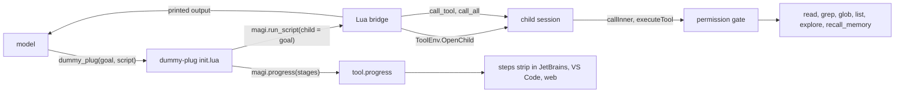
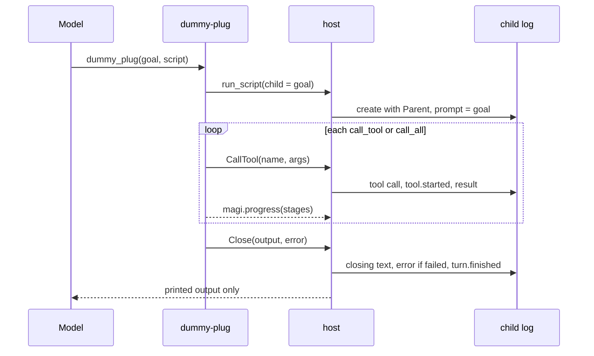

# magi — Dummy plug (code mode)

[English](DUMMY_PLUG.md) · [한국어](DUMMY_PLUG.ko.md) · [↑ Docs](README.md)

This is the design record of the dummy plug: why it exists, how it is built today, what it promises,
what it does not do yet, and the designs it replaced. Everything marked as built was read from the
code at commit `f245a8413`; everything marked as planned has no code yet. The plugin author's API
(`magi.run_script`, `magi.progress`, `ToolEnv.OpenChild`) is documented in
[EXTENDING](EXTENDING.md); this page explains how those pieces fit together for this one plugin.

## 0. Terms

| Term | Meaning |
|---|---|
| dummy plug | The `plugins/dummy-plug` plugin. One tool, `dummy_plug`, takes a Lua script from the model and runs it. |
| script | The Lua source the model writes. It calls tools and prints what the model should see. |
| outer call | The model's own `dummy_plug` call, recorded in the conversation. |
| inner call | A tool call the script makes (`call_tool`, `call_all`). The host runs it like any call. |
| child session | A session opened for one script run, with the conversation as its parent. No model drives it; a tool the script calls may still run one of its own (`explore` runs a model-driven subagent). |
| stage | One step of a run as the person sees it (`plan`, `stage`), reported as structured data. |

## 1. Why it exists

A model that wants twenty file reads makes twenty round trips, and each result ends up in its context
whether it needed it or not. The dummy plug lets the model write that loop once: the script reads,
filters and counts, and only what it prints comes back. On 2026-11-21 a script that listed 35
documents, read 8 of them in parallel and queried memory (a 21,894-byte answer) cost the model one
step and returned four short lines.

The saving comes from two places: fewer model round trips, and results filtered by the script before
the model sees them. A bash script can do the second for files, but not for harness tools such as
`explore` or `recall_memory`, and not under magi's permission gate. A model-driven subagent can do
both, but it pays a model call per step. The dummy plug sits between them: the flow is code, the
tools are the harness's, and no model drives the flow. A script that calls `explore` still pays for
that subagent's own model steps; the run above did not call it.

Since commit `0d483d59d` the script runs in a child session. That adds a second value: the person can
open the child and see every call the script made and what it returned, while the conversation keeps
only the result.

## 2. How it is built

| Piece | Where | What it does |
|---|---|---|
| `dummy_plug` | `plugins/dummy-plug/init.lua:129` | The only tool. Its description tells the model what a script can use. `goal` names the child. |
| `track` | `plugins/dummy-plug/init.lua:47` | Keeps the run's stages from `plan`, `stage` and each call's start and end, and reports them. |
| `magi.run_script` | `internal/adapter/plugin/lua/bridge_script.go:34` | Runs the script in a Lua state of its own. With `child` it opens a child (`:57`) and closes it with the output (`:72`). |
| `ToolEnv.OpenChild` | `internal/port/port.go:515`, `ChildRun` at `:1006` | The host's generic hook. Nothing in it names the dummy plug. |
| `openChild` | `internal/app/open_child.go:23` | Creates the child like a spawned one and gives back a `CallTool` bound to it. |
| `callInner` | `internal/app/inner_call.go:53` | Records an inner call and runs it through `executeTool`, the same path a model's call takes. |
| `magi.progress` | `internal/adapter/plugin/lua/bridge_script.go:124` | Sends a note and the stage list through `ToolEnv.EmitStages` (`internal/port/port.go:570`). |

The core knows nothing of the dummy plug. The host offers four general things (run a script, open a
child, run a tool from a script, report stages), and the plugin composes them. That rule came from a
review on 2026-11-20 that found plugin-only concepts in the core (an allow list naming the plugin, a
graph builder, an icon list) and moved them out.

## 3. One run, step by step

The child shows on the subagent strip while the script runs and leaves it when the script ends. The
stage list rides the outer call's row, so the strip under the `dummy_plug` row is where the
person watches the run.

## 4. What is recorded where

| Record | Where it goes | Read by |
|---|---|---|
| The outer call and what the script printed | the conversation's log | the model, as its tool result |
| The goal, as the child's prompt | the child's log | recovery, the subagent strip |
| Each inner call, its start fact and its result | the child's log | recovery, the person opening the child |
| The script's printed output, as closing text | the child's log | the person opening the child |
| `error` ("the script stopped: ...") when the script failed | the child's log (`internal/app/open_child.go:60`) | recovery, screens |
| `turn.finished` when the child closes | the child's log (`internal/app/open_child.go:65`) | recovery |
| Stage lists | `tool.progress`, not stored | screens only |

An inner call also names the outer call as its `Parent`, and `reconstruct` drops parented calls from
the model's history (`internal/app/reconstruct.go:202`). Since the calls now live in the child's log,
this filter is a second guard; it was the only one before `0d483d59d`.

## 5. Safety rules

- **Declared tools only.** The manifest lists what scripts may call: `read`, `grep`, `glob`, `list`,
  `explore`, `recall_memory`, `bash`, `edit`, `multiedit`, `write` (`plugins/dummy-plug/plugin.toml:6`). A call to anything else is
  refused before it reaches the host. A plugin that lists one of its own tools is refused at load
  (`internal/adapter/plugin/lua/host.go:434`).
- **The conversation's permission, not a script's own.** A script runs for the conversation that
  called it, so each inner call passes the same gate as the model's own call (`gatePermission` in
  `internal/app/execute.go`): the permission mode (`allow`, `auto`, `ask`, `deny`), policy rules,
  scanner-forced asks and the recovery repeat guard all apply. The standing state a decision rests on
  ("always" grants, delegation, a task's auto-approval) is read from the conversation at the top of
  the child's chain (`permissionHome` in `internal/app/permission.go`), so an "always" the person gave
  in the conversation covers its scripts, and an "always" given for a script's ask is kept by the
  conversation. A call that must be asked is shown in the conversation (§8) and the script waits;
  with nobody to ask, it is resolved the way the model's own call would be. Until 5e43b5ed1 every
  call that did more than look was asked in every mode, which made `allow` mean nothing inside a
  script.
- **Bounds.** At most 200 inner calls per outer call (`internal/app/inner_call.go:47`). A script
  runs 60 s by default, up to 300 s, and keeps 16,000 bytes of printed output by default, up to
  64,000 (`internal/adapter/plugin/lua/bridge_script.go:21-24`). `call_all` runs at most 8 at once
  (`:94`).
- **Values that cannot be converted.** A table that holds itself, or nests past 100 levels
  (`internal/adapter/plugin/lua/convert.go:64`), is refused with a reason instead of exhausting the
  Go stack. Before `7524a373c` it crashed the process.
- **No call back into a running plugin.** A tool marks its plugin in the call's context while it
  holds the plugin's lock (`internal/adapter/plugin/lua/plugin.go:236`). A call that comes back into
  that plugin, directly or through another plugin's tool, is refused at once
  (`internal/adapter/plugin/lua/luatool.go:52`). Before `d14da185a` such a call waited forever.

## 6. Child session contract

The child is made the way a spawned subagent is: a session with the conversation as `Parent`, the
goal as its prompt, a place on the subagent strip. What differs is who drives it. No loop runs in it,
so nothing writes an end on its own, and `Close` must.

Recovery decides whether a session has an open turn by reading its log (`unfinishedTurn`,
`internal/app/unfinished.go:43`): a prompt with no later `turn.finished`, no abandonment and no
unrecovered error is open. Three cases follow.

| How the script ended | What the child's log ends with | What recovery sees |
|---|---|---|
| finished | closing text, `turn.finished` | done |
| failed | `error` with the reason, `turn.finished` | done, with the reason |
| the process died mid-script | the last inner call, maybe without a result | an open turn, settled by recovery |

Before `f245a8413` `Close` wrote no end, and a finished child read as cut off after a restart. A
review reproduced it; the tests `TestAToolRunsItsCallsInAChildSessionItDrives`,
`TestAFailedChildEndsWithItsReason` and `TestAChildNeverClosedIsLeftForRecovery` now hold all three
cases.

`dummy_plug(..., background = true)` returns at once with a launch result, and the script runs on in
the same child after the conversation's turn ends, so the model can carry on or go idle. Only a
top-level call can do this (`ToolEnv.StartBackground` is nil in a child and in a trial). The work is
cancelled by an interrupt of the conversation and by shutdown, and holds back an update restart
while it runs (`HoldForUpdate`). When it ends, a `tool.background` fact and a
`[background job finished]` note carry the script's output or failure reason, and the child line,
and open a new turn (`wakeOnBackground`). If the launch result cannot be saved, the work is
cancelled before it starts and an `error` says so. Test:
`TestDummyPlugBackgroundReportsTheChildFailure`.

## 7. Progress stage contract

A stage is `{id, label, kind, state, done, total, running}` (`internal/core/event/payload.go:511`).

- `id` is fixed for the run, so a screen keeps one node per stage and changes only what moved.
- `kind` says what the stage does (`tool`, `mcp`, `web`, `harness`, `subagent`); each screen picks
  its own mark. The plugin decides the kind from the tool name (`plugins/dummy-plug/init.lua:22`).
- `state` is `waiting`, `running`, `done` or `failed`.
- `plan({...})` lists every stage before the first call, so the first report already shows them all.
  Without it, stages appear as `stage(name)` opens them.
- A report identical to the last is not sent, and two unforced reports are at least 100 ms apart
  (`internal/adapter/plugin/lua/bridge_script.go:111`). Opening a stage, a batch starting or ending,
  and the run's end force a report. A probe on 2026-11-21 ran three scripts (a fast one, one ending
  right after a batch, a failing one) and the last report always carried the final states.

The screens draw a stage as a 32 px mark over its label, with arrows between nodes: JetBrains
`ProgressStages` (`clients/jetbrains/plugin/intellij/src/main/kotlin/dev/sayaya/magi/ide/ui/ProgressStages.kt:34`),
VS Code `updateStages` (`clients/vscode/src/web/chat_adapter.ts:1720`), web `StageStrip`
(`clients/web/ui/coding-agent-ui/src/main/java/dev/sayaya/magi/client/interfaces/StageStrip.java:24`).
Start and end use the stages' states: start is `running` while any stage runs or waits and `done`
after; end waits until every stage is done, or shows `failed`.

`call_graph({...})` runs named tasks after their predecessors succeed. Declare each task with `id` and `tool`, optional `args` and `label`, and an `after` list of IDs declared earlier. A task can start as soon as its own predecessors finish. The host allows up to eight parallel-safe calls and runs an exclusive call on its own. Inside a script, `bash` and the other tools in the danger list are parallel-safe: if they need approval, the conversation shows one prompt at a time and the next waits until the first is answered. File writers (`write`, `edit`, `multiedit`), `mcp__` tools, `ask_user` and subagents that write still run on their own. The host decides this by tool name alone and does not look at what a `bash` command reads or writes: two `bash` branches that change the same file can run at once, the one saved last can overwrite the other, and the before/after change record can count the other branch's write as its own. Order such branches with `after`. The progress event uses `after: []` for a root and lists predecessor IDs for other graph tasks. Completed tasks use the success color while other branches continue.

If a task fails, independent branches can continue and affected successors become `skipped`. The child session keeps the individual tool results and an `error` event with failed task IDs and the reasons successors were skipped, followed by `turn.finished`. To detect an unexpected result from a tool that reports success, the script must check that result and raise an error itself.

The plugin keeps every graph a run declared and sends it with the steps in each later report,
including the last one, so `stage()` before or after a graph does not drop it, nor its `failed` and
`skipped` tasks. Each graph's IDs get a `g<N>:` prefix (`graph_id` from `call_graph`), so two graphs
that reuse a task ID, or a task named like a step (`s1`), stay apart. Tests:
`TestDummyPlugKeepsGraphInFinalReportAfterStage`, `TestDummyPlugKeepsFailedAndSkippedGraphTasksAfterStage`,
`TestDummyPlugKeepsSeparateGraphsWithReusedTaskIDs`.

## 8. What it does not do

- **Only permission asks reach the conversation.** A permission ask raised inside the child is shown
  in the parent conversation too, with "asked inside child <id>" before its reason, and an answer
  given there goes to the child (`relayAskLocked` in `internal/app/permission.go`, the redirect in
  `RespondPermission`). An `ask_user` question inside a child is not relayed. With the write tools open, a
  script's write in `ask` mode is the usual way an ask arrives here.
- **A row opens its first child only.** The outer call's result ends with
  `[child <id>, N tool call(s)]` (and why, when the script stopped short), the line a spawned
  subagent leaves too. Every client reads that line (`app.ChildrenNamed` in
  `internal/app/child_named.go`, with the same rule copied into the VS Code and JetBrains folds)
  and puts an "open the child" action on the call's row: a click on the head in the TUI, a button
  on the row in JetBrains (a tab of its own), VS Code (the panel switches to the child) and the web
  console (the child's page). When one call ran several children, the row opens the first; the
  rest are reached from the subagent list.
- **An interrupted run is two items.** After a crash, recovery handles the outer call and the child's
  uncertain calls separately.
- **Each inner call rereads the child's log** to find its result (`internal/app/inner_call.go:77`).
  The child's log is short, so this is cheap now; it was the whole conversation's log before
  `0d483d59d`.
- **The plugin's lock is held while a script runs.** Other tools of the same plugin wait for it.
- **No judgment of its own.** A script has no call that asks a model a short question and gets a
  bounded answer back. It can reach a model only through `explore`, which runs a whole read-only
  subagent (several model steps and a summary report) for one question. See §10.

## 9. Designs it replaced

| Earlier design | Why it went | Replaced by |
|---|---|---|
| `dummy_plug_enter` / `dummy_plug_exit` and a per-session mode | Two extra model round trips per use, in a tool meant to save them; the mode added state | one tool, running at once (`0d483d59d`) |
| Inner calls in the conversation's log, hidden from the model by `Parent` | Correct only while the filter holds; the log grew with every script | the child session (`0d483d59d`) |
| A Mermaid run graph redrawn on each report | The graph blinked, nodes appeared one by one, labels sat off centre, and the IDE's own Mermaid drew icons as `?` and keys as `{{start}}` | the stage list and a steps strip per client (`9ff409c94`, squashed into `6769583ea`) |
| Font Awesome Pro icons baked at build time, `%% magi-i18n` keys | Needed only by the graph; added a build step and a file that must never be committed | marks drawn by each client, words from each client's language pack |
| Glyphs (`⚙`, `✦`) before a label | Read as emoji; the mark was too small to see | a 32 px mark over the label (`0d483d59d`) |

## 10. Planned, not built

1. **Output-dependent stretches.** A trace keeps calls, not results, so a drafted stretch whose later
   call uses a value from an earlier result is saved as a draft with a TODO (§12); the person writes
   that data flow. The calls of a parallel batch are traced in the order they finished.
2. **Candidates from Engram.** Repeated sequences are counted by the dummy plug itself (§12), not by
   Engram; `propose_experience` writes to the store at once with no review step, so it is not used.
3. **`ask_user` questions reach the conversation.** Permission asks are already relayed (§8);
   `ask_user` questions are not yet.
4. **Judgment.** A `judge(question, choices or schema)` block asks a small dedicated model at chosen
   points (classify, pick, extract, yes/no). The answer is limited to the choices or schema so the
   script can branch on it. Each judgment is a model step in the child's log, counted against a
   limit, and its cost is added to the outer call the way a spawned child reports `Metrics`. This is
   what separates the dummy plug from a plain script: the flow stays code, and the small decisions
   inside it are a model's.

## 11. Not verified

- That a dummy plug child shows on the subagent strip of a real daemon, and reads as done in a real
  recovery after a restart. Covered by tests only.
- That the last stage report reaches a real client; `tool.progress` is a transient event and that
  hop was not run end to end.
- The steps strip on real JetBrains, VS Code and web screens, and in a dark theme. Headless tests
  measured the layout (mark height, arrow position, colours).
- Background runs on a real daemon: the completion turn, an interrupt or a restart mid-script, and how the
  screens draw the launch result. Covered by tests only.
- Web marks do not take the baked sprite (`data-i`, `Icons.dress`); they are always the drawn shapes.
- Traced routines (§12) on a real daemon: the trace from live `tool_finished` events, `/routine-*`
  command output in each client, and a writing routine's prompts on real screens. Tests fire the
  events by hand.
- Routines (§12) on a real daemon: the approval prompt on real JetBrains, VS Code and web screens,
  and the example routine with a real `explore`. Covered by tests with stand-in tools only.

## 12. Routines

A routine is a dummy plug script kept as a skill and run again by name with `run_routine{name, args}`.

- **Format.** A skill file (`.magi/skills/<name>.md` or `.claude/skills/<name>/SKILL.md`) whose
  frontmatter has `kind: routine`, `tools:` (the tools the script may call, comma-separated) and
  `inputs:` (one-line JSON Schema). The script is the body's first `lua` block and reads its
  arguments from `input`. A skill without `kind: routine` is not run.
- **Execution.** Through `magi.run_script` like `dummy_plug`: a child session records each call, only
  what the script prints comes back, and `run_script`'s `tools` option limits the run to the listed
  tools. Arguments are checked against `inputs` (required keys, types, no unknown keys) first.
- **Approval.** The first run, and any run after the script, `inputs` or `tools` changed, shows all
  three in the conversation's permission prompt (`magi.approve`). The approved fingerprint (sha256 of
  the three) is kept in the plugin store, so it holds after a restart. Only a person answers it:
  an "always" grant for `run_routine` does not, and neither does the permission mode — with nobody
  to ask (headless) or nobody answering in time, the routine is not approved and nothing is stored,
  even in `allow`. Answering "always" or "persist" approves that routine version only; it adds no
  session grant and no project allow rule. Approval grants nothing else: each call still passes the
  permission gate, and a call outside `tools` is refused.
- **Writes.** A routine may call any tool in the dummy plug's `call_tools`, including `bash`, `edit`,
  `multiedit` and `write`. Its approval prompt names the writing tools (`writes`); approving lets the
  routine run, not write: each write still passes its own permission gate (in `ask` mode it asks), and
  the writing tools run one at a time (`run_script`'s `serial`). A tool outside `call_tools`
  (`coding_task`, `wait_for`, …) cannot be in a routine.
- **Traces and drafts.** `/routine-trace` lists up to 300 recent calls with their number, turn,
  tool and success status. The trace stores no arguments or message text.
  `/routine-draft <name> <from>-<to>` saves a draft with one argument object per step
  (`input.step1`, `input.step2`, …). Supply those objects and check the order and dependencies
  before removing `status: draft`. `run_routine` refuses drafts. The trace labels parallel batches
  and calls of unknown order. You can draft those calls one at a time. A draft spanning multiple
  calls requires known sequential dispatch for every call.
  `/routine-draft <name> run:<id>` still saves the selected `dummy_plug` script as it ran.
- **Dry check.** A trace draft runs with synthetic arguments. `dry_check:` reports whether it
  produced the expected tool calls in observed completion order. No tools execute during the check.
  A saved `dummy_plug` script reports how far it got in a dry run.
- **Candidates.** At turn end, repeated sequential stretches are matched by tool name. Parallel
  calls, unknown order, judgement calls and failures break a stretch. Opening stretches of only `read`, `list` or
  `glob` are skipped. `/routine-candidates` lists the suggestions and `/routine-register <id> <name>`
  saves the selected candidate. The separate suggestion for a `dummy_plug` script whose tool
  sequence succeeds three times still uses that script.
- **Legacy traces.** On load, the plug-in clears copied arguments and message text from all of
  its stored traces and trace candidates. `/routine-trace-clean` repeats the cleanup and lists
  saved workspace drafts that may still contain legacy values. It leaves the saved files intact.
- **Writing comparison.** `routine_compare_writes{name, script, files, args}` runs the active and
  candidate scripts in two disposable directories seeded with the same text fixtures (`files`).
  It supports `read`, `write`, `edit` and `multiedit` and reports final file hashes, differing paths
  and script or tool failures, including partial writes. The host deletes both copies. This
  comparison uses only the supplied files. Before seeding fixtures or running file calls, it
  checks tool policy against the supplied path and its normalized workspace-relative and absolute
  forms. Policy denials and requests for approval block the operation. The comparison opens no
  approval prompts and leaves adoption to the separate routine commands.
- **Improvement.** A routine's evals live in `.magi/routines/<name>/`: `contract.json` (cases run dry
  on fixed fixtures — control flow: the recalled policy reaches each `explore`, an empty or failed
  answer is reported as no answer, a branch no fixture answers stays unverified) and `tasks.json`
  (tasks with `split: dev|holdout`, `protected`, fixtures and expected evidence). A person freezes them
  with `/routine-evals-freeze <name>`; `routine_improve` refuses evals changed since. `routine_improve`
  takes a candidate script with its problem and hypothesis. It rejects a candidate that changes its
  tools or inputs, checks it against the contract, and only then pairs it with the active version on
  the same tasks (repeated, `repeats`, default 3). Each task is judged on its own: newly solved, newly
  regressed, still failing, kept, unstable, unverified. A broken contract or a lost protected task
  rejects. Another regression or an unsettled task holds the candidate. Only holdout
  tasks count toward the one-sided sign test (p ≤ 0.10), both for quality gains and for
  reducing calls with quality unchanged. Dry counts include simulated explore calls.
  They record no model usage. Adoption checks that the compared files still match. Every attempt — baseline, candidate, problem, hypothesis, conditions,
  per-task results, verdict and reason — is appended to `attempts.jsonl`, rejected ones included;
  `routine_history` reads them back for the next candidate. `from_run` (a run from `/routine-trace`)
  and `previous` (an earlier attempt) link an attempt to the run it started from and the attempt it
  follows; both must exist. A person adopts an applicable candidate
  with `/routine-adopt <name> <version>` (the replaced version is kept, and `/routine-rollback <name>`
  restores it; both go to `decisions.jsonl`), and the adopted version asks for approval on its next
  run. The comparison checks control flow on fixtures only, not the accuracy of real `explore`
  answers, effects on files, or new tasks. No Engram and no model are needed.
- **Delegated auto-apply.** `/routine-auto <name>` lets a person allow, once, that applicable
  candidates of a read-only routine are applied without asking. The delegation records the routine's
  tools, input schema and frozen evals; a routine that may write cannot be delegated. When
  `routine_improve` finds a candidate applicable and it stays inside that scope (no writing tool, the
  same tools and inputs, the same evals), it is applied as `adopt` would, recorded in
  `decisions.jsonl` as `auto-applied` with `by: auto` and `run_approval: not granted`, and announced
  in one line with `/routine-rollback <name>`. A rejected or held candidate is only recorded in
  `attempts.jsonl`; nobody is told. Outside the scope (evals frozen again, tools or inputs changed) an
  applicable candidate is left for a person. Applying is not run approval: the applied version asks
  before its next run. `/routine-auto <name> off` revokes it. No Engram is needed.
- **Data reach.** Each comparison records the arguments both versions pass to `read`, `grep`, `glob`,
  `list` and `recall_memory` on the tasks (`path`, `pattern`, `query`, …). A candidate that adds
  arguments the active version never used is outside a delegation and left for a person. `explore`
  takes free text, so its arguments are compared whole: a candidate whose explore questions differ
  is left for a person too, unless the delegation uses `/routine-auto <name> explore-text <directory>`.
  That directory becomes the `explore` child's file-tool root on future runs of the auto-applied
  version. It remains in effect if the delegation is revoked. The decision record includes
  `explore_scope`. Earlier delegations with no directory need to be renewed.
- **Generating candidates.** `routine_autoimprove{name, problem, rounds}` makes one sidecar call
  (`magi.analyze`) per round with the active script, the problem and feedback from development
  screening in the current run. It screens each candidate against the contract and development
  cases. The first passing candidate receives one full evaluation, including holdout, and ends
  the run regardless of the verdict. The full evaluation is recorded in `attempts.jsonl`. Its
  results are kept out of future candidate prompts. Generation uses model calls. Fixture
  comparisons run dry.
- **After rollback.** `/routine-rollback <name>` also blocks automatic reapplication of the
  removed version, even if you renew the delegation. You can still restore it explicitly
  with `/routine-adopt <name> <version>` when it meets the adoption checks.
- **Example.** `plugins/dummy-plug/routines/recovery-policy-evidence.md` recalls the recovery policy
  once, hands it to one `explore` per question, and prints each answer under its question.
