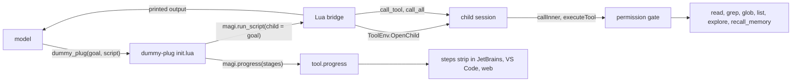
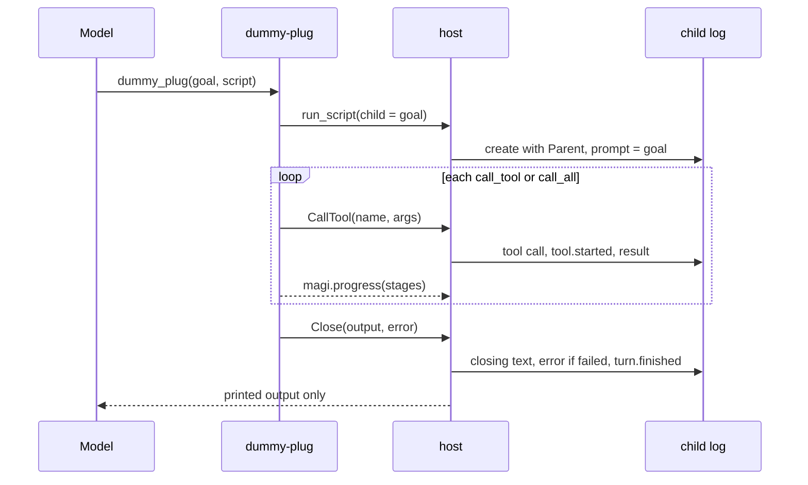

# magi — Dummy plug (code mode)

[English](DUMMY_PLUG.md) · [한국어](DUMMY_PLUG.ko.md) · [↑ Docs](README.md)

This is the design record of the dummy plug: why it exists, how it is built today, what it promises,
what it does not do yet, and the designs it replaced. Everything marked as built was read from the
code at commit `f245a8413`; everything marked as planned has no code yet. The plugin author's API
(`magi.run_script`, `magi.progress`, `ToolEnv.OpenChild`) is documented in
[EXTENDING](EXTENDING.md); this page explains how those pieces fit together for this one plugin.

## 0. Terms

| Term | Meaning |
|---|---|
| dummy plug | The `plugins/dummy-plug` plugin. One tool, `dummy_plug`, takes a Lua script from the model and runs it. |
| script | The Lua source the model writes. It calls tools and prints what the model should see. |
| outer call | The model's own `dummy_plug` call, recorded in the conversation. |
| inner call | A tool call the script makes (`call_tool`, `call_all`). The host runs it like any call. |
| child session | A session opened for one script run, with the conversation as its parent. No model drives it; a tool the script calls may still run one of its own (`explore` runs a model-driven subagent). |
| stage | One step of a run as the person sees it (`plan`, `stage`), reported as structured data. |

## 1. Why it exists

A model that wants twenty file reads makes twenty round trips, and each result ends up in its context
whether it needed it or not. The dummy plug lets the model write that loop once: the script reads,
filters and counts, and only what it prints comes back. On 2026-11-21 a script that listed 35
documents, read 8 of them in parallel and queried memory (a 21,894-byte answer) cost the model one
step and returned four short lines.

The saving comes from two places: fewer model round trips, and results filtered by the script before
the model sees them. A bash script can do the second for files, but not for harness tools such as
`explore` or `recall_memory`, and not under magi's permission gate. A model-driven subagent can do
both, but it pays a model call per step. The dummy plug sits between them: the flow is code, the
tools are the harness's, and no model drives the flow. A script that calls `explore` still pays for
that subagent's own model steps; the run above did not call it.

Since commit `0d483d59d` the script runs in a child session. That adds a second value: the person can
open the child and see every call the script made and what it returned, while the conversation keeps
only the result.

## 2. How it is built



| Piece | Where | What it does |
|---|---|---|
| `dummy_plug` | `plugins/dummy-plug/init.lua:129` | The only tool. Its description tells the model what a script can use. `goal` names the child. |
| `track` | `plugins/dummy-plug/init.lua:47` | Keeps the run's stages from `plan`, `stage` and each call's start and end, and reports them. |
| `magi.run_script` | `internal/adapter/plugin/lua/bridge_script.go:34` | Runs the script in a Lua state of its own. With `child` it opens a child (`:57`) and closes it with the output (`:72`). |
| `ToolEnv.OpenChild` | `internal/port/port.go:515`, `ChildRun` at `:1006` | The host's generic hook. Nothing in it names the dummy plug. |
| `openChild` | `internal/app/open_child.go:23` | Creates the child like a spawned one and gives back a `CallTool` bound to it. |
| `callInner` | `internal/app/inner_call.go:53` | Records an inner call and runs it through `executeTool`, the same path a model's call takes. |
| `magi.progress` | `internal/adapter/plugin/lua/bridge_script.go:124` | Sends a note and the stage list through `ToolEnv.EmitStages` (`internal/port/port.go:570`). |

The core knows nothing of the dummy plug. The host offers four general things (run a script, open a
child, run a tool from a script, report stages), and the plugin composes them. That rule came from a
review on 2026-11-20 that found plugin-only concepts in the core (an allow list naming the plugin, a
graph builder, an icon list) and moved them out.

## 3. One run, step by step



The child shows on the subagent strip while the script runs and leaves it when the script ends. The
stage list rides the outer call's row, so the strip under the `dummy_plug` row is where the
person watches the run.

## 4. What is recorded where

| Record | Where it goes | Read by |
|---|---|---|
| The outer call and what the script printed | the conversation's log | the model, as its tool result |
| The goal, as the child's prompt | the child's log | recovery, the subagent strip |
| Each inner call, its start fact and its result | the child's log | recovery, the person opening the child |
| The script's printed output, as closing text | the child's log | the person opening the child |
| `error` ("the script stopped: ...") when the script failed | the child's log (`internal/app/open_child.go:60`) | recovery, screens |
| `turn.finished` when the child closes | the child's log (`internal/app/open_child.go:65`) | recovery |
| Stage lists | `tool.progress`, not stored | screens only |

An inner call also names the outer call as its `Parent`, and `reconstruct` drops parented calls from
the model's history (`internal/app/reconstruct.go:202`). Since the calls now live in the child's log,
this filter is a second guard; it was the only one before `0d483d59d`.

## 5. Safety rules

- **Declared tools only.** The manifest lists what scripts may call: `read`, `grep`, `glob`, `list`,
  `explore`, `recall_memory`, `bash`, `edit`, `multiedit`, `write` (`plugins/dummy-plug/plugin.toml:6`). A call to anything else is
  refused before it reaches the host. A plugin that lists one of its own tools is refused at load
  (`internal/adapter/plugin/lua/host.go:434`).
- **The conversation's permission, not a script's own.** A script runs for the conversation that
  called it, so each inner call passes the same gate as the model's own call (`gatePermission` in
  `internal/app/execute.go`): the permission mode (`allow`, `auto`, `ask`, `deny`), policy rules,
  scanner-forced asks and the recovery repeat guard all apply. The standing state a decision rests on
  ("always" grants, delegation, a task's auto-approval) is read from the conversation at the top of
  the child's chain (`permissionHome` in `internal/app/permission.go`), so an "always" the person gave
  in the conversation covers its scripts, and an "always" given for a script's ask is kept by the
  conversation. A call that must be asked is shown in the conversation (§8) and the script waits;
  with nobody to ask, it is resolved the way the model's own call would be. Until 5e43b5ed1 every
  call that did more than look was asked in every mode, which made `allow` mean nothing inside a
  script.
- **Bounds.** At most 200 inner calls per outer call (`internal/app/inner_call.go:47`). A script
  runs 60 s by default, up to 300 s, and keeps 16,000 bytes of printed output by default, up to
  64,000 (`internal/adapter/plugin/lua/bridge_script.go:21-24`). `call_all` runs at most 8 at once
  (`:94`).
- **Values that cannot be converted.** A table that holds itself, or nests past 100 levels
  (`internal/adapter/plugin/lua/convert.go:64`), is refused with a reason instead of exhausting the
  Go stack. Before `7524a373c` it crashed the process.
- **No call back into a running plugin.** A tool marks its plugin in the call's context while it
  holds the plugin's lock (`internal/adapter/plugin/lua/plugin.go:236`). A call that comes back into
  that plugin, directly or through another plugin's tool, is refused at once
  (`internal/adapter/plugin/lua/luatool.go:52`). Before `d14da185a` such a call waited forever.

## 6. Child session contract

The child is made the way a spawned subagent is: a session with the conversation as `Parent`, the
goal as its prompt, a place on the subagent strip. What differs is who drives it. No loop runs in it,
so nothing writes an end on its own, and `Close` must.

Recovery decides whether a session has an open turn by reading its log (`unfinishedTurn`,
`internal/app/unfinished.go:43`): a prompt with no later `turn.finished`, no abandonment and no
unrecovered error is open. Three cases follow.

| How the script ended | What the child's log ends with | What recovery sees |
|---|---|---|
| finished | closing text, `turn.finished` | done |
| failed | `error` with the reason, `turn.finished` | done, with the reason |
| the process died mid-script | the last inner call, maybe without a result | an open turn, settled by recovery |

Before `f245a8413` `Close` wrote no end, and a finished child read as cut off after a restart. A
review reproduced it; the tests `TestAToolRunsItsCallsInAChildSessionItDrives`,
`TestAFailedChildEndsWithItsReason` and `TestAChildNeverClosedIsLeftForRecovery` now hold all three
cases.

`dummy_plug(..., background = true)` returns at once with a launch result, and the script runs on in
the same child after the conversation's turn ends, so the model can carry on or go idle. Only a
top-level call can do this (`ToolEnv.StartBackground` is nil in a child and in a trial). The work is
cancelled by an interrupt of the conversation and by shutdown, and holds back an update restart
while it runs (`HoldForUpdate`). When it ends, a `tool.background` fact and a
`[background job finished]` note carry the script's output or failure reason, and the child line,
and open a new turn (`wakeOnBackground`). If the launch result cannot be saved, the work is
cancelled before it starts and an `error` says so. Test:
`TestDummyPlugBackgroundReportsTheChildFailure`.

## 7. Progress stage contract

A stage is `{id, label, kind, state, done, total, running}` (`internal/core/event/payload.go:511`).

- `id` is fixed for the run, so a screen keeps one node per stage and changes only what moved.
- `kind` says what the stage does (`tool`, `mcp`, `web`, `harness`, `subagent`); each screen picks
  its own mark. The plugin decides the kind from the tool name (`plugins/dummy-plug/init.lua:22`).
- `state` is `waiting`, `running`, `done` or `failed`.
- `plan({...})` lists every stage before the first call, so the first report already shows them all.
  Without it, stages appear as `stage(name)` opens them.
- A report identical to the last is not sent, and two unforced reports are at least 100 ms apart
  (`internal/adapter/plugin/lua/bridge_script.go:111`). Opening a stage, a batch starting or ending,
  and the run's end force a report. A probe on 2026-11-21 ran three scripts (a fast one, one ending
  right after a batch, a failing one) and the last report always carried the final states.

The screens draw a stage as a 32 px mark over its label, with arrows between nodes: JetBrains
`ProgressStages` (`clients/jetbrains/plugin/intellij/src/main/kotlin/dev/sayaya/magi/ide/ui/ProgressStages.kt:34`),
VS Code `updateStages` (`clients/vscode/src/web/chat_adapter.ts:1720`), web `StageStrip`
(`clients/web/ui/coding-agent-ui/src/main/java/dev/sayaya/magi/client/interfaces/StageStrip.java:24`).
Start and end use the stages' states: start is `running` while any stage runs or waits and `done`
after; end waits until every stage is done, or shows `failed`.


`call_graph({...})` runs named tasks after their predecessors succeed. Declare each task with `id` and `tool`, optional `args` and `label`, and an `after` list of IDs declared earlier. A task can start as soon as its own predecessors finish. The host allows up to eight parallel-safe calls and runs an exclusive call on its own. Inside a script, `bash` and the other tools in the danger list are parallel-safe: if they need approval, the conversation shows one prompt at a time and the next waits until the first is answered. File writers (`write`, `edit`, `multiedit`), `mcp__` tools, `ask_user` and subagents that write still run on their own. The host decides this by tool name alone and does not look at what a `bash` command reads or writes: two `bash` branches that change the same file can run at once, the one saved last can overwrite the other, and the before/after change record can count the other branch's write as its own. Order such branches with `after`. The progress event uses `after: []` for a root and lists predecessor IDs for other graph tasks. Completed tasks use the success color while other branches continue.

If a task fails, independent branches can continue and affected successors become `skipped`. The child session keeps the individual tool results and an `error` event with failed task IDs and the reasons successors were skipped, followed by `turn.finished`. To detect an unexpected result from a tool that reports success, the script must check that result and raise an error itself.

The plugin keeps every graph a run declared and sends it with the steps in each later report,
including the last one, so `stage()` before or after a graph does not drop it, nor its `failed` and
`skipped` tasks. Each graph's IDs get a `g<N>:` prefix (`graph_id` from `call_graph`), so two graphs
that reuse a task ID, or a task named like a step (`s1`), stay apart. Tests:
`TestDummyPlugKeepsGraphInFinalReportAfterStage`, `TestDummyPlugKeepsFailedAndSkippedGraphTasksAfterStage`,
`TestDummyPlugKeepsSeparateGraphsWithReusedTaskIDs`.

### Asking a bounded question

The dummy plug registers `judge` as a regular tool. Call it directly with `{"question":"Classify this supplied ticket: duplicate invoice","choices":["billing","support","unknown"]}` or use `local answer, err = judge(question, choices)` inside the script. A saved routine declares `judge` in its tools. The standalone result contains an `answer` field. The Lua helper unwraps it for branching. For extraction pass a JSON Schema object as the second argument, for example `{type="boolean"}` for yes/no. A model reply must be one JSON value satisfying the contract. Handle errors before branching.

A single choice costs zero model calls. Other valid requests send only the question and contract to the sidecar once. The production OpenAI-compatible request caps output at 128 tokens for choices and 512 for schemas, subject to any lower provider ceiling. The input limit is 16 KiB including the contract. Set `judge_model` in `[plugins.dummy-plug]` to select a small model. Otherwise the sidecar uses its default model. A script allows up to four live judge calls. Dry runs use fixtures. Sidecar usage is reported with the `judge` label.

When saving a finished script as a routine, magi parses its Lua source and marks lines where a local `explore` result is immediately compared with a string literal in an `if`. These are migration hints: reuse the original question when its evidence is available in the script. Searches that obtain new evidence still need their reader. This check and ordinary routine matching use zero model calls.

## 8. What it does not do

- **Only permission asks reach the conversation.** A permission ask raised inside the child is shown
  in the parent conversation too, with "asked inside child <id>" before its reason, and an answer
  given there goes to the child (`relayAskLocked` in `internal/app/permission.go`, the redirect in
  `RespondPermission`). An `ask_user` question inside a child is not relayed. With the write tools open, a
  script's write in `ask` mode is the usual way an ask arrives here.
- **A row opens its first child only.** The outer call's result ends with
  `[child <id>, N tool call(s)]` (and why, when the script stopped short), the line a spawned
  subagent leaves too. Every client reads that line (`app.ChildrenNamed` in
  `internal/app/child_named.go`, with the same rule copied into the VS Code and JetBrains folds)
  and puts an "open the child" action on the call's row: a click on the head in the TUI, a button
  on the row in JetBrains (a tab of its own), VS Code (the panel switches to the child) and the web
  console (the child's page). When one call ran several children, the row opens the first; the
  rest are reached from the subagent list.
- **An interrupted run is two items.** After a crash, recovery handles the outer call and the child's
  uncertain calls separately.
- **Each inner call rereads the child's log** to find its result (`internal/app/inner_call.go:77`).
  The child's log is short, so this is cheap now; it was the whole conversation's log before
  `0d483d59d`.
- **The plugin's lock is held while a script runs.** Other tools of the same plugin wait for it.


## 9. Designs it replaced

| Earlier design | Why it went | Replaced by |
|---|---|---|
| `dummy_plug_enter` / `dummy_plug_exit` and a per-session mode | Two extra model round trips per use, in a tool meant to save them; the mode added state | one tool, running at once (`0d483d59d`) |
| Inner calls in the conversation's log, hidden from the model by `Parent` | Correct only while the filter holds; the log grew with every script | the child session (`0d483d59d`) |
| A Mermaid run graph redrawn on each report | The graph blinked, nodes appeared one by one, labels sat off centre, and the IDE's own Mermaid drew icons as `?` and keys as `{{start}}` | the stage list and a steps strip per client (`9ff409c94`, squashed into `6769583ea`) |
| Font Awesome Pro icons baked at build time, `%% magi-i18n` keys | Needed only by the graph; added a build step and a file that must never be committed | marks drawn by each client, words from each client's language pack |
| Glyphs (`⚙`, `✦`) before a label | Read as emoji; the mark was too small to see | a 32 px mark over the label (`0d483d59d`) |

## 10. Planned, not built

1. **Other output dependencies.** The automatic reader loop in §12 recognizes glob results passed to successive reads. For other dependencies a trace draft leaves a TODO for the step that needs an earlier result.
2. **Candidates from Engram.** Repeated sequences are counted by the dummy plug itself (§12), not by
   Engram; `propose_experience` writes to the store at once with no review step, so it is not used.
3. **`ask_user` questions reach the conversation.** Permission asks are already relayed (§8);
   `ask_user` questions are not yet.


## 11. Not verified

- That a dummy plug child shows on the subagent strip of a real daemon, and reads as done in a real
  recovery after a restart. Covered by tests only.
- That the last stage report reaches a real client; `tool.progress` is a transient event and that
  hop was not run end to end.
- The steps strip on real JetBrains, VS Code and web screens, and in a dark theme. Headless tests
  measured the layout (mark height, arrow position, colours).
- Background runs on a real daemon: the completion turn, an interrupt or a restart mid-script, and how the
  screens draw the launch result. Covered by tests only.
- Web marks do not take the baked sprite (`data-i`, `Icons.dress`); they are always the drawn shapes.
- Traced routines (§12) on a real daemon: the trace from live `tool_finished` events, `/routine-*`
  command output in each client, and a writing routine's prompts on real screens. Tests fire the
  events by hand.
- Routines (§12) on a real daemon: the approval prompt on real JetBrains, VS Code and web screens,
  and the example routine with a real `explore`. Covered by tests with stand-in tools only.

## 12. Routines

A routine is a dummy plug script run by name with `run_routine{name, args}`. Its workspace directory, `.magi/routines/<name>/`, holds `routine.md`, the evaluation files `contract.json` and `tasks.json`, the logs `attempts.jsonl` and `decisions.jsonl`, and `versions/` when those files are created.

Workspace settings remain in `.magi/config.toml`. Reusable skill instructions belong in `.magi/skills/`, and workspace memory belongs in `.magi/experience/`. Routine files are grouped by routine name under `.magi/routines/`.

Automatic discovery saves a reusable routine after a dry check. A/B improvement uses separately prepared and frozen evaluation cases. Automatic candidate generation also needs the routine’s `start-on-failure` delegation.

- **Format.** The definition is `.magi/routines/<name>/routine.md`. Existing definitions in `.magi/skills/<name>.md` or `.claude/skills/<name>/SKILL.md` keep working in place. The
  frontmatter has `kind: routine`, `tools:` (the tools the script may call, comma-separated) and
  `inputs:` (one-line JSON Schema). The script is the body's first `lua` block and reads its
  arguments from `input`. A skill without `kind: routine` is not run.
- **Execution.** Through `magi.run_script` like `dummy_plug`: a child session records each call, only
  what the script prints comes back, and `run_script`'s `tools` option limits the run to the listed
  tools. Arguments are checked against `inputs` (required keys, types, no unknown keys) first.
- **Approval.** The first run, and any run after the script, `inputs` or `tools` changed, shows all
  three in the conversation's permission prompt (`magi.approve`). The approved fingerprint (sha256 of
  the three) is kept in the plugin store, so it holds after a restart. Only a person answers it:
  an "always" grant for `run_routine` does not, and neither does the permission mode — with nobody
  to ask (headless) or nobody answering in time, the routine is not approved and nothing is stored,
  even in `allow`. Answering "always" or "persist" approves that routine version only; it adds no
  session grant and no project allow rule. Approval grants nothing else: each call still passes the
  permission gate, and a call outside `tools` is refused.
- **Writes.** A routine may call any tool in the dummy plug's `call_tools`, including `bash`, `edit`,
  `multiedit` and `write`. Its approval prompt names the writing tools (`writes`); approving lets the
  routine run, not write: each write still passes its own permission gate (in `ask` mode it asks), and
  the writing tools run one at a time (`run_script`'s `serial`). A tool outside `call_tools`
  (`coding_task`, `wait_for`, …) cannot be in a routine.
- **Traces and drafts.** `/routine-trace` lists up to 300 recent calls with their number, turn,
  tool and success status. The trace stores no arguments or message text.
  `/routine-draft <name> <from>-<to>` saves a draft with one argument object per step
  (`input.step1`, `input.step2`, …). Supply those objects and check the order and dependencies
  before removing `status: draft`. `run_routine` refuses drafts. The trace labels parallel batches
  and calls of unknown order. You can draft those calls one at a time. A draft spanning multiple
  calls requires known sequential dispatch for every call.
  `/routine-draft <name> run:<id>` still saves the selected `dummy_plug` script as it ran.
- **Dry check.** A trace draft runs with synthetic arguments. `dry_check:` reports whether it
  produced the expected tool calls in observed completion order. No tools execute during the check.
  A saved `dummy_plug` script reports how far it got in a dry run.
- **Candidates.** At turn end, repeated sequential stretches are matched by tool name. Parallel
  calls, unknown order, judgement calls and failures break a stretch. Opening stretches of only `read`, `list` or
  `glob` are skipped. `/routine-candidates` lists the suggestions and `/routine-register <id> <name>`
  saves the selected candidate. The separate suggestion for a `dummy_plug` script whose tool
  sequence succeeds three times still uses that script.
- **Automatic read-only routines.** The plug-in looks for two successful occurrences of a sequential stretch or a complete parallel group of `read`, `grep`, `glob` or `list` calls. The occurrences may be in the same turn. Parallel groups use dispatch membership and need every recorded call to succeed. The plug-in checks the generated calls with synthetic arguments. If it passes, it saves `.magi/routines/auto-<candidate>/routine.md`. The model can discover it with `routine_catalog`. A query such as `{"query":"sort uniq"}` filters the full catalog by name, description and tool before returning up to 30 matches. For requests that mention its reader operations, the plug-in can suggest up to three routines in the turn context, so the model can call `run_routine` directly. It supplies each step’s arguments from the current request and uses ordinary tools if a later step needs an earlier result to choose its arguments. Automatic creation stops at 20 visible routines or 100 saved files per workspace. The first `run_routine` shows the proposed arguments and read scope. By default each file read is approved individually, and a search is approved for its tool and directory. A search approval grants no direct file reads. If the user wants to reuse direct-read approval for a folder, the model can ask with `reuse_read_directory: true`. The prompt names the folder, and approval then covers its subdirectories. A file at the workspace root is approved individually. A search must name a subdirectory. A new scope asks for approval again, and each tool call still passes the usual permission checks. For learned writing routines, the query can also use words from earlier requests for the same task.
- **Automatic writing routines.** The plug-in learns successful sequential `write`, `edit`, `multiedit`, and `bash` calls that repeat in two non-overlapping stretches in a workspace. It checks up to 12 consecutive calls each time a tool finishes, so both stretches can occur in one turn. A repeated sequence must include at least two tool calls in the same order. For example, two occurrences of `mkdir → read` can produce one routine. For simple shell commands, the plug-in fingerprints the executable name, option names and operand positions. A bare word before the first option can distinguish subcommands. Literal pipelines and command lists preserve command order and the operators `|`, `&&`, `||`, and `;`. A newline between commands counts like a semicolon. For a literal environment prefix such as `TMPDIR=/tmp/check`, the digest includes the variable name. The host parser includes redirection operators in the digest. Unsupported scripts use the digest of the whole command. The trace keeps the digest and the executable name when it identifies a simple command. Only shell templates with a learned command structure can be generated from one Bash call. Original arguments are supplied from the current request.

  On POSIX, the harness also compares operand counts after a literal `--` in the first pipeline stage. When the same three stages recur across at least two successful calls and the counts differ, it saves a routine with an `items` array of 1 to 32 operands. For example, `git show --format= REV -- PATH… | grep -E INCLUDE | grep -v EXCLUDE` accepts a fresh file list. The template fixes options and the leading word identified as a subcommand before an option. A pattern made solely of regex punctuation can also become fixed when the observations agree. Other operands come from the current request. An optional `tail` uses only output stages and argument layouts observed before saving. Each list item becomes one quoted shell argument.

  Once a variable-width routine covers a fixed pipeline’s input layout, filters and output stages, the catalog shows the representative. An exact lookup can still open an older fixed definition. A Git pipeline with an input in the subcommand position remains an observation.

  A foreground tool can return a JSON string array, or an object containing one such array and optional string fields. Bash can print the same JSON. A complete single-commit Git diffstat is another supported format. Within one turn the harness compares that result with the successful foreground Bash calls in the next model response. Every operand after `--` must match the returned list in order. Other variable operands must each match one unambiguous result field. Two observations with different list lengths and changing bound scalar values can establish a routine. A competing complete binding disables that producer’s automatic choice.

  In `/routine-trace`, each supported top-level pipeline is listed under its Bash call and shell statement number. The commands are nodes in execution syntax, and each pipe connects stdout to stdin. For example, `git [2/9 inventory items] | grep | cut` means two distinct returned items occurred after the first stage’s literal `--`. This is an argument match, not evidence that the file contents were read. Partial matches can be inspected but cannot teach a full-list routine. The writing-window learner skips these pipeline calls to avoid saving the same steps again as overlapping Bash wrappers.

  For example, `queue-scan -- job1` returns `{"cycle":"A","tickets":["x","y"]}` and the next call runs `bundle-labels --cycle A -- x y`. After another complete example with a different cycle and list length, the harness can supply a new cycle and tickets itself. It compares the producer tool, arguments and result schema. For a simple shell producer, literal operands after `--` may vary. The saved definition and ordinary tool permissions still apply. The next producer response includes the follow-up output under `[inventory routine]`. The request wording does not select the routine. Lists must contain 1–32 distinct nonempty strings. A response containing several tool calls can teach the binding if exactly one successful foreground Bash call matches. Background launches do not count. The consumer must still be a complete standalone command or pipeline.

  In `routine_catalog`, the `usage` field describes when to use the routine, what each input means, its output and its failure conditions. Git diff filters also include example arguments. Newly learned routines save the same guidance in `routine.md`. For existing files, the catalog derives the guidance from their saved templates. The variable-width routine stores its stage specification and calls the shared `run_pipeline_v1` Lua helper. The helper checks and quotes the arguments and dispatches one Bash call through the usual permission gate.

  In a live session on 2026-11-24, the harness saved this routine and suggested it at 06:46:35 KST. By 06:51:39 it had recorded zero further suggestions and zero `run_routine` calls for that routine. To check reuse in a session, match the name in the suggestion to the `name` argument of a later `run_routine` call.

  Older learned shell routines with matching receipts dry-run the proposed arguments and compare the resulting command with the saved graph before executing. A different subcommand in a learned `git show` pipeline is rejected before Bash runs.

  The shell parser records dependencies inside pipelines and conditional lists. A file edge connects an absolute output redirection to a later input redirection for that path. These observations support discovery even when the user gets no suggestion.

  For a pipeline such as `git … | grep -E INCLUDE | grep -v EXCLUDE`, the catalog explains which input keeps matching lines and which removes them. A request such as “filter the commits” can retrieve the routine without naming grep. The matcher looks for both the source and a filtering expression. It derives the roles from the saved command template, including for older routines, without calling a model.

  On POSIX hosts, a repeated chain of three to eight simple commands joined by `&&` is observed for hints and dependency graphs but is not saved as a routine: it was one `bash` call, one model response, so a routine for it would save no model call. A chain qualifies as a top-level statement or as the initial stages of a longer top-level AND-list. Function definitions and optional branches can contribute observations. Two distinct shell calls must have the same executable order and argument layout. The template keeps option names. Other arguments come from the new request, and repeated literal operands can share one input even when one stage quotes the path. For example, `mkdir -p DIR && touch FILE && test -f FILE` needs two inputs. The routine quotes each input and submits one command to the usual shell permission gate. A denied command produces no file changes.

  The same commands can have different input dependencies. In `mkdir -p DIR && touch FILE && test -f FILE` the last step checks the file just created. If it checks a separate prerequisite file, the routine needs a third input. Each variant can be learned from two matching calls even if the variants alternate. The catalog keeps both input layouts available.

  A repeated POSIX pipeline of three to eight simple commands is observed the same way and not saved, for the same reason. A pipeline becomes a routine only as an inventory consumer, where the routine replaces a model response of its own. Consumers that differ only in output settings, such as the `cut -c` width or a `head` count, are one routine, and the next plan uses the setting seen last. For example, `cat FILE | sort | uniq -c` has one file input and returns counts for its lines. The harness ignores background launch acknowledgements when learning shell graphs. The saved routine preserves the pipe operators and shell exit behavior. Its success alone does not establish that every stage succeeded.

  The harness also learns which request words occur with a multi-step routine or an eligible graph. It stores workspace-specific hashes. A later request can match by repeating the earlier phrasing or by sharing at least two terms that occurred on two observed turns. For example, two release-note requests that wrote and then read the same file can yield a routine for the next release-note request. Supply the writing tool’s arguments in `step1`. The read uses the same path. Pass `step2` for optional read settings such as a line limit.

  After a dry check with synthetic arguments, the plug-in saves `.magi/routines/write-<id>/routine.md` with `status: learned-write`. The routine is available in `routine_catalog` and can be suggested for a writing request when it combines multiple calls. The generated version needs no separate routine approval. Each tool call follows the existing permission policy, and editing the saved file restores the usual routine approval check. The dry check verifies the tool calls. Comparing real file effects is a separate step.
- **Automatic catalog maintenance.** The idle hook reviews automatically saved routines at most once an hour. It hides exact duplicates with the same approval scope and keeps their names, files and history. Different versions can share a catalog entry only when their scopes match and both frozen evaluations confirm the same tool calls and results. A routine is archived after 30 days without execution or paused after three consecutive execution errors. Its name still works with `run_routine`. A successful explicit run restores an archived or paused entry at the next review. Use `/routine-lifecycle` to inspect entries and `/routine-lifecycle restore <name>` to keep one visible. Decisions appear in the routine’s history.
- **Routines as skills.** On each request the plug-in picks the routines worth listing and writes each one under `.magi/routines` as a one-line skill file, `.magi/skills/<name>.routine.md`, whose description says to call `run_routine` directly with its name and inputs. The model sees them in the ordinary skill list and picks one while it plans; loading the skill is not needed. A routine that already is a flat skill file is not listed twice, and the skill files are not routines of their own. The host freezes the skill list at session start and re-freezes it after compaction, so a routine added in between is announced in one line and one removed in between stays named until then; the head of the request is not rewritten mid-session. Draft routines and entries the maintenance above hides are left out. The choice stops at 10 entries or 1.5KB, whichever comes first, in value order (see Routine value). A file leaves the skill list when its routine is no longer chosen; only files carrying the plug-in's mark are removed. `/routine-skills` shows the current choice in value order. Each request that lists a routine counts as one exposure, however many model steps it takes. The idle review drops a routine listed at least 20 times whose value is zero or less. It still runs by name and stays in `routine_catalog`; a run that succeeds returns it; a call refused before it runs does not. The recommendation provider `automatic-routine-catalog` is unchanged and still stays quiet when nothing fits. Neither uses Engram.
- **Routine value.** A routine is worth the model calls it saves. When the plug-in saves a learned reader or writing sequence, it counts the model responses that wrote the recorded calls (the core marks each `tool_finished` observation with `response_id` and that response's output tokens in `response_tokens`). Saved calls per run = those responses − 1 for the `run_routine` call − any `judge` calls in the script. Without response identities the count of calls is used and marked as an estimate. A shell routine learned from one `bash` call saves nothing, because the model already did it in one step. An edited version keeps the original measurement and adds or removes the tool call sites it changed, as an estimate. A run that succeeds adds one to a score that halves every 14 days, and a failed run subtracts one call. Each request that lists a routine adds one to a listing score with the same half-life, and listings are charged at the line's tokens divided by `RV.STEP_TOKENS` (2000 tokens per saved model call, an assumption rather than a measurement). A learned routine with few runs of its own also borrows `RV.SHRINK` (half) of the mean run score of routines in the workspace, divided by one plus its own runs. When one learned stretch is contained in another, only the one with the larger saved calls × (observed occurrences + run score) is listed, so the same saving is not counted twice; the other still runs by name. Overlaps are decided heaviest first, and only a routine that stays listed hides another. The idle review drops a routine listed at least 20 times whose value is zero or less, by the same value. The index orders routines by that value, then by name, and shows `(saves N model calls per run)` with `, estimated` when the value is not measured. A learned routine that saves no call is left out of the index but still runs by name and stays in `routine_catalog`. Hand-written routines have no measurement and are listed by their run score. Nothing here calls a model.
- **Legacy traces.** On load, the plug-in clears copied arguments and message text from all of
  its stored traces and trace candidates. `/routine-trace-clean` repeats the cleanup and lists
  saved workspace drafts that may still contain legacy values. It leaves the saved files intact.
- **Writing comparison.** `routine_compare_writes{name, script, files, args}` runs the active and
  candidate scripts in two disposable directories seeded with the same text fixtures (`files`).
  It supports `read`, `write`, `edit` and `multiedit` and reports final file hashes, differing paths
  and script or tool failures, including partial writes. The host deletes both copies. This
  comparison uses only the supplied files. Before seeding fixtures or running file calls, it
  checks tool policy against the supplied path and its normalized workspace-relative and absolute
  forms. Policy denials and requests for approval block the operation. The comparison opens no
  approval prompts and leaves adoption to the separate routine commands.
- **Improvement.** A routine's evals live in `.magi/routines/<name>/`: `contract.json` (cases run dry
  on fixed fixtures — control flow: the recalled policy reaches each `explore`, an empty or failed
  answer is reported as no answer, a branch no fixture answers stays unverified) and `tasks.json`
  (tasks with `split: dev|holdout`, `protected`, fixtures and expected evidence). A person freezes them
  with `/routine-evals-freeze <name>`; `routine_improve` refuses evals changed since. `routine_improve`
  takes a candidate script with its problem and hypothesis. It rejects a candidate that changes its
  tools or inputs, checks it against the contract, and only then pairs it with the active version on
  the same tasks (repeated, `repeats`, default 3). Each task is judged on its own: newly solved, newly
  regressed, still failing, kept, unstable, unverified. A broken contract or a lost protected task
  rejects. Another regression or an unsettled task holds the candidate. Only holdout
  tasks count toward the one-sided sign test (p ≤ 0.10), both for quality gains and for
  reducing calls with quality unchanged. Dry counts include simulated explore calls.
  They record no model usage. Adoption checks that the compared files still match. Every attempt — baseline, candidate, problem, hypothesis, conditions,
  per-task results, verdict and reason — is appended to `attempts.jsonl`, rejected ones included;
  `routine_history` reads them back for the next candidate. `from_run` (a run from `/routine-trace`)
  and `previous` (an earlier attempt) link an attempt to the run it started from and the attempt it
  follows; both must exist. A person adopts an applicable candidate
  with `/routine-adopt <name> <version>` (the replaced version is kept, and `/routine-rollback <name>`
  restores it; both go to `decisions.jsonl`), and the adopted version asks for approval on its next
  run. The comparison checks control flow on fixtures only, not the accuracy of real `explore`
  answers, effects on files, or new tasks. No Engram and no model are needed.
- **Delegated auto-apply.** `/routine-auto <name>` lets a person allow, once, that applicable
  candidates of a read-only routine are applied without asking. The delegation records the routine's
  tools, input schema and frozen evals; a routine that may write cannot be delegated. When
  `routine_improve` finds a candidate applicable and it stays inside that scope (no writing tool, the
  same tools and inputs, the same evals), it is applied as `adopt` would, recorded in
  `decisions.jsonl` as `auto-applied` with `by: auto` and `run_approval: not granted`, and announced
  in one line with `/routine-rollback <name>`. A rejected or held candidate is only recorded in
  `attempts.jsonl`; nobody is told. Outside the scope (evals frozen again, tools or inputs changed) an
  applicable candidate is left for a person. Applying is not run approval: the applied version asks
  before its next run. `/routine-auto <name> off` revokes it. No Engram is needed.
- **Start on repeated failure.** Add `start-on-failure` as the final argument to `/routine-auto <name>` or `/routine-auto <name> explore-text <directory>` to authorize model calls. Two runs of the same version must omit expected evidence on the same frozen development input. The routine returns its result, and generation starts after that conversation’s turn ends if the delegation is still current. A transient connection or service error gets one retry after a later turn in that conversation. The option is recorded in `decisions.jsonl`. The plugin stores the queued job, so a restart before dispatch leaves it eligible at the next turn end in that conversation. The model call runs without the Lua lock. The plugin checks the active version and delegation again before evaluating the reply. Requests already dispatched before a restart are skipped to avoid a duplicate charge.
- **Data reach.** Each comparison records the arguments both versions pass to `read`, `grep`, `glob`,
  `list` and `recall_memory` on the tasks (`path`, `pattern`, `query`, …). A candidate that adds
  arguments the active version never used is outside a delegation and left for a person. `explore`
  takes free text, so its arguments are compared whole: a candidate whose explore questions differ
  is left for a person too, unless the delegation uses `/routine-auto <name> explore-text <directory>`.
  That directory becomes the `explore` child's file-tool root on future runs of the auto-applied
  version. It remains in effect if the delegation is revoked. The decision record includes
  `explore_scope`. Earlier delegations with no directory need to be renewed.
- **Live explore comparison.** `routine_compare_explore{name, script, directory, split}` runs the
  active script and the candidate against the same frozen tasks. It defaults to `dev`. Set
  `split: holdout` to evaluate a selected candidate. Use paths relative to `directory` in
  `expect.evidence`. A required citation must appear in the routine output and a successful
  `explore` reply, and its file and line must exist. The report includes missing and invalid
  citations, protected regressions, elapsed time, and the number of `explore` calls.
  `live-explore.jsonl` records the start and result, including uses of the same holdout task hash.
  Both arms use one temporary Git snapshot of the working tree and share the effective explore
  model and provider. The report records the snapshot commit and tree, actual backend request
  counts, and token usage when reported. Use `aa: true` on development tasks to run the active
  script twice and see how its results vary. Each arm runs once per task. The report checks
  citations and leaves adoption to the separate routine commands. For a task with
  `expect.conclusion`, set it to `SUPPORTED` or `UNVERIFIED` and request a standalone
  `CONCLUSION: <value>` line. The report scores that line separately from citations and requires
  it in both the routine output and the explore response. A reviewer still checks the reasoning.
- **Generating candidates.** `routine_autoimprove{name, problem, rounds}` makes one sidecar call
  (`magi.analyze`) per round with the active script, the problem and feedback from development
  screening in the current run. It screens each candidate against the contract and development
  cases. The first passing candidate receives one full evaluation, including holdout, and ends
  the run regardless of the verdict. The full evaluation is recorded in `attempts.jsonl`. Its
  results are kept out of future candidate prompts. Generation uses model calls. Fixture
  comparisons run dry.
- **After rollback.** `/routine-rollback <name>` also blocks automatic reapplication of the
  removed version, even if you renew the delegation. You can still restore it explicitly
  with `/routine-adopt <name> <version>` when it meets the adoption checks.
- **Example.** `plugins/dummy-plug/routines/recovery-policy-evidence.md` recalls the recovery policy
  once, hands it to one `explore` per question, and prints each answer under its question.

### How the plug-in discovers and recalls routines

#### Discovery from tool calls

The plug-in starts a new trace turn on `user_message`. Each `tool_finished` adds the tool name, outcome, and dispatch metadata. For a file operation it can also record a workspace-specific hash of the path. These traces keep fingerprints and tool metadata. They supply neither the old tool arguments nor the old prompt when the routine runs again.

Discovery runs at two points. On each tool completion, the plug-in looks back at up to 12 ordered, successful calls within the current turn for a writing sequence. Two non-overlapping occurrences can qualify, so a long turn can yield a routine before it ends. It also detects a write followed by a read of the same path, even with other eligible file operations between them. At turn end it checks sequential stretches of 2–12 calls and complete parallel dispatches of 2–8 readers. A parallel dispatch must have its declared number of calls, unique call IDs, and successful results from every member. Sequential matches preserve tool order. Parallel matches use the set of tools and the number of calls per tool.

For shell calls, the host parser supplies a command fingerprint and dependency graphs. The plug-in counts recurrence by graph and, for runnable templates, by precise input layout. Two calls with the same commands but different argument-sharing relationships can therefore produce different routines. Some observed graphs have no runnable template. The rules above describe which simple pipelines and AND-lists can be saved as executable templates.

The dry check uses synthetic inputs and verifies the expected tool calls before automatic saving. The saved definition lives at `.magi/routines/<name>/routine.md`. Discovery counts and request associations live in the plug-in store. Read-only routines use `auto-review`, and writing and runnable shell routines use `learned-write`.

The harness keeps up to 16 glob results per session in the current workspace. It compares the workspace-salted hashes of 2–64 returned paths with later reads, across up to 2,048 calls and eight turn changes. `/routine-trace` shows the source glob number beside a matching read. The link is inferred from the path. If several pending searches contain that path, the harness drops those observations. A matching edit or write also disqualifies a search, as does a matching read that fails, runs in parallel, uses extra arguments or arrives out of order. Two complete observations of different lengths, such as three files and five files, establish the loop. On reuse, supply the current subdirectory and pattern in `args.search`. Approval covers that search and the files it returns.

The trace also connects `wait_for(job)` and `bash_output(id)` to the background `bash` call that issued the job. The harness looks back through the last 300 calls in that session and compares a daemon-specific digest of the job ID. These links appear in `/routine-trace`. Only the glob and read pattern above produces a loop from these observations.

#### Explicit search and automatic recall

| Route | Matching and selection |
| --- | --- |
| `routine_catalog` | Takes an optional query. Each query word must occur in the name, description or tool list for a text match. A learned request association is a second route into the results. An exact single-word name comes first, followed by higher association scores and then name order. The limit of 30 applies after filtering. Drafts and entries hidden by catalog maintenance are omitted. Results include the input schema. |
| Read-only suggestions | The context provider maps request words to read, search and listing tools. Every tool in the saved routine must match a detected intent. It suggests up to three visible automatic reader routines. |
| Writing and shell suggestions | Multi-call writing sequences can match by earlier request wording or tool intent. A saved single Bash call remains searchable in `routine_catalog`. Repetition, pipeline length and a follow-up prompt alone cannot trigger a recommendation. |

The request association stores workspace-specific hashes for up to 48 distinct words from the first 4,096 bytes. An exact match to the latest recorded request scores 50 when that request had at least two eligible words. Otherwise the score is the number of matched terms in the most recent non-empty intersection between two observations on different turns. A score of two can qualify for search or context matching. Shell graphs and their runnable layouts track associations separately.


The context provider runs before the first model call. A strong match for a same-file write and read can put a harness message in the chat once per turn. Commit inventory handling runs later, when the harness has the actual revision and paths.

A single Bash wrapper can qualify for automatic recall when its arguments are fully determined. The current matcher handles templates with zero input fields. It compares direct Bash and explicit routine use for the same definition, exact request and model across at least two distinct turns per route. The wrapper must have zero observed failures. It qualifies when all of its metered replies use fewer output tokens than every metered direct reply (at least two per route), or when the direct call failed on at least two turns. Only tool-only replies with reported output usage count toward token evidence.

For example, `cat FILE | sort | uniq -c` already takes one Bash call. Saving this command permits explicit reuse. For a commit review, count the model requests needed to obtain the same diff with and without the learned routine. Compare provider input and output tokens over the same interval, including any extra diff text.

#### Implementing the same flow in another project

Start with a workspace-scoped store and a trace per conversation. The host assigns a unique call ID at dispatch. A completion event carries the session, tool, arguments, success, known-order flag, parallel group ID and size, and background flag. Use the arguments to derive fingerprints and input relationships at observation time. Persist the derived values. Keep a bounded history by session and workspace. Magi keeps up to 300 calls per trace, 500 routine shapes, and 200 shell dependency entries per workspace.

Wire the events and the model entry point in this order. These names describe responsibilities and can be implemented with ordinary functions in another host.

```text
on user_message:       advance session turn and hash request terms
before model call:     find saved candidates from the current request
                       pass the suggestion and argument schema to the model
on tool_finished:      record the outcome and compare writing windows and shell shapes
on turn_finished:      compare reader stretches and complete parallel dispatches
on repeat confirmed:   build a parameterized script and dry-check the expected calls
                       save the definition and index it for future requests
```

The plugin also retrieves workflows by their dependency graph. Starting at a result or pipeline prefix, it walks backward along observed file, glob, background job, pipe and inventory links. A write and a later read of its file can match across the 300-call trace, including across turns. An intervening failed, unordered or opaque operation stops that file lookup. The parser numbers shared operand slots within a pipeline. For example, in `collect -- A | reduce -- A`, both stages have an edge to the same input. A second run with `B` in both positions preserves that relationship. Using two distinct operands changes it.

Two rounds of Weisfeiler–Lehman refinement hash each node’s role and its sorted, labeled incoming neighbors. The workspace index keeps 96 patterns of at most 40 nodes each. On a fingerprint hit, a directed VF2-style search checks the actual nodes and edges. Each operand position has its own edge label, so once a result node is paired, its predecessor choices are fixed. Two pipelines with different endings can share a prefix. The index counts non-overlapping observations and keeps a subset of an inventory distinct from a full match.

After two observations, a related request can recall one cross-call flow if the provider has no stronger routine suggestion. A matching saved pipeline can be looked up for its step. When two of nine inventory entries appeared downstream, the hint asks the model to choose the inputs for the current task. This graph match records how the calls were related. Automatic execution still requires a runnable template and its existing input checks.

To reproduce the shell case, parse the command without executing it. Keep the executable order, operators, option names and operand slots. Number equivalent operands by their first occurrence within the chain. For example, `mkdir -p DIR && touch FILE && test -f FILE` becomes `mkdir -p {1} && touch {2} && test -f {2}`. Changing the last operand to a different file gives `{3}`. Count the two layouts independently. When the same runnable layout appears in two distinct calls, dry-check it with placeholder inputs, save its definition and record its file digest as the receipt. Reuse a shell parser that understands quoting and nested syntax.

**Only inventory consumers save shell templates, as `learned-write`.** The read-only tool restriction applies to `auto-review`. A graph without a runnable template stays in the observation store. Magi generates a runnable shell template for supported POSIX pipelines and AND-lists of 3–8 stages, subject to its dry check and save cap. The receipt binds the automatically saved file to its workspace and digest. Execution still passes through the ordinary Bash tool and permission policy.

#### Reproducing the tests

The Go tests use a temporary workspace and plug-in store. `routineRig.fire` sends a plug-in event and drains observer work before the next assertion. This lets tests drive discovery directly with fixtures, then call the context provider or execute the saved routine through the real tool entry point. A model is unnecessary for these checks.

| What to reproduce | Test |
| --- | --- |
| Two complete parallel reader batches in one turn produce one saved definition. Partial and failed batches contribute no observations. | [TestAParallelReaderRoutineIsSavedWithinOneTurn](../internal/app/routine_discovery_test.go) |
| A one-call shell chain or pipeline is observed but saves no routine. Inventory consumers that differ only in output settings are one routine, and the plan carries the latest setting. | [TestARepeatedOneCallShellCommandSavesNoRoutine and TestOutputShapeVariantsOfAnInventoryConsumerAreOneRoutine](../internal/app/routine_learn_gate_test.go) |
| The catalog finds a matching routine beyond the first 30 names. | [TestRoutineCatalogSearchesPastItsFirstThirtyEntries](../internal/app/routine_recall_test.go) |
| A single Bash pipeline repeated across four turns stays silent on a follow-up. | [TestRoutineKeepsSingleCallFollowupsQuiet](../internal/app/routine_recall_test.go) |
| A saved pipeline accepts a new filename, including spaces and an apostrophe, and returns the expected counts through the normal Bash permission path. | [TestRoutineReplaysAPipelineWithTheNewRequestsFile](../internal/app/routine_recall_test.go) |

Run the routine and plug-in regression tests with `go test ./internal/app -run 'Routine|DummyPlug' -count=1`. For a chronological replay on real session data, query for suggestions before feeding each turn's tool completions, and include turns without shell calls. Count suggestions and compare them with the exact layouts observed later in the turn. This measures retrieval on past behavior. To measure actual adoption, send the same request and tool set to a model with and without the suggestion, then check the selected tool, input arguments and output.

### Proposed design for routine improvement notes

The active routine file carries a short improvement section after the Lua block. Record the
current version's adoption rationale, if known, and the next changes to test. Each proposal has
a status (proposed, supported on development cases, or rejected), a hypothesis, a lesson from a
specific run, benefits, costs or regressions, and the next test. Use stable proposal IDs so a later
attempt can update the same proposal.

Include a compact development-only summary when measurements exist. Count distinct tasks and
paired repetitions separately. Record solved and regressed pairs, timeouts, backend requests,
elapsed time and reported tokens. Include the model and source tree when known. Mark missing
measurements explicitly. A repeat of the same task adds a repetition to that task's evidence.

Detailed reports stay in `attempts.jsonl` and `live-explore.jsonl`. The routine file can link to
those logs for the reader. Candidate generation would receive only explicitly structured
development evidence, including the conditions under which a previous change failed. It would
exclude full evaluation verdicts, holdout task names and results, and anything learned through
holdout analysis until the affected cases are explicitly moved to development and replaced in the
holdout. A candidate cannot edit the trusted evaluation files or the improvement notes it reads.
Adding notes changes the file contents without changing the executable routine fingerprint.
A comparison checks the active file against the recorded digest before adoption, so editing notes
after a comparison can require another comparison.

For example, the following proposed notes summarize a development experiment on
`recovery-policy-evidence`. The active version's adoption rationale is unrecorded. The candidate
remains a proposal.

| Proposal | Lesson and trade-off | Development evidence and next test |
|---|---|---|
| `RPE-01` · Require a standalone `CONCLUSION: UNVERIFIED` and an exact `path:line` for the behavior the code establishes | The conclusion marker and the citation can be checked separately. A marker alone gives no assurance that the reasoning is sound. | One distinct rollback question, one paired rerun. The earlier candidate failed the citation and conclusion checks and the new candidate passed both. Both made three requests to `qwen3-coder:30b`. Neither arm timed out. Elapsed time was 4.943 s versus 4.690 s. Backend input/output was 4,402/166 versus 4,612/211 tokens (tree `6d897fb4e28c`). Next, check a development case where the code does establish the claim and the expected conclusion is `SUPPORTED`. |
| `RPE-02` · Split a multi-file trace into one search per handoff | The report could show which handoff lost its evidence. Splitting the work may add requests and latency. | Proposed. No development comparison yet. Test a single search and a staged search on the same development tasks and within the same request budget. |

The note format and its use in candidate generation are proposed. Existing evaluation and adoption
commands continue to use their current inputs.

#### Design proposal for adapting routines by task family

A task family groups requests that use the same investigation method and need the same kind
of evidence. Start with client-to-daemon call tracing. Web recovery, VS Code cancellation and
JetBrains approval can share a family even when they involve different files and outcomes.
A family groups its lessons, recent runs and pending proposals by ID. The routine file links
to the family and its relevant lessons. Each run has one canonical record, so a run listed in
two families counts once in aggregate reports.

**Choose and adapt.** The model already interpreting the request identifies the task family and
writes the completion checks before execution. It records the source routine version, lesson IDs
and the intended adaptation. Prefer an exact approved routine when it fits. For an adjacent
request, reuse applicable steps and adapt the entry point, required evidence and completion
condition through the approved routine's inputs. When the match is weak, handle the request
normally and leave the family unset. Several similar observations can later support a new family.

**Run once.** Execute one plan under the user's existing request budget. For the first version,
reuse a parameterized, read-only routine or a previously approved variant. The host checks tool
and path scope, and accounts for backend calls, tokens and time, including child calls. A change
to the executable script goes through the existing version approval. A wider read scope, new tool
or write follows the existing permission path. If a candidate fails after starting, record the
partial result and use the normal recovery path. A failed trial does not start a second routine
automatically. Where token usage is unavailable, record that explicitly and enforce the request
and time caps.

**Record once.** Write the plan before execution. Link the actual adaptation, run outcome and
session event references to the same run ID at completion. Leave an interrupted run marked
incomplete. Keep request bodies and tool arguments in their original session record. The
task-family view shows the source version, changes, evidence coverage, unverified checks and
measured cost. It can also show how many distinct tasks support a lesson and where it failed.

| Record | Proposed contents |
|---|---|
| Task family | Stable ID, matching conditions, exclusions, lesson IDs and run references. |
| Run | Run ID, family IDs, source routine and version, lesson IDs, planned and actual changes, checks and outcomes, interruptions, model, scope, backend requests, reported tokens, elapsed time and source evidence references. |
| Lesson | Applicable conditions, technique to try, supporting and contradictory run IDs, limitations, costs, and status such as hypothesis or corroborated. |

**Example.** Start from `recovery-policy-evidence` and reuse the lesson that each handoff should
cite the executable call. For a VS Code Stop investigation, replace the web recovery entry
point with the Stop handler and require evidence for the client request, daemon dispatch and
delivery of cancellation to the running turn. Code can establish the path. Whether a particular
job stopped remains unverified without runtime evidence. Keep the source routine link and put
the results in the same family as web recovery. This is an illustrative record.

**Promote on evidence.** A normal run adds one observation. A successful transfer to another
request makes the lesson more plausible. Preserve failures and report distinct tasks separately
from repeats. Record an unmet check as unresolved. Label it a regression when paired evidence
shows the baseline passed and the candidate failed, or a protected contract is demonstrably broken.
Before replacing a default, use the existing comparison tools on matched development cases and
reserve fresh holdout cases for the selected version. Only development evidence goes into future
candidate prompts. Capture lessons from the ordinary run without queuing experiments or making an
additional model call. Explicit comparisons remain available when adoption needs stronger evidence.

This proposal uses SIM's improvement history, GUARD's explicit checks and RRSI's bounded changes.
Harness² supplies the idea of carrying lessons forward to unfamiliar tasks. In Magi, an approved
template is adapted once within the normal task budget and the result is reviewed later.
A task family and its selection rules can be versioned separately from the execution routine,
with the dummy plug owning the records. Engram remains optional.

[SIM](https://arxiv.org/abs/2611.18856) · [GUARD](https://arxiv.org/abs/2611.23476) ·
[RRSI](https://arxiv.org/abs/2609.24972) · [Harness²](https://arxiv.org/abs/2610.14224)

#### Evolving the shared control flow

Add a third layer alongside task-specific adaptation and routine editing. The dummy plug
owns a separately versioned policy that controls the order and conditions for selecting
lessons, choosing a routine, checking evidence and handling a failed step. The policy
works on the host's structured observations and calls only approved operations. The host
enforces permissions, read scope, budget, cancellation and run approval.

For example, the current policy can choose a routine and plan its entire trace up front.
A candidate policy can require a verified handoff before moving to the next file. If the
required evidence is missing, it can spend one remaining search on that gap or report it
as unverified. This changes the control flow shared by web recovery, VS Code cancellation
and JetBrains approval. A request-specific input change still belongs to the individual run.

Normal runs record the policy version, branch taken, evidence checked and cost. The host
can replay recorded development observations to compare decisions without model calls.
Replay only supports claims about decisions on those observations. If a policy would take
a different action, an explicit paired run is needed to measure its effect on outcomes
and cost. Compare across different tasks in the family and check any other affected family.
Holdout cases stay outside policy refinement.

A person reviews and activates a new policy version. An active run keeps the version it
started with. Rollback restores the previous policy for future runs. Start with one read-only
task family and one policy change. Record lessons during ordinary work, and run paired
comparisons explicitly before changing the default. This layer is a design proposal.

#### First implementation of the call-path family

Call `routine_trace_path` with the client, action, a repository subdirectory, one to four ordered
handoffs and the current task's request and time limits. The shared instruction asks for the
executable call at each handoff. Supply an expected scope-relative `path:line` when one is known.
Otherwise the tool can check whether a returned citation resolves. Assess whether a citation
supports the conclusion when reading the answer.

```json
{
  "client": "vscode",
  "action": "cancellation",
  "directory": "clients",
  "question": "Where does the Stop control dispatch its request?",
  "handoffs": [{"label": "VS Code handler to daemon request"}],
  "request_limit": 4,
  "timeout": 30
}
```

`/routine-trace-policy` shows the current policy. The default `whole-v1` asks for the full path
in one explore. `/routine-trace-policy use handoff-v1` selects one explore per handoff and stops
when a valid citation is missing. Approval binds the policy, executable routine and read scope.
`/routine-trace-policy rollback` selects the preceding policy for future runs.
`/routine-trace-runs [run-id]` shows records under
`.magi/routines/client-daemon-call-trace/runs/`, including incomplete starts.
`/routine-trace-policy replay <run-id>` compares decisions on those recorded results without
calling a model. To measure different outcomes, run each policy explicitly on the same task.

Each run enforces the supplied host request and time limits across its explore children.
The optional `reported_token_limit` stops further requests after the reported total reaches
the limit. Usage arrives after a request, so that final request can exceed the limit.
`routine_task_families` lists the registered families and their applicable lesson without model
calls. The agent selects a family when it interprets a request. The first family uses the bundled
lesson. `/routine-lesson promote <run-id> <run-id>` lets a person share that lesson with the
`implementation-evidence` family after reviewing two completed traces with checked expected
references and different client/action pairs. Call `routine_trace_path` with
`family: "implementation-evidence"` and `action: "claim"` to investigate a related code claim.
The run records which lesson it used. `/routine-lesson withdraw` reverses the sharing.
The command shows the source runs, including partial and failed observations. Holdout runs are
excluded from lesson review, promotion and policy replay.

For a paired trial, write `policy-tasks.json` in the family directory with a `tasks` array.
Each entry has `id`, `split` (`dev` or `holdout`), optional `protected` and an `input`
object with the same fields as `routine_trace_path`. Every handoff in the input needs an expected
citation. Freeze it with `/routine-trace-policy freeze`, then call `routine_compare_trace_policy`
with the chosen split. The tool asks for approval once, runs both policies against the same
snapshot and model under identical per-arm limits, and records paired outcomes and run IDs.
The total budget per comparison is at most 32 backend requests and 600 seconds. A failed
baseline is insufficient evidence of a gain. A partial baseline and a complete candidate
count as a solved pair.

`/routine-trace-policy adopt <comparison-id>` requires the current frozen tasks, a fresh
holdout comparison against the active policy, at least one gain, zero regressions and successful
protected candidate cases. Use `use` for an explicit manual policy switch.
Both paths keep the preceding version for rollback.
