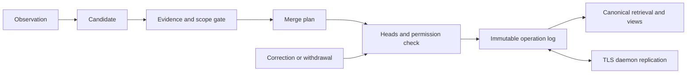

# Engram consolidation, forgetting and daemon sharing

[한국어](ENGRAM_MEMORY.ko.md) · [Documentation map](README.md)

Status: **target design for implementation handoff, 2026-09-11.** The requirements are to reduce repeated knowledge and share skills/memories between daemons. These contracts are targets, not completed behavior. Git is an optional export/audit mechanism.

## 0. First implementation scope, 2026-10-15

Automatic skill writes now require the host's `verified` outcome at the save boundary. Analyzer success or skill output cannot promote error/guard/unverified/ungated turns. Failed-turn lesson analysis remains enabled. This is a necessary gate, not proof that every proposed procedure in a successful turn was executed. Procedure-level evidence validation remains future work.

New Engram learnings create project-local managed projections at `managed/<object_id>.json`. Existing memories, skills, ledger files and human-authored material are not automatically imported. Linked ledger corrections update the same object revision. Skill undo, restoration and unused-skill archiving update its withdrawn/active/archived state. This grants no authority to delete independent team copies.

`port.ManagedExperienceStore` and Lua `magi.apply_experience` define the boundary. The host assigns owner/source from plugin identity. Non-project scope is rejected; an absent project store never widens scope. Random object/operation IDs and expected revisions identify writes. One atomic JSON file contains content, state and operation receipts. Replaying an operation after a lost acknowledgment creates neither a duplicate object nor another revision.

Plugin state `managed_experience_v1:<workdir>` persists identity links and pending requests before calls. User/turn events retry requests; failure of one object does not block unrelated ones. A flush makes at most eight calls. A 256-entry queue rejects new registration and logs that local reconciliation is needed. State conflicts are not overwritten. There is no separate idle retry worker.

Kernel file locks serialize plugin-state and managed-record writes and release on process death; lock files are not unlinked. Atomic replacement preserves complete files, and malformed stores are not overwritten. Compare-and-exchange protects identity/outbox updates against stale writers. Local Markdown and experience JSON are not one distributed transaction; partial failures remain pending or conflicted.

Saved skill-body and verification-script snapshots protect later human edits from automatic overwrite, undo and archiving. Conflicting undo preserves the human file and withdraws the automatic projection. Inventory lists managed records as `managed:<id>`; forgetting writes a tombstone. Stale plugin writes conflict after external withdrawal instead of reviving the object.

The first stage does not implement committed-only reads, legacy `git add .` cleanup, fleet replication, authorization freshness, passage receipts or final Lua/D13 deduplication. Operation-history retention also remains open. Old independent D13 copies are not automatically corrected or withdrawn. Section 1 preserves the pre-change review; sections 2 onward remain target contracts.

### 0.1. Korean retrieval without embeddings

`internal/core/lexical` provides NFKC normalization, lowercasing and CJK whole-word/bigram terms. CJK experience queries use BM25 (k1=1.2, b=0.75) multiplied by squared query-word coverage. A word's whole form and bigrams count as one coverage group. A regression covers long documents repeating a partial query and outranking more complete evidence. This weighting is a retrieval heuristic, not a general quality guarantee.

Project/team/global candidates are reranked over the complete visible union. Existing English substring ranking and optional embedding fusion remain. No new model, configuration or network call is added. Compacted-topic retrieval and hints in `internal/app/recall.go` also use normalized Unicode terms. Retrieval normalization does not change original content or object IDs.

Tests cover Korean inflections, decomposed Hangul, full-width Latin, mixed scripts, unrelated queries, repetitive distractors, cross-scope ranking, compacted context and existing English regressions. Morphology, synonyms, semantic negation and real-model task success are outside this validation. Larger frozen evaluation and heuristic calibration remain future work.

### 0.2. Separate load observations from the forgetting clock

`skill_usage` records load counts, verified-turn counts, and failed-turn counts. These observations do not prove application. Loading a skill no longer refreshes `skill_lastused`, even when the turn is verified. Existing dates remain unchanged; automatic skills without dates start their observation period at the first cleanup. Section 0.4 describes the implemented verification evidence that can now renew a managed skill’s local lifetime.

Section 0.3 below disables the former seven-day file-moving policy by default. Only an explicitly configured `/engram-prune-days` value enables legacy file moves. Set it to `0` to disable them.

### 0.3. Device-local cold state and archive candidates

Managed memories and skills owned by `plugin:engram` age from the first local observation of their content revision. After 30 days they become cold: ordinary retrieval and MCP `knows` rank them after active candidates. Cold entries fill slots left by active results. At 90 days they become archive candidates; this never automatically moves, withdraws, or deletes content. A new device or changed content revision gets a fresh observation period. Reads, loads, and repeated observations of unchanged content do not renew it.

Device state lives under the OS user config directory at `magi/experience-local/<absolute-store-path-hash>/<object_id>.json`, outside the Git-backed store and exp-sync inventory. File locks and atomic replacement protect concurrent local actions. Corrupt state is not overwritten. Clock rollback does not pull a future observation timestamp backward; its age remains below the cutoff during that interval.

Inventory entries include `retention`: observation time, content revision, pin, cold, archive-candidate, and locally archived status. `POST /retention` uses the existing Curate permission and published-project selection. Send `tier=project`, `name=managed:<object_id>`, the inventory's `retention.content_revision` as `revision`, and `action=pin|unpin|archive|restore`. The existing `d` socket selector identifies the project. An empty action reads status. Stale content revisions are rejected. Pinning prevents automatic demotion and candidate marking. Explicit local archiving removes the entry from automatic search while retaining inventory and source content. Restoration starts a new observation period; it cannot restore a withdrawn or archived source object.

This step covers the managed store and management API. The web knowledge screen now shows device-local state and observation dates, with pin/unpin/archive/restore controls. It disables the row actions during a request, displays failure reasons, and reloads inventory. Dedicated JetBrains/VS Code controls are now available through the project-only `knowledge` daemon capability. VS Code uses the command palette and status-panel menu; JetBrains uses the status panel’s management dialog. Both show protected/retention state and verification history, submit the displayed content revision, and reload after actions. Legacy entries remain read-only. Section 0.5 describes explicit registration of local legacy skill snapshots. Section 0.4 covers active-task protection and the supported verification evidence. This policy does not move human-authored or edited files. Explicit legacy file-moving settings remain effective; use `/engram-prune-days 0` to disable them.

### 0.4. Verification evidence and active-task protection

New automatic skills retain SHA-256 snapshots of their saved document and bundled `scripts/verify.sh`. After loading and applying a skill, the model is instructed to run the exact `bash -- '<absolute-script-path>'` command through the foreground Bash tool. The host checks both snapshots before and after execution, requires a successful process exit, and reads back the persisted tool result before recording an application receipt. Permission denial, cancellation, background execution, edited artifacts, command wrappers, or missing execution records do not count. Replaying the same receipt does not renew the clock again.

This proves successful execution of the unchanged verifier. It does not prove every procedure was followed or that the skill caused the task’s success. Engram creates a bundled script only for recognized shell verification longer than 200 characters; short or prose verification, older skills without snapshots, and native Office verification do not qualify. Retrieved memories gain protection but no verified-application renewal.

Loaded managed skills and explicitly recalled managed memories acquire a two-minute host lease, renewed every 30 seconds. A live lease prevents cold demotion and archive-candidate marking without refreshing age. Foreground completion releases its references; outstanding background tool jobs retain them until completion. Independent turns hold independent references. A process crash leaves protection only until lease expiry. Explicit user archiving and source withdrawal remain effective.

The web knowledge screen shows protection, successful verification count and last verification time. Reference identifiers and execution receipts stay in device-local metadata and are omitted from public inventory. Each object accepts at most 256 concurrent references and 4,096 deduplication receipts; exceeding a limit reports an error without silently dropping evidence. Native verifier adapters and causal application evidence for memories remain future work.


### 0.5. Explicit registration of legacy local skills

The IDE inventory lists workspace `.claude/skills/<name>/SKILL.md` files as import candidates, excluding already managed skills. **Register a managed copy** asks for confirmation and sends the reviewed document hash. If the file has changed, registration fails and the list reloads. Documents must be nonempty regular files of at most 256 KiB; rooted filesystem reads reject symlinks escaping the workspace.

Registration creates a `user:legacy-import` skill snapshot in the project experience store. It is pinned on its first local observation. The source file is never rewritten, moved or deleted, and no verification success or executable verification snapshot is invented. Identical retries reuse the publication and preserve later user pin/archive choices. A changed document cannot silently replace an existing managed copy. Correcting or reconciling those copies remains manual.

This is an explicit copy, not continuous synchronization. Archiving the managed copy removes it from shared-experience retrieval; the original local skill remains available to the local skill loader. Team/global legacy stores, attachment migration and automatic reconciliation of subsequent human edits are outside this first registration path.

## 1. Implementation review

| Evidence | Current behavior | Gap |
|---|---|---|
| [engram](../plugins/engram/init.lua) | Writes ledger lessons, local skills and D13 copies separately. Includes token deduplication, row-number correction and default seven-day unused-skill archiving. | Correction, cancellation and forgetting do not cover every copy. |
| [Experience store](../internal/adapter/experience/git/store.go) | Content-based memory names, optional cosine deduplication (default 0.93), same-name skill replacement. | Similarity does not prove identity. Replacement loses the previous body; concurrent writes can lose observation counts. |
| [Layers](../internal/adapter/experience/layered/store.go) | Combined project/team/global retrieval capped at five memories and three skills; optional embedding search. | Needs a token budget, canonical-ID deduplication and Unicode search. Default git-store tokenization retains ASCII only and can miss Korean queries. |
| [exp-sync](../cmd/magi/expsync.go) | TLS replication between admitted machines, using set union for team memories/wiki revisions every five minutes; path/content checks. | Does not replicate skills or memory withdrawal. Teams are not currently tenant authorization boundaries. |
| [Wiki](../internal/adapter/experience/git/wiki.go) | Immutable revisions determine current pages; local usage affects retrieval retirement. | Reuse its storage/replication foundation, but chronological winner selection does not resolve semantic conflicts. |

**Priority defects:** engram analyzes guard/error/unverified turns and saves a returned skill without rechecking host outcome. Cancellation and seven-day archiving change only local files, leaving D13 skills retrievable. Ledger correction does not withdraw old D13 memories. Physically deleted shared memories can return through another machine's exp-sync. Establish these four paths as regression cases before migration.

Targeted experience-store/Lua tests matching Engram/Experience/Skill/Memory/Retrieve/Propose passed during this review. These findings come from code paths, not a multi-user deployment test. The existing README's “review queue” description also disagrees with immediate storage.

## 2. Responsibilities and authority

Engram **observes and extracts candidates**. The core experience service is the **single writer for identity, consolidation, state and retrieval**. The fleet door handles **authentication, authorization and replication**. Clients use the same inventory/correction/withdrawal API. Do not create a separate knowledge-maintenance system for each workspace daemon.

The installation's experience service coordinates short per-store write locks. Implement it as a module in existing Go processes, without requiring another installed service. Local recording/retrieval works without the fleet door; sharing waits. Do not hold storage locks during analysis, embedding or network calls.

Versioned knowledge objects and immutable operations are authoritative. SESSION_SUMMARY.md, SKILL.md and wiki pages become generated **views**. Detect human edits by file hash and import them as revision candidates; generators must not overwrite them. Preserve unmanaged file regions. Do not independently recreate one observation in both local and shared stores.



## 3. Data contract

| Field | Meaning |
|---|---|
| namespace_id, object_id | Sharing-space UUID and knowledge UUID, stable across renames, paraphrases and file moves. |
| kind | lesson, fact or procedure. Wiki pages may assemble related objects. |
| revision_id, parents[] | SHA-256 of the canonical full payload and parent revisions. Hash state, scope and evidence as well as body. |
| claim, applies_when, excludes, procedure, verification | Assertion, applicability, exclusions, steps and checks. OS/product/version/project constraints participate in consolidation. |
| evidence[] | observation_id, source turn/session reference, host outcome, observation time and contributor. Do not share raw chats or secrets by default. |
| state, pinned, authored_by, visibility | active/conflicted/superseded/withdrawn, retention pin, human/automatic authorship and explicit read/write policy. Local archiving is separate. |
| aliases[], supersedes[], derived_from[] | Canonical duplicate links, corrections and provenance across scopes. Copy with provenance rather than merging across scopes. |
| operation_id, actor_id, expected_heads[], reason | Retry deduplication, authenticated contributor, concurrency check and change reason. |

Identical content may have additional independent evidence. Replaying an observation_id must not increase usage/success counts. Track retrieval, loading, application and verified success separately. A successful turn that loaded a skill does not by itself prove the skill caused success.

Operations are propose, reinforce, merge, correct, withdraw and restore. Every change records actor, reason and parents. Hide/pin preferences replicate only to personal devices through the recovery log; automatic archiving remains device-local (§3.3). Automatic widening of visibility is prohibited.

Proposed host ports are `Propose(observation)`, `PlanMerge(ids, heads)`, `Apply(plan, expectedHeadsById)`, `Withdraw(id, heads, reason)` and `Recall(query, principal, budget)`. Return operation_id, current heads, local completion and propagation state. Distinguish stale-head, permission-denied, evidence-rejected and pending-dependencies instead of reporting success. These are proposed interfaces.

### 3.1 Storage layout and file responsibilities

**Use a local JSON operation log, SQLite indexes and Markdown views.** Start without an external vector database or Git server. Store all authoritative namespaces beneath the platform-resolved existing `<config>` directory. Workspaces contain namespace bindings and explicitly exported views, reducing accidental Git publication of private generated knowledge.

```text
<config>/knowledge/v2/
  namespaces/<namespace-uuid>/
    manifest.json
    operations/<sha256-prefix>/<operation-sha256>.json
    blobs/<sha256-prefix>/<blob-sha256>
    snapshots/<snapshot-sha256>.json
    quarantine/
    incoming/
    views/objects/<object-uuid>.md
  private/<user-id>/operations/
  local/
    state.sqlite
    index.sqlite
    locks/<namespace-uuid>.lock
<workspace>/.magi/knowledge.json
<workspace>/.claude/skills/<slug>/SKILL.md
<workspace>/SESSION_SUMMARY.md
```

| Location | Contents and replication |
|---|---|
| manifest.json | Rebuildable namespace/schema/current-policy-head view. Signed policy operations are authoritative; editing this file cannot grant access. |
| operations/ | Immutable JSON change transactions. Authoritative and replicated to authorized peers, including corrections and withdrawals. |
| blobs/ | Hashed chunks for bodies/attachments too large for a 64 KiB operation. Replicate only referenced chunks with the operation's ACL. No automatic raw-chat attachments. |
| snapshots/ | Verifiable heads/state checkpoints over a specified operation set. Do not replace/delete the log before retention requirements are met. |
| quarantine/, incoming/ | Unverified files and incomplete batches. Exclude from retrieval, views and forwarding. |
| views/ | Object-ID Markdown for people; rebuildable from the log. |
| local/state.sqlite | Local pins, hiding, actual-use timestamps, import manifest and sync acknowledgments. Do not replicate the database file. Recover the private hide/pin log across personal devices; back up device observations locally (§3.3). |
| local/index.sqlite | Current objects, search tokens/n-grams and embedding cache. Rebuildable and not replicated. |
| .magi/knowledge.json | Workspace→project namespace UUID and connected team namespace UUIDs. Contains no credentials; received bindings do not authorize access. |

Project/team/global become namespace scopes and bindings rather than authoritative directory tiers. Receiving a project binding through Git still requires namespace admission. Each OS user has their own config and local databases. Other users/devices communicate through daemon APIs rather than opening shared database files.

SQLite is **local-disk only**. Do not share a WAL database over a network filesystem. Following the [SQLite WAL documentation](https://www.sqlite.org/wal.html), network workspaces keep logs/databases in local config and only export views into the workspace. exp-sync does not replicate database files.

**CGO-free is mandatory; `modernc.org/sqlite` is the driver adoption candidate.** [.goreleaser.yaml](../.goreleaser.yaml) specifies `CGO_ENABLED=0` and all six darwin/linux/windows × amd64/arm64 combinations, with no ignores. Work package A first builds and runs **windows/arm64**, checking database opening, FTS5 and recovery, then validates the other five combinations before finalizing the driver/libc versions. Candidate selection does not establish six-target support. A failure blocks adoption and requires design review; do not enable CGO or remove targets.

The driver-introduction commit must regenerate [THIRD_PARTY_LICENSES](../THIRD_PARTY_LICENSES) through `make licenses`. The [generator](../scripts/gen_licenses.sh) uses `go list -deps ./cmd/magi`; compare attribution against actual module dependencies for all six targets instead of trusting the host result alone. If dependencies differ, update generation to cover their union. M11 also checks that the release archive includes the regenerated file.

### 3.2 Concrete JSON and local database shape

This is a **shape example**, with placeholder UUIDs, hashes and signatures. A verified outcome is accepted only when supplied and validated by the host.

```json
{
  "schema": "magi.knowledge.operation.v2",
  "operation_id": "<UUID>",
  "namespace_id": "<namespace-UUID>",
  "actor_id": "<registered-key-ID>",
  "type": "propose",
  "parents": [],
  "expected_heads": {},
  "changes": [
    {
      "object_id": "<object-UUID>",
      "kind": "procedure",
      "state": "active",
      "claim": "Wait for a feature probe with a bounded deadline before reading its output.",
      "applies_when": {
        "os": [
          "windows",
          "macos",
          "linux"
        ],
        "component": "core-feature-probe",
        "version_range": null
      },
      "excludes": [
        "interactive child process"
      ],
      "procedure": [
        "Start the probe.",
        "Bound its completion time.",
        "Read the completed output."
      ],
      "verification": [
        "A silent probe returns within the deadline."
      ],
      "evidence": [
        {
          "observation_id": "<stable-observation-UUID>",
          "outcome": "verified",
          "source_ref": "<opaque-source-ID>",
          "observed_at": "2026-09-11T00:00:00Z"
        }
      ],
      "visibility": {
        "policy_id": "<namespace-policy-ID>",
        "policy_revision": "<policy-hash>"
      },
      "authored_by": "automatic",
      "derived_from": []
    }
  ],
  "reason": "verified observation",
  "signature": {
    "algorithm": "<negotiated-algorithm>",
    "key_id": "<registered-key-ID>",
    "value": "<signature>"
  }
}
```

The operation filename hash is SHA-256 of canonical full-payload bytes excluding `signature`; sign those same bytes. JSON is UTF-8, rejects duplicate keys, sorts object keys and allows integers only; schema-defined strings represent large numbers. Sort set fields such as parents/target IDs, but preserve meaningful order such as procedure steps. Do not normalize string content during hashing. Share golden serialization-byte fixtures across Go and every producer.

An object revision_id hashes its changes entry and that object's parent revisions. operation_id is a UUID retained on retries, distinct from the file hash. Reinforce operations add new observations instead of copying all historical evidence into every revision. Views show aggregates and source pointers.

The initial logical `index.sqlite` schema follows. Every key/query includes namespace_id because the database contains multiple namespaces.

| Table | Main columns and constraints |
|---|---|
| objects | (namespace_id, object_id) PK; heads_digest, kind, state, policy_id, current_payload, exact_fingerprint |
| aliases | (namespace_id, alias_id) PK; canonical_id. Reject cycles on receipt/application. |
| evidence | (namespace_id, canonical_object_id, observation_id) UNIQUE; source_ref, outcome; evidence_sources (§3.3) |
| search_text | FTS5 over claim/conditions/procedure/verification. |
| search_grams | namespace_id, object_id, field, gram, count; short Korean queries and identifier-fragment candidate search. |
| embeddings | (namespace_id, object_id, revision_id, model_digest, dimensions, input_digest) PK; float32 vector |
| indexed_operations | (namespace_id, operation_hash) PK; replay missing operations after restart. |

Distinguish commit acknowledgment from indexing completion. Read-after-write waits for that operation's indexing or uses a log overlay. Apply ACL/withdrawal changes immediately in final state/permission checks even before indexing catches up.

### 3.3 Personal-state recovery and merged evidence

**Hiding is user intent; usage time is a device observation.** Separate them. Default hide/pin/explicit-unhide actions become private preference operations, encrypted and replicated only to the user's admitted devices, never to the team. Automatic cold/archive status, usage time and sync cursors remain device-local. An explicit “hide on this device only” option must explain that it does not migrate.

`state.sqlite` contains the local projection of private preference operations and device observations. Store the private log at `<config>/knowledge/v2/private/<user-id>/operations/`, separate from shared namespaces. Preferences reference namespace_id/original object_id and follow merge aliases. Never combine different users' preferences. Concurrent hide/unhide by one user favors hide; explicit unhide names the observed hide operations as parents.

On a new device/reinstall, recover the preference log and recovery keys from an admitted personal device or encrypted backup, rebuild the database, then enable automatic shared-knowledge recall. Until recovery completes, show `preferences-unavailable` and suspend only automatic injection of shared knowledge. An empty database does not mean “nothing hidden.” If all devices, backups and keys are lost, report unrecoverability and require explicit personal-state reset before resuming. First enrollment also explicitly records fresh-state creation. Database loss must not silently unhide content.

**Resolve evidence keys through canonical identity.** Merging A and B into C aggregates the union of `(namespace_id, canonical_object_id, observation_id)`, counting each observation once. X,Y on A and Y,Z on B yield three observations on C. Preserve source-object/revision links in a separate `evidence_sources` table. Conflicting outcome/source payloads under one observation_id become evidence conflicts, not overwrites or successes. Update aliases and evidence projections in one index transaction; replay and repeated merges must not inflate counts.

## 4. Consolidation rules

1. Narrow by authorized scope/ACL and retain kind/applicability for comparison. Matching team names do not establish namespace identity.
2. Find at most 20 candidates using Unicode normalization/token search and optional embeddings. Korean/English lexical retrieval and exact deduplication must work without an embedding service.
3. Repeated observation_id is a no-op. Exact semantic-field matches reinforce the canonical object. Exclude source/time from content equality while preserving them as evidence.
4. Similar records receive an analyzer proposal: duplicate/refinement/contradiction/related/independent, with supporting spans. Never delete or overwrite based solely on a score such as 0.93.
5. Automatic consolidation is limited to automatically authored objects in the same namespace/ACL whose claims, conditions, commands and verification steps are identical; only evidence is added. Summarizing away unique conditions, human-edited/pinned objects and differing ACLs require review.
6. Corrections name an existing ID and expected_heads. “A fails on Windows” and “A succeeds on Linux” are conditional knowledge, not duplicates. Contradictions under the same conditions become conflicted, preserving both sources. Neither similarity nor a recent timestamp decides truth.
7. Recheck heads immediately before applying. Recompute against changes, at most three attempts, then defer. Plans expire after ten minutes; manual approval must also show a current diff.

One merge operation contains the resulting revision and the originals' superseded links. Retrieval returns each canonical object once. The first release proposes semantic-summary merges without automatically applying them. Expand automation only after evaluating human-labeled cases.

### 4.1 Similarity pipeline

**Use exact fingerprints, BM25/character n-gram/embedding candidate retrieval, structural comparison, then model-proposed relationships.** Only exact equivalence enables automatic consolidation. Embeddings are optional candidate discovery, never sufficient reason to discard a memory.

| Stage | Method | Initial parameters/result |
|---|---|---|
| Normalize | NFC, whitespace cleanup and English case-folding for natural-language search; retain originals. Preserve code, commands, paths, versions, numbers and negation. | Version normalization rules. Do not alter code through NFKC or remove negation as stopwords. |
| Exact comparison | SHA-256 over conservatively normalized JSON containing kind, claim, applicability/exclusions, procedure, verification and visibility. Do not case-fold natural language or substitute synonyms for this fingerprint. | Within the same namespace/ACL, matching fingerprints plus semantic-field equality reinforce evidence only. |
| Lexical candidates | FTS5 unicode61 BM25 over claim/conditions/procedure/verification, initially weighted 5/3/2/2. | Top 40; preserve exact identifier/error-code matches separately. |
| Korean/substring candidates | Unicode character 2-gram/3-gram inverted index, weighted Jaccard; tokenize numbers and identifiers separately too. | Top 40; support Korean suffix variations and two-character queries without an initial morphological-analyzer dependency. |
| Semantic candidates | Existing Embedder with a fixed conditions/claim/procedure/verification template; cosine over normalized float32 vectors. | Top 40 from the same model/dimensions/template. Fall back to lexical retrieval on failure. |
| Rank fusion | RRF: add `Σ 1/(60 + rank)`, starting ranks at one. | Do not add raw BM25/Jaccard/cosine scores. Send the merged top 20 to structural comparison. |
| Relationship | Analyze condition/command/verification diffs and source spans. | equivalent/refinement/contradiction/related/independent/uncertain. Missing conditions or evidence mean uncertain. |

[Official FTS5 documentation](https://www.sqlite.org/fts5.html) establishes unicode61 tokenization and BM25 support. Do not assume unicode61 alone handles Korean suffixes or two-character queries; retain the n-gram path. Weights, candidate counts and RRF constants above are initial project design values, not measured optima.

Applicability helps classify relationships. Do not exclude every relevant counterexample merely because its OS differs. **Filter authorization before search**; use kind/conditions to decide exact-merge eligibility and candidate relationships. Even within a namespace, do not send unauthorized bodies/embeddings to the relationship analyzer.

Weighted Jaccard is `Σ min(wA,wB) / Σ max(wA,wB)` over gram weights. Weight rare grams through IDF. Handle one-character queries through an explicitly bounded short-query path, not an unlimited scan. Preserve command-flag, numeric and prohibition/permission differences in structural diffs despite similar n-grams.

Initially use **exact cosine scans** over active/cold vectors allowed by namespace/ACL. Raw storage for 10,000 768-dimensional float32 vectors is about 30.7 MB, excluding metadata. Introduce ANN only if the actual corpus misses M09, measuring candidate recall against exact search. Cache by revision/model/template hashes instead of re-embedding all content. Dimension 768 is a sizing example, not a model contract.

### 4.2 Final decisions and tuning

Return `relation, target_ids, compared_heads, matched_spans, unique_conditions, contradictory_spans, proposed_changes, reason`. Model confidence is diagnostic and grants no automatic-application authority. The earlier §4 label duplicate means equivalent in this contract.

| Observation | Decision |
|---|---|
| Same content, conditions and commands in different turns | Reinforce with independent observations, without increasing canonical count. |
| Same purpose, more detailed commands | Refinement proposal; retain existing content pending approval of the unique-step diff. |
| “Finishes within five seconds” / “Five seconds is insufficient” | Contradiction under the same environment; uncertain if environment information is missing. |
| Same lesson in Korean and English | Discover through embeddings or multilingual candidates, then propose equivalence. No automatic semantic merge in the first release. |
| Same tool, different problem | Related; retain separate canonical objects. |

Before release, label at least 200 pairs: 40 each for exact duplicates, paraphrases, counterexamples, added conditions and independent cases. Include Korean/English, negation, OS/version/numeric/command differences. Split train/dev/test by task/source so paraphrases of one incident do not leak across splits. Initial candidate recall@20 target is 95%; separately report per-class relationship precision/recall and unique-condition loss.

Enable automatic application only for exact comparison, requiring zero false merges on its counterexample fixtures. Passing 200 pairs does not guarantee future correctness. Reevaluate a fixed holdout after model/template/normalization/weight changes. Improve candidate counts or lexical processing when recall is low; do not loosen semantic decisions simply to eliminate more duplicates at the cost of lost knowledge.

### Example

Twelve paraphrases of “install dependencies before testing” become one candidate group. Compare version-specific commands and failure conditions. Equivalent entries yield one canonical object and twelve independent observations. “Skip installation offline” adds a condition and must not be dropped. “Installation damaged project files” is counterevidence, not another success count.

## 5. Forgetting and recall

**Forgetting first means removal from automatic recall.** Distinguish it from withdrawing incorrect content and permanently deleting stored data.

| Object | Default policy: initial values to validate |
|---|---|
| Duplicates/superseded revisions | Link to the canonical revision and immediately exclude from automatic recall. History and restoration remain available. |
| Automatically authored, unused objects | Cold after 30 days without actual application; local archive candidates after 90 days. Replaces seven-day automatic skill moves. |
| Human edits, pins, active-task references | Exempt from automatic archiving; may receive a review reminder. |
| Version-expired facts | Mark expired and exclude by default; revalidate when needed. Missing dates do not imply permanent truth. |
| Conflicted/withdrawn | Conflicts return both sources with a warning. Withdrawn objects are excluded except from explicit audit queries. |
| Permanent deletion | Disabled by default. Requires an explicit namespace-admin action, replication acknowledgments and retention policy. |

Cold/archive are local usage decisions and must not withdraw knowledge another user needs. A newly joined device gets a 30-day observation window instead of immediately archiving old shared objects. Explicit restoration or verified actual use returns local state to active. Search exposure alone does not refresh age.

Default automatic recall returns at most five canonical memories and three skills within 3,000 tokens total. Deduplicate local/team copies and generated views through provenance. Oversized objects return a summary pointer retaining conditions/source, with explicit full retrieval. Archives require explicit queries; cold objects are a fallback when active results are insufficient. Do not summarize across incompatible ACLs.

## 6. Consistent cancellation, archiving and deletion

Save notifications identify object_id, revision_id and operation_id. Cancellation is a compensating operation. If another contributor has edited meanwhile, propose a revert diff instead of restoring an old file. Engram's short N cancellation window uses this same API.

After sharing, cancellation propagates withdrawal to the original, managed views, retrieval indexes and authorized replicas. Independently copied objects in another scope receive a source-withdrawal warning; do not delete them without authority. Tombstones suppress retransmitted old revisions. Restoration requires an authorized explicit operation naming the current tombstone as parent.

Do not promise physical erasure of peer copies or external backups. Show local completion, pending propagation and acknowledged-device count separately. Retain deletion tombstones until all admitted replicas acknowledge or unresponsive devices are revoked. Rejoining revoked devices must bootstrap from a current snapshot. Git exports are outside deletion-propagation guarantees.

### 6.1 Log retention, compaction and body deletion

Initial policy: **retain active canonical content/evidence; superseded bodies become compaction candidates after 90 days; withdrawn bodies become deletion candidates after a 30-day recovery window.** Cold/archive alone does not delete originals. Actual body GC requires namespace-admin policy activation; the default shows candidates and reclaimable size only. Explicit permanent deletion may skip the grace period, never authorization or replica acknowledgment. Distinguish withdrawal (immediate recall exclusion) from completed body deletion.

GC creates an admin-signed checkpoint containing active objects, required evidence, aliases, minimal tombstones, the covered operation-set Merkle root, deletion hashes and replication epoch. Commit only after all admitted replicas durably acknowledge it or an administrator revokes unresponsive devices. Elapsed time is not acknowledgment. Validate pre-checkpoint parents through its certified operation set without requesting old bodies. New/rejoining revoked devices bootstrap from the current checkpoint and cannot reintroduce earlier-epoch operations.

**Offline replicas deliberately delay GC by default.** A laptop offline for a month can block body GC for at least that month. The 30/90-day intervals establish eligibility, not deletion-completion deadlines. Never revoke admitted devices automatically based on age. An administrator may need to restore connectivity or explicitly revoke a device. Before revocation, explain possible loss of unsynced changes and mandatory bootstrap from the current checkpoint on rejoining.

The GC view shows blocking devices, last contact, checkpoint acknowledgment time, pending body size and the reason for waiting. Send a first administrator reminder after seven days, then a weekly consolidated reminder; reminders never revoke devices or reduce quorum. Storage pressure does not force GC: pause new learning records at quota and report it, while preserving reads, withdrawals and recovery.

After durably committing the checkpoint, remove targeted operation files, unreferenced blobs, old snapshots, generated views, embeddings and indexed bodies. **Never redact signed operations in place.** If a file also contains active objects, preserve their necessary state in the checkpoint before deleting the whole file. The checkpoint must not retain targeted bodies either. A staged GC journal resumes cleanup after interruption and prevents reindexing deleted material. Test local SQLite cleanup including WAL/freelist storage; ordinary deletion is not an SSD forensic-erasure guarantee.

Keep minimal resurrection-prevention tombstones (object_id, withdrawal operation ID, epoch and authorization proof) without default expiration. Retain no original body, summary or sensitive reason. Restoration requiring old bodies is unavailable after grace-period expiry; earlier restoration guarantees apply only to retained revisions. Managed backups have a maximum 30-day rolling retention, and restoration applies the latest GC manifest before serving content. Show deletion as “live-store cleanup complete / managed-backup expiry pending / unverified external copies.” External exports and unauthorized copies are outside erasure guarantees.

## 7. Daemon sharing

Reuse the TLS fleet door and device identity with an experience-v2 capability. Notify on changes, transfer batches and retain five-minute anti-entropy for repair. Local writes finish offline; sharing remains pending.

**Multiple users:** Do not reuse “my admitted machine may access every team” for another user's invitation. A namespace administrator grants read/contribute/curate/admin to user/device keys. Show invitation scope on acceptance and verify registered keys and operation signatures. An actor string supplied by the caller is not identity. Contributions stay within grants; semantic edits to existing knowledge and shared withdrawal require curate or above. Revoke new sync/write access when keys are revoked; do not promise erasure of existing copies.

Sign the complete operation and validate SHA-256, schema, size, parents and ACL. Quarantine incoming content before retrieval; unverified objects never enter model context. External-memory instructions remain lower-trust data than user/system instructions. Before sharing, scan for secrets and minimize provenance; suspicious items remain private locally. Detection is not guaranteed complete.

Replicate immutable operation sets. Exchange heads and missing operation_ids; retries are idempotent. Derive current state from the DAG so equal sets produce equal results regardless of delivery order. Independent evidence combines, concurrent semantic edits conflict, and merges wait for parents. A fast clock does not win. Quarantine cyclic aliases/missing parents and request dependencies.

For concurrent withdrawal and editing, suppress automatic recall while retaining the edit in conflict history. Restoration resolves only tombstones it names; an unseen withdrawal keeps the object inactive. Automatic maintenance uses narrowly delegated namespace permissions, and user cancellation also checks authorization and current heads.

Initial limits: 4 MiB requests, 2 MiB responses, 64 KiB operations and 400 operations per batch. Chunk large bodies by hash and expose them only after every chunk verifies. Use per-namespace cursors, backpressure and retry jitter. Never send unreadable content to an embedding service.

Do not export v2-managed objects to v1 peers. Bidirectional sharing with tombstone-unaware peers resurrects deleted content. Show upgrade-required state; manual export is separate. The default acceptance path is create→retrieve→correct→withdraw on two machines with no Git.

## 8. Storage, concurrency and recovery

Under a namespace lock, check expected_heads, write a temporary operation file, fsync, atomically rename and ensure directory durability. A multi-object merge still has one operation file as its visibility boundary. Reuse platform-correct atomic-file support and test Windows locking/replacement behavior on the actual OS.

Build indexes and view files after commit; both are rebuildable from authoritative operations. Embedding caches include model, dimensions and content hash. State/ACL changes invalidate retrieval caches, and final return rechecks permission and state.

The analyzer cannot verify a turn. Automatic procedure promotion requires the host's verified outcome and traceable evidence. guard/error/unverified/ungated must not become active procedures merely because the model says success. Record manual authorship/approval separately. Preserve observations on analysis failure and retry; do not label failure as “no duplicates” or “merge completed.”

Initial maintenance limits are one worker per namespace per installation, batches of 100 objects, at most 20 analyzed pairs and 60 seconds per run. Schedule daily by default; queues must not block chat work. Resume by operation_id without learning the same observation twice. Raw-session retention and learned-object retention are separate settings.

## 9. Migration, ownership and acceptance

Start with dry-run. Snapshot source hashes/provenance from ledger, skills, D13 and wiki, recording path→object_id→revision in an import manifest. Allocate IDs on first import and share that manifest rather than issuing fresh IDs on each device. Reconcile independently imported objects as exact-duplicate candidates. Preserve human edits; uncertain provenance/verification is unknown.

Unify readers before ending engram's multiple writes. Use the manifest to prevent generated legacy files from being imported as new knowledge. Block legacy writers for v2-enabled namespaces. Rollback preserves v2 read-only and uses explicit export; automatic downgrade that discards tombstones is prohibited.

| Work | Owned modules and deliverables | Depends on |
|---|---|---|
| A | Ports/experience service: object/operation schema, atomic storage, heads/ACL/outcome gate | None |
| B | Engram/Lua bridge: observation IDs, single propose, correction/cancellation/forgetting API | A |
| C | Retrieval/consolidation: Unicode, candidate decisions, provenance deduplication, budgets, dry-run report | A |
| D | Fleet door/identity: namespace grants, v2 operations/tombstones, offline repair | A |
| E | Console: merge diff, evidence, scope, conflicts, restore, propagation status, human-edit import | A–D |
| F | Migration/live QA: legacy data, multiple processes, Windows/macOS/Linux acceptance | A–E |

| Case | Required result |
|---|---|
| M01 Repeated learning | Replaying one observation 100 times creates one evidence entry. Twenty independent equivalent observations yield one canonical object and twenty evidence entries. |
| M02 Conditions/conflicts | Korean/English synonyms, negation and OS/version differences do not silently lose distinct claims. |
| M03 False success | Injecting skill JSON into guard/error analysis cannot activate a procedure. |
| M04 Cancellation/correction | After save→D13 recall→cancel/correct, managed views and subsequent recall exclude the old revision. |
| M05 Offline | A withdraws while B edits offline; reconnect, reordered and duplicated delivery cannot resurrect the object, while conflict evidence survives. |
| M06 Forgetting | Loading alone does not extend lifetime. Pins, human edits and another user's activity are not automatically withdrawn. |
| M07 Races/crashes | Concurrent merge/cancel and termination at every commit boundary recover to one canonical state or an explicit conflict. |
| M08 Authorization | Reject wrong namespace, forged actor, revoked key, ACL escalation, malicious paths and modified hashes. Old peers cannot bypass tombstones. |
| M09 Scale | Initial target: warm local candidate search p95 200 ms for 10,000 objects. Report remote embedding time separately and enforce the 3,000-token recall budget. |
| M10 Migration | Repeated imports, regenerated views, human edits and rollback preserve content/provenance without relearning duplicates. |
| M11 Release | Validate windows/arm64 first, then all six CGO_ENABLED=0 builds and SQLite/FTS5/recovery execution; verify union-of-target dependency attribution and archived THIRD_PARTY_LICENSES. |
| M12 Personal recovery | Database loss, new devices, reinstall and lost keys never silently unhide knowledge; resume automatic shared recall only after recovery or explicit reset. |
| M13 Body GC | Verify retention and non-resurrection across grace expiry, unresponsive/revoked/rejoining peers, crashes at GC boundaries and database/WAL/backup restoration. |
| M14 Merged evidence | A={X,Y}, B={Y,Z} yields three observations after merge/replay/remerge; conflicting evidence payloads under one ID remain conflicts. |

Release reports include canonical/duplicate/conflict counts, incorrect automatic merges, post-withdrawal reappearance, scope leaks, retrieval misses and propagation latency. Fewer sentences alone do not establish success. M01–M08 and M10–M14 are mandatory; report hardware, model and corpus for M09 performance.


## 10. Implementer review incorporated (2026-09-12)

Incorporated review `4d58fee3`. Personal-state recovery, log retention and merged evidence are addressed by §3.3, §6.1 and M12–M14. Driver adoption now starts with windows/arm64 validation; attribution regeneration is required by §3.1/M11. Section 6.1 explicitly permits offline-device GC delays until administrator action and specifies reminders and capacity handling. Actual driver adoption and acceptance tests remain outstanding.

## 11. Memory upgrade design (2026-11-07)

The next steps below come from reading the oh-my-openagent memory implementation (HEAD `38bf4f81c8`), its code and its prompts, and comparing it with the current implementation. As of 2026-11-07 the chunked ranking, the similarity floor (`embed_min_similarity`), best-chunk excerpt injection, the background index and the query time budget of §11.3, the local-server connection of §11.2 (detect and connect only), and the excerpt tone filter of §11.3, are implemented; the rest is design. The other project's features were not run, so their effect is unconfirmed. The similarity floor and `/v1/embeddings` compatibility were measured (§11.6). The floor was set to 0.5 (provisional) rather than the planned 0.65; 150ms, 4 turns and 25 turns are still assumptions.

Out of scope: judging whether a recalled memory was useful (their telemetry model judge), people cards, soul files and the save nudge.

**Proposed names**: `engram_dream` (tool) and `context_compacted` (plugin event) in this section do not exist in the source yet (0 matches in `cmd`, `internal` and `plugins` on 2026-11-07). `embed_min_similarity` is now implemented in `internal/config/config.go`. `[plugins.engram] embed_url` and `embed_model` and `/engram-embed` were implemented in `plugins/engram/init.lua` on 2026-11-08. They are names to be created during implementation and may change. The other identifiers cited here, `ApplyExperience`, `newEmbedder`, `bridgeSpawn`, `volatileContext`, `Fuse`, `sidecar_model` and `analyze_and_record`, exist in the current source.

### 11.1 Storage tiers and classification

Measured on the current store (`.magi/experience`): 42 managed memories and 25 managed skills, 12 legacy `memories/*.md` and 7 `skills/*.md`. A managed memory is `{ID, Tags, Text}`; all 42 have `Tags` null and `ID` empty. The only classification is a prefix such as `[구현]` at the start of `Text`. Bodies have a median of 930 characters and a maximum of 1,963. There is no one-line summary, so recall shows the whole body. Legacy files use a `리팩터링` category that managed records never use, so the vocabulary does not match either.

The other project splits memory by what it costs to show (the Visibility section of `dream-persona.md`). The same rule applies here.

| Tier | Content | What enters the context |
|---|---|---|
| Core | User instructions and preferences, repository conventions, confirmed (observed) key lessons | Added once at session start and held at that revision for the session. Over budget, dream trims it to 80% |
| Reference | fact, lesson and pitfall notes | Only an excerpt of the matching chunk |
| Skill | Skills | Name and description, plus body chunks when relevant |
| Episode | The raw conversation | Not copied into memory. Only an evidence pointer is kept |

Classification has two axes. `kind` is exactly one value and decides the tier and the recall policy (lesson / fact / procedure / preference / pitfall). `areas[]` takes several values from a fixed vocabulary (구현 / 디버깅 / 분석 / 설정 / 리팩터링 / 문서).

Managed memories gain optional fields. `Text` stays, so existing JSON still reads.

```
description (at most 200 chars, required) · kind · areas[] · tier (core|reference)
status: hypothesis | observed | conflicted | disconfirmed
valid_until · evidence[]{session#turn, commit, outcome} · links[] (canonical for corrections and duplicates)
```

Recording follows the Extract filter of the other project's reflection prompt. The conversation is already searchable, so it is not recorded again. One-off details such as line numbers, error strings and temporary paths are dropped, and relative dates become absolute. Contradictions keep both sides and are marked `conflicted`. Instructions the user states directly and `remember` calls start as `observed`; candidates a model extracts start as `hypothesis`.

**Implementation (2026-11-08)**: `port.Memory` gained `Description`, `Kind`, `Areas`, `Tier`, `Status`, `ValidUntil`, `Evidence` and `Links`, all with `omitempty` (`internal/port/port.go`). The existing 67 managed JSON files are not rewritten on disk; `EffectiveDescription` (200-rune cap), `EffectiveKind`, `EffectiveAreas`, `EffectiveTier`, `EffectiveStatus` and `IsExpired` infer defaults at read time (`internal/port/managed_experience.go`), keeping existing file bytes and operation digests unchanged. The Lua bridge exposes `magi.search_experience` and passes the extended fields through `magi.apply_experience` (`internal/adapter/plugin/lua/bridge_managed_experience.go`).

### 11.2 Local embedding server

When the engram plugin starts (`startup`) it prepares a local embedding server. The model is bge-m3.

1. If `embed_url` is set, that server is used. This is the path for a user who already runs one. A non-loopback address shows a one-time warning that memory text will be sent to it.
2. Otherwise the container runtime (docker, else podman) is chosen and its **server architecture** (`Server.Arch` from `docker version`) picks the image in one step. The host `uname` is not the criterion; the VM that actually runs the container is. There is no try-the-next-one fallback.

| Server architecture | Image | Basis |
|---|---|---|
| amd64 | TEI `cpu-1.9.4` + `BAAI/bge-m3` (pinned revision) | Same as the other project's Engram server (`servers/engram/deploy/docker-compose.yml`) |
| arm64 | `ollama/ollama` + `bge-m3` | The TEI CPU images (`cpu-1.9.4`, `cpu-latest`) list only amd64 in their manifests; `ollama/ollama` has arm64 (`docker manifest inspect`, 2026-11-07) |

3. The image is derived from the architecture on every start. The recorded `embed_image` is not trusted, because earlier builds recorded `ollama/ollama` on every architecture. A running or stopped `magi-engram-embed` with a different image is reused until `/engram-embed reselect` removes it (the volume stays), and `/engram-embed start` then creates the new one. If the image does not start, no other image is tried: the cause is shown and recall stays lexical.
4. The container binds only to `127.0.0.1` under a fixed name. Several magi processes share it, so start-up runs under a file lock and an existing container is reused. A shared lease map (`embed_leases_v1`) tracks them, and the last one to shut down stops the container.
5. Project, team and global memories are all embedded by this local server. The other project's Engram server embeds with TEI on the server and stores vectors in pgvector; here only text is shared and each device makes its own vectors, so team memories written by other people do not leave the machine.

Four constraints must be fixed before implementation.

- The engram manifest has only `permissions = ["fs:read", "fs:write"]` (`plugins/engram/plugin.toml`). It needs permission to run docker or podman and to make local HTTP calls.
- `magi.exec` stops a command at 60 seconds. bge-m3 is 1.2GB on Ollama, so the container starts with `run -d`, the model download is requested asynchronously and only its status is polled.
- The Go embedding client is built once at start-up (`newEmbedder` in `cmd/magi/main.go`). The plugin `startup` hook runs after that, so a bridge is needed to hand the plugin's address to the client.
- The client only calls the OpenAI-compatible `/v1/embeddings`. The Ollama container answers that path, including `data[].index`, and its vector for a sentence had cosine 1.0 with the `/api/embed` vector (§11.6), so the Ollama path needs no client change. TEI `cpu-1.9.4` also answers `/v1/embeddings` with 1024-dimension vectors, so it needs no client change either. It returns 200 for a wrong model name, and `/models` and `/v1/models` return 404, so readiness falls back to `model_id` in `/info`. The same sentence had cosine 1.0000 between TEI and Ollama, and pairwise similarities differed by at most 0.002 over 6 pairs, so both backends use the provisional 0.5 similarity floor for now. TEI was measured under amd64 emulation on an arm64 machine, where `/health` took over 8 minutes; a native amd64 start has not been measured.

The vector cache key is backend + model + revision. TEI's original weights and Ollama's GGUF conversion of the same bge-m3 can produce different vectors, and for the same reason the similarity threshold is measured per backend.

**Implementation (2026-11-08)**: at `startup`, if the `/models` list at `[plugins.engram] embed_url` (default `http://127.0.0.1:11434/v1`) already has `embed_model` (default `bge-m3`, tags included), engram connects it immediately to the recall client with `magi.set_embed_endpoint` (`plugins/engram/init.lua`). When the server or model is not ready yet, engram detects the container runtime (`docker`, else `podman`) and `Server.Arch`, records them in the plugin store, and runs the `magi-engram-embed` container in the background via `magi.pipe`. On arm64 that is `ollama/ollama` (bound to `127.0.0.1:11434:11434`, volume `magi-engram-ollama:/root/.ollama`) followed by `ollama pull bge-m3`. On amd64 it is TEI (`127.0.0.1:<port>:80`, volume `magi-engram-tei:/data`), which takes `--model-id` and `--revision` as start-up arguments and has no separate pull step. Because `startup` is synchronous (`FireEvent` in `host.go`), it returns without waiting for image or model downloads; recall stays lexical while provisioning runs and switches automatically to semantic recall via `magi.set_embed_endpoint` as soon as a subsequent `engram-lessons` context check, `user_message`, `turn_finished` or `/engram-embed` call observes the model is ready. The manifest declares `exec_timeout = "10m"` along with `net:127.0.0.1`, `net:localhost`, `config:read:embed_model`, `exec:docker` and `exec:podman` (`plugins/engram/plugin.toml`). Multiple magi processes share one container via a shared lease map (`embed_leases_v1`), and when all connected companions exit (`shutdown`) leaving 0 active leases, the container is automatically stopped (`docker stop -t 2 magi-engram-embed`). A user who set `embed_model` in `config.toml` keeps that setting untouched, and when `[plugins.engram] embed_url` is set explicitly, automatic container start-up is skipped and only that address is probed. `/engram-embed` supports `[status|connect|start|reselect]`. On the host side `embed.Client.SetEndpoint` changes the address while running, and the similarity floor is computed from the current model on every recall (`WithMinSimilarityFunc`), so a bge-m3 server connected after background provisioning still gets the 0.5 floor. Checking against a real server (the `ollama/ollama` container, `bge-m3:latest`) found two issues: `magi.http` without `method` sent the method `"nil"` and got 405 (`bridgeHTTP` in `bridge_net.go`), and Ollama with zero installed models answers `{"object":"list","data":null}`, which previously failed the model-list check. Both are fixed and covered by tests.

### 11.3 Chunked recall and injection

Recall today scores each document whole; there are no chunks. Embedding covers the whole memory `Text` and only the name and description of a skill, never the skill body (`Retrieve` in `internal/adapter/experience/layered/store.go`). Every candidate with a cosine above 0 enters the semantic list, and embedding runs synchronously inside `Retrieve`.

The changes:

- **Chunks**: memory bodies, skill descriptions and bodies, and wiki bodies are cut into 1,200-character chunks. A paragraph break more than 400 characters past the start becomes the cut, and neighbouring chunks overlap by 160 characters (the values in the other project's `memory-core/src/recall/chunks.ts`). Each chunk carries the `description` as a header.
- **Index**: vectors are built in the background after a write and after start-up. A turn embeds only the query, under a time budget (about 150ms); past it, or while the index is incomplete, the lexical ranking alone is used.
- **Ranking**: a document scores as its best chunk's cosine. Below the floor is dropped, adjustable with `embed_min_similarity`. The default floor for bge-m3 is 0.5 (§11.6). The existing RRF fusion with the lexical ranking (k=60, `Fuse` in `internal/core/embed/embed.go`) stays, so an exact token such as a file name or error code cannot lose to something that only looks related.
- **Injection**: `description` + the best chunk's excerpt (at most 600 characters) + the object ID. The full text is read with `recall_memory`. What is implemented now is the object ID and the excerpt. Only memories that cleared the floor in the semantic ranking get `port.Memory.Excerpt`, and they appear as a "Matching passages" list under the count pointer in the prompt (`experienceExcerpts` in `internal/app/loop_helpers.go`). The field is never stored (`omitempty`), so managed record JSON and operation digests do not change. Memories picked by the lexical ranking alone have no excerpt and are only counted, as before. The `description` field is not done yet. The tone filter was implemented on 2026-11-08 (`excerptStatement` in `internal/app/loop_helpers.go`). It splits an excerpt into sentences and drops those in the second person, those opening with an English imperative, and those ending in a Korean request or command form (`세요`, `십시오`, `하라`, `할 것`, `말 것`, `하지 마`). An excerpt with a secret-like pattern (a private key header, `AKIA…`, `ghp_…`, `sk-…`, a JWT, `password=…`) is left out whole. If no sentence is left, the excerpt is omitted and only the count pointer and `recall_memory` remain. The per-turn budget of 5 memories, 3 skills and 3,000 tokens (§5) stays.
- **Session ledger (not adopted, 2026-11-08)**: excerpts go into `volatileContext`, an ephemeral trailing message added at every step and never stored in the transcript (`internal/app/prompt.go`). The other project stores recall messages in the transcript, so suppressing repeats makes sense there; here, suppressing the next turn's injection would leave the model without the excerpt. Repeats of one query are already served by the pointer cache (`expPtrQ`), and duplicate arrival notices, which are stored, by `memSeen`.
- **No more ledger table**: engram currently injects its whole lesson table into the context, including rows unrelated to the task and imperative sentences. The excerpt injection above replaces it.
- **Tone**: excerpts are injected as plain statements of fact. Excerpts in the second person, with an imperative ending or with a secret-like pattern are left out (the same judgement as the other project's `recall/gate.ts`).
- **Pinned core tier**: the core tier keeps the revision chosen at session start; changes during the session appear as a one-line notice. Per-turn excerpts go into `volatileContext` as now (`internal/app/prompt.go`).

**Implementation (2026-11-08)**: `embed.ChunksWithHeader` prepends `Description` to every chunk (`internal/core/embed/chunk.go`), and exact `managed:<id>` matching in `managedPool` and `RankCJK` ensures `recall_memory` with an object ID always finds the record (`internal/adapter/experience/git/managed.go`). `coreBlockFor` freezes `tier="core"` (`status="observed"`) memories once per session without the `@<revision>` hash up to 2,400 characters so the system prompt prefix never shifts mid-session (`internal/app/loop.go`). Because the context that produced a newly distilled core memory or a memory from the active session is already in the recent conversation window, `noteMemoryArrivals` skips mid-session arrival notices for those records and refreshes `# Core memory` **only on session compaction (`resetMemoryDelivery`) or on restart / a new session** (`internal/app/prompt.go`, `internal/app/compact.go`). In addition, `sessionLangDirective` keeps the position-0 language directive sticky across short ASCII replies (`ok`, `1`, commands), and stateful CLI pipes (`claudecode`, `antigravity`) skip re-sending unchanged `# Runtime context` blocks across consecutive tool-result steps of the same turn to preserve KV cache hits. Once the local embedding server is connected, the `engram-lessons` context provider stops injecting the `SESSION_SUMMARY.md` table and keeps it only as a lexical fallback when no embedding server is active (`plugins/engram/init.lua`).

### 11.4 Running facts, reflection and dream

Today engram analyzes each turn with the sidecar model on `turn_finished` and records one lesson or skill. Nothing tidies the store afterwards. The other project runs fact extraction (facts), session-span tidying (reflection) and cross-session consolidation (dream) separately.

Host constraints decide how each runs. `magi.spawn` accepts `model`, `provider`, `tools` (an allowlist), `max_steps`, `timeout` and `review`, but works **only inside a tool call**; an event handler has no tool environment and the call fails (`bridgeSpawn` in `internal/adapter/plugin/lua/bridge.go`). A daemon cron `prompt` job is submitted as an ordinary turn in its own session (`SubmitPrompt` in `internal/app/cron.go`), so an engram tool called in that turn can start a subagent.

| Process | When | How | What it does |
|---|---|---|---|
| facts | Every 4 turns, on shutdown, on compaction | One `magi.analyze` call | Analyzes the turn summaries in a persistent inbox at once and returns candidates. If an embedding match already says the same thing, only evidence is added |
| reflection | On compaction (`context_compacted`), every 25 turns (when >= 3 observations with a settled outcome have accumulated), on idle (`idle`), on shutdown (`shutdown`), `/engram-reflect` | One `magi.analyze` call | The plugin gathers the inbox, compaction summary and related objects found by embedding and passes them in. The result is update / create / discard / mark conflicted |
| dream | At least 12 hours since last run + 30m idle + new observations accumulated, or via daemon cron / `/engram-dream` | Background auto-run or `engram_dream` tool | Merges embedding clusters, promotes hypotheses matched in two or more sessions to `observed`, expires past `valid_until`, keeps the core tier within budget, audits skills (unused, duplicate) and reports contradictions |

Running reflection as a subagent would need a separate host change to allow spawn from event handlers. Because the plugin can gather the needed context itself and pass it to a single call, this design leaves that out.

**Only the host writes.** The other project's reflection and dream children edit memory files directly in their own worktree and merge afterwards. Here all three return only a list of proposed changes (target object, expected revision, operation), and the host applies them through the CAS in `ApplyExperience` (`internal/adapter/experience/git/managed.go`). If someone else changed the object in between, the proposal stays as a conflict and nothing is overwritten. This is the single-writer rule of §2. The dream subagent gets read-only tools only: memory search and read, and session search.

Safeguards:

- Each run has time and step limits. Three consecutive failures enter exponential backoff (up to 1 hour) with automatic Half-Open probe recovery; the inbox is kept.
- One run at a time per workspace.
- Proposals are validated strictly against a schema; malformed ones are discarded.
- The dream session itself is excluded from engram's turn analysis. Otherwise the tidying work would be recorded again as a lesson.
- Nothing is deleted; only new revisions are written. Pins, human edits and the cold/archive policy (§0.3) still apply.

The engram manifest does not declare the `spawn` capability today. In this repository only s2-engine declares it.

**Implementation (2026-11-08)**: `unverified` and `ungated` turns are queued in `engram_inbox_v1:<workdir>` in batches of 4 per `magi.analyze` call; when `magi.search_experience` (floor 0.78) finds an existing memory, engram appends `evidence` via CAS instead of creating a duplicate and promotes `hypothesis` to `observed` once observed in two or more sessions (`plugins/engram/init.lua`). The host fires `context_compacted` when compaction finishes (`internal/app/compact.go`, `cmd/magi/pluginops.go`), and watches for quiet periods of at least 30 minutes with no prompts and no running turns to fire `idle` (`internal/adapter/plugin/lua/host.go`). engram runs reflection on **session compaction (`context_compacted`), every 25 turns (only when at least 3 observations including a settled outcome have accumulated), 30-minute idle (`idle`), on shutdown (`shutdown`), or on `/engram-reflect`**, updating the store in the background while deferring the active session's `# Core memory` system-prompt refresh until the next compaction or restart. In addition to the **scheduled idle mode (12h elapsed + 30m idle + dirty updates)**, `dream` supports an urgent **pressure dream mode** that bypasses the 12-hour interval with a 5-minute cooldown and a +200 char hysteresis guard whenever the core tier exceeds the 2,400-char budget or unreflected backlog exceeds 15 items. Under pressure, it protects newly acquired lessons within a 2-hour Nursery Grace Period, demotes older unreferenced memories to `reference` using citation/age eviction scores, and synthesizes remaining overflows into concise 1-line rules with pointers while preserving full evidence in `reference` (Split & Link), strictly bringing committed core size below the 80% (1,920 chars) target. For offline fallback and hybrid search, a Unified Lexical BM25 engine is introduced featuring CamelCase/path sub-tokenization, Korean unigram+bigram hybrid indexing with josa suffix stripping, 4-char-or-less technical word preservation stop-stemming, field-weighted boosting (ID 3x, Title 2x, Body 1x), and length normalization b=0.45, k1=1.2 to ensure high-precision retrieval without embeddings, complemented by semantic 3-way reconciliation on CAS conflicts. Furthermore, the skill digest input to the facts sidecar (`analyze_and_record`), which previously inlined all skill bodies and consumed most of the input window, is now omitted by default (`include_skills=false`); when explicitly enabled, it is split into a **summary list of all skills (name, one-line description, usage tally) and selected bodies for the top-k skills (skills loaded this turn plus vocabulary overlap with the conversation window, default k=5)**, and attempts by the model to update an existing skill whose body was not included in the prompt are rejected to prevent overwriting human edits. Five self-healing defenses safeguard autonomous operations: a Half-Open circuit breaker with exponential backoff (up to 1 hour), set-difference CAS atomic inbox draining protecting mid-run arrivals from loss and duplicate reflections, 1,500-char observation truncation with 2-strike poison pill isolation to a dead-letter queue, area-safe clustering preventing cross-domain merges, and a 48-hour hard max age preventing idle dream starvation.

### 11.5 Order and verification

Embeddings serve facts (duplicate check), reflection (finding related objects) and dream (clusters), so stages up to 3 come first.

| Stage | Content | Check |
|---|---|---|
| 0 | Measure: response format, `/v1/embeddings` compatibility, query latency, cosine distribution over our memories | Record the values here and fix 0.65 and 150ms |
| 1 | Storage format and classification (§11.1) | Regression test that the existing 67 JSON records still read |
| 2 | Embedding server, permissions, address bridge (§11.2) | Start, reuse and lexical fallback on failure, on arm64 and amd64 |
| 3 | Chunk index, injection, ledger table removal (§11.3) | Recall of a late chunk in a long document, threshold, fallback past budget, per-turn injected tokens before and after |
| 4 | facts | Fewer analysis calls, inbox survives a crash |
| 5 | reflection, plus a new `context_compacted` event | Candidates applied after compaction, CAS conflicts kept |
| 6 | dream | Cron run, proposal validation, dream session not recorded as a lesson |

### 11.6 Open decisions and unverified points

Decided (2026-11-08): facts, reflection and dream use the user's default model, or a separate model when the user names one. Still to decide: the core tier token budget and whether to normalize the existing 79 records (67 managed + 12 legacy) into new-format revisions. Not checked: TEI's `/v1/embeddings` compatibility and a daemon idle-detection path. A 30-minute idle trigger would need a new daemon idle event.

**Measurements (2026-11-07)**: the `ollama/ollama` container (CPU) on an arm64 Mac with `bge-m3:latest` (F16, 1024 dimensions), over the 47 managed memories in this repository. Each query is the task description at the start of a memory body (at most 80 characters) and the right answer is that memory itself. Because the query comes from the body, right-answer scores may run higher than for real questions.

| Item | Value |
|---|---|
| Query embedding latency | p50 117ms, p90 381ms, max 683ms |
| Document embedding (8 per request) | 47 in 41s, about 878ms each |
| Right-answer cosine | p10 0.683, median 0.757, min 0.633 |
| Highest wrong answer per query | median 0.673, max 0.749 |
| Own memory ranked first | 43 of 47 |
| Floor 0.50 / 0.60 / 0.65 / 0.70 | right answers kept 47 / 47 / 46 / 41, wrong pairs passing 29.6% / 9.1% / 4.3% / 0.9% |

Those queries are copied from the bodies, so five questions with known answers were reworded and measured again. Their right-answer cosines were 0.505, 0.569, 0.569, 0.575 and 0.612; the best wrong answer for the same queries was 0.518 to 0.551, and the right memory ranked first in 4 of 5. A 0.65 floor would have dropped all five from semantic recall. Through the real `Retrieve` path, a 0.65 floor gave exactly the lexical result, while a floor of 0 brought up a relevant memory that lexical search missed.

So the default of `embed_min_similarity` is 0.5: unset, it is 0.5 when the model name starts with `bge-m3` and 0 (the previous behaviour) for any other model, whose score distribution was not measured. Five questions are a small sample, so 0.5 is provisional. Precedence is `MAGI_EMBED_MIN_SIMILARITY`, then `embed_min_similarity`, then the per-model default.

The measurements also found a bug. The client sent every uncached text in one request under a 20s HTTP timeout, and the 47 memories took about 41s. The request was cut every time, nothing was cached, and the ranking function swallowed the error, so semantic recall silently never ran. It now sends 8 texts per request and caches each batch as it finishes (`embedBatch` in `internal/core/embed/embed.go`). After the fix, the first recall over the same store took 49s and later ones 28 to 190ms.

The measurements change the design in two more places. With a query p90 of 381ms, a 150ms budget would send many queries to lexical-only recall. And with an empty cache a document takes about 0.9s to embed, so embedding synchronously inside `Retrieve`, as today, can make the first recall take tens of seconds. Both are now handled. A client with a cache directory no longer embeds documents inside `Retrieve`. If any chunk is missing from the cache it starts a background embedding (`embed.Client.Warm`, one at a time per client) and ranks that turn lexically. When every chunk is cached, only the query is embedded, under a 1-second budget (`embedForRank` and `queryBudget` in `internal/adapter/experience/layered/store.go`); one second covers the measured maximum of 683ms. On an empty cache over the same store, the first `Retrieve` returned the lexical result in 69ms, semantic ranking took effect about 50 seconds later when the background embedding finished, and later calls took 50 to 60ms. An embedder without a cache directory still embeds synchronously, as before.
