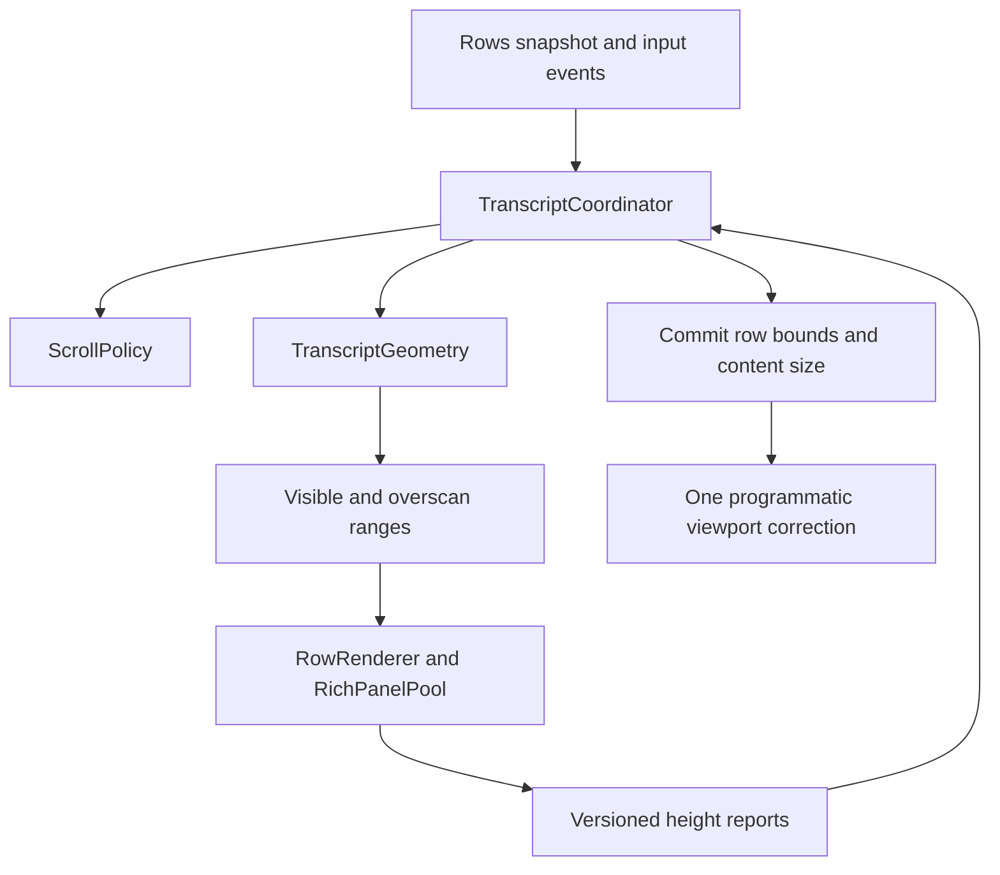

# JetBrains 대화창 가상 스크롤 리팩토링 지침

기준: `6067564b4`, 2026-11-14. 상태: 코드 검토에 근거한 구현 제안입니다. 구현 범위와 남은 제안은 아래 구현 상태에 구분했습니다. [English](JETBRAINS_TRANSCRIPT_REFACTOR.md).


## 구현 상태

현재 구현은 `TranscriptGeometry`, `ScrollPolicy`, `TranscriptCoordinator`, `HeightReports`를 분리합니다. 크기 조회는 확정된 배치만 반환합니다. 로컬 행 ID는 본문 변경과 초안 완료에도 유지되며, 재생을 시작할 때 할당을 초기화합니다. 세션 읽기 위치에도 행 앵커를 저장합니다. 여유 영역은 이동 방향을 반영하고 화면 바깥 추가 행을 한쪽 최대 128개로 제한하며, 유지 경계 안에서는 부착 범위를 보존합니다. 리치 렌더 준비는 보이는 행과 가까운 행을 우선하고 브라우저 4개 제한을 유지합니다.

브라우저 보고에 문서 토큰·요청 세대·실측 폭·응답 순서를 추가했습니다. 교체·해제된 패널과 오래된 폭의 보고를 거부합니다. 조정 역할이 스크롤바 범위와 위치를 함께 적용하고, 사용자 이동은 예약된 보정을 취소합니다.

대기 중인 앵커 보정은 나중 요청이 대체합니다. 같은 EDT 틱에 위쪽 행 두 개가 연달아 커지면 첫 보정만 적용되어, 읽던 위치가 두 번째 증가분만큼 어긋났습니다(시험에서 920이어야 할 위치가 850). 보정이 적용되기 전에는 뷰포트 위치 대신 보정 대상 앵커를 읽기 위치로 씁니다. 하단 추적과 `restore` 요청의 우선순위는 그대로입니다.

격리 샌드박스 IDE에서 높이 보고 계약을 한 번 확인했습니다(2026-11-14). 페이지 `innerWidth` 1276에 여백 14를 더한 값이 패널 폭 1290과 같아 보고가 수용됐습니다. 문서 교체 직후 도착한 이전 요청 세대의 보고 4건은 거부됐습니다. 스트리밍 중 위로 스크롤하고 다이어그램 노드와 케이스를 누르는 동안 앵커 보정과 임시 축소 복원은 0건이었습니다. 측정식은 마지막 자식의 아래 마진을 높이에 넣지 않으므로 페이지 `scrollHeight`가 패널보다 16px 컸고, 글자는 잘리지 않았습니다. 9절의 성능 목표(EDT 배치 시간, 1만 행 메모리)는 재지 않았습니다.

이행 안전장치로 700ms 임시 축소 보류, 1500ms 완료 유예, `StreamingHeight`, 최대 3회 Swing 측정을 유지합니다. 폰트·이미지·Mermaid 준비 중 보고는 보류하고 2.5초 뒤에도 준비되지 않으면 추정 높이로 처리합니다. 포커스·텍스트 선택 중인 화면 밖 행은 따로 부착합니다. 브라우저 수명 관리는 기존 `RichAnswer`에 유지하며, 별도 `RichPanelPool` 추출과 실제 JCEF 성능 목표 검증은 후속 작업입니다. 단위 시험으로 완료됐다고 주장하지 않습니다. 브라우저 높이 캐시는 초기 추정치로 사용하고 새 보고를 검증한 뒤 배치에 반영합니다.

## 1. 판단과 범위

재설계를 권합니다. 가상화는 유지하되, 행의 높이를 확정하는 과정과 화면 위치를 결정하는 과정을 분리합니다. 전사 전체를 DOM 하나로 옮기거나 모든 행을 항상 렌더링하는 변경은 이번 범위에 넣지 않습니다. 긴 대화에서 자원 사용을 제한해야 하고, 현재 Swing 입력·복사·포커스 기능과 IDE Markdown 연동도 보존해야 합니다.

최근 수정은 각각 의미가 있습니다. `f1df9c668`은 사용자의 이동을 덮어쓰던 위치 복원을 취소하고, `541bde9c7`·`6067564b4`는 줄바꿈과 BoxLayout 캐시 때문에 높이가 반복 변경되던 문제를 처리했습니다. 그러나 높이 조회, 실제 배치, 스크롤 보정, 다시 그리기가 서로 호출하는 구조는 남아 있습니다. 이 문서는 새 결함을 모두 재현했다는 보고가 아닙니다. 확인된 코드 구조와 앞으로 검증해야 할 위험을 구분합니다.

목표는 다음과 같습니다.

- 읽던 행과 행 안의 위치를 유지합니다. 사용자가 이동하면 이전 보정 요청은 취소합니다.
- 스트리밍 중 하단 추적, 답변 완료 후 읽기, 명시적 최신 위치 이동을 구분합니다.
- 화면 경계 밖의 행을 미리 준비하여 스크롤 중 부착·측정 비용을 줄입니다.
- 늦게 온 브라우저 높이 보고가 다른 세션·문서·폭의 배치를 바꾸지 못하게 합니다.
- IDE를 띄우지 않아도 위치 계산과 이벤트 순서를 재현할 수 있게 합니다.

## 2. 현재 코드에서 확인한 구조

경로는 `clients/jetbrains/plugin/` 기준입니다. 식별자를 함께 적어 이후 줄 번호 변경에도 찾을 수 있게 합니다.

| 위치 | 확인한 동작 | 리팩토링 이유 |
|---|---|---|
| `intellij/.../ui/VirtualTranscript.kt`: `getPreferredSize`, `measure` | 높이 조회 중 자식 트리를 배치하고 캐시를 변경하며 `changed()`를 호출합니다. 최대 3회 측정합니다. | 단순 크기 조회가 다시 그리기를 예약합니다. 조회 횟수가 작업량을 좌우합니다. |
| 같은 파일: `rekey`, `doLayout` | 행 삽입·삭제와 높이 변경 때 각각 `viewport.viewPosition`을 변경합니다. | 한 번의 데이터 변경에 여러 위치 보정이 개입할 수 있습니다. |
| `intellij/.../ui/TailScroll.kt` | 별도 리스너와 `invokeLater`가 하단으로 이동합니다. 1500ms 유예와 이동 횟수를 관리합니다. | 높이 계산과 별개로 이동을 예약합니다. 실행 순서를 함께 검증해야 합니다. |
| `intellij/.../ui/MagiToolWindow.kt`: `redrawLog` | 키 생성, 범위 계산, 브라우저 보존, 행 재사용, 실제 배치, 하단 추적 갱신을 모두 수행합니다. | 부분 수정의 영향 범위가 큽니다. |
| 같은 파일: `ReadingPosition` | 세션별 절대 픽셀 위치와 추적 여부를 저장합니다. | 재생 후 폭·폰트·높이 추정이 달라지면 같은 내용의 위치를 뜻하지 않습니다. |
| `intellij/.../ui/RichAnswer.kt`: `measurer` | JS가 숫자 높이를 보고하고 EDT에서 당시 `holder.width`와 함께 수용합니다. | 보고를 만든 문서 세대와 폭이 메시지에 없습니다. 오래된 보고를 명시적으로 배제할 계약이 필요합니다. |
| `intellij/.../ui/StreamingHeight.kt` | 스트리밍 중 최대 높이 유지, 1000ms 이내 교대 높이 완화를 수행합니다. | 실제 접기·폭 변경과 임시 재배치를 구분하는 정보가 부족합니다. |
| `core/.../usecase/RowText.kt`: `foldKey` 및 `redrawLog.identity` | 일부 키가 본문 해시를 포함합니다. `rekey`는 중복에 순번을 붙입니다. | 내용 개정과 행 식별을 분리해야 높이·선택·앵커를 안전하게 보존합니다. |

전체 대화의 모델은 `Rows`가 담당합니다. 가상화 때문에 모델의 행을 버려서는 안 됩니다. `TranscriptViewport.scrollRectToVisible`의 포커스 보호와 `Copying`의 전체 전사 접근도 유지합니다.

검토한 구현: [VirtualTranscript](../clients/jetbrains/plugin/intellij/src/main/kotlin/dev/sayaya/magi/ide/ui/VirtualTranscript.kt) · [TailScroll](../clients/jetbrains/plugin/intellij/src/main/kotlin/dev/sayaya/magi/ide/ui/TailScroll.kt) · [MagiToolWindow](../clients/jetbrains/plugin/intellij/src/main/kotlin/dev/sayaya/magi/ide/ui/MagiToolWindow.kt) · [RichAnswer](../clients/jetbrains/plugin/intellij/src/main/kotlin/dev/sayaya/magi/ide/ui/RichAnswer.kt) · [StreamingHeight](../clients/jetbrains/plugin/intellij/src/main/kotlin/dev/sayaya/magi/ide/ui/StreamingHeight.kt) · [TranscriptViewport](../clients/jetbrains/plugin/intellij/src/main/kotlin/dev/sayaya/magi/ide/ui/TranscriptViewport.kt)

## 3. 화면 밖 여유 영역과 브라우저 준비

현재도 화면만 정확히 잘라 그리지는 않습니다. `range()`는 30행 이하를 모두 붙이고, 그보다 많으면 위아래에 각각 `max(화면 높이, 320px)`를 더합니다. 다만 `RichAnswer.KEEP`는 4입니다. Swing 행의 부착 범위와 실제 Markdown 브라우저의 유지 범위는 다릅니다. 행 마진을 늘리는 것만으로 브라우저 준비까지 보장할 수 없습니다.

다음 값은 실측 전의 시작 설정입니다. 성능 결과로 조정합니다.

| 구분 | 시작 정책 | 제약 |
|---|---|---|
| 화면 범위 | 현재 위치와 화면 높이 | 항상 포함합니다. |
| 행 부착 범위 | 정지 시 위아래 2화면, 이동 중 앞쪽 3화면·뒤쪽 1화면 | 행 수와 EDT 시간 예산도 제한합니다. 빠른 이동은 속도를 반영하되 상한을 둡니다. |
| 유지 범위 | 부착 범위보다 바깥에 1화면 추가 | 이 범위를 벗어나야 해제하여 경계 왕복 시 재생성을 줄입니다. |
| 브라우저 준비 | 보이는 행 우선, 다음으로 이동 방향의 가까운 행 | 최초에는 기존 4개 제한을 유지합니다. RAM·생성 지연 측정 없이 제한부터 늘리지 않습니다. |
| 큰 단일 행 | 화면을 여러 배 넘는 행도 같은 RowId로 유지 | 클리핑으로 내부 스크롤을 추가하지 않습니다. 큰 브라우저의 한계는 별도 측정합니다. |

부착 범위를 늘려도 높이가 번갈아 변하거나 오래된 보고를 수용하면 화면은 흔들립니다. 아래의 높이 계약과 위치 소유권 개선을 함께 수행합니다. JCEF 예산이 모자라면 안정된 크기의 자리 표시 또는 기존 경량 표시를 유지하고, 승격 시 앵커를 한 번만 보정합니다. 아직 준비되지 않은 그림을 준비된 것처럼 표시하지 않습니다.

포커스·텍스트 선택 중인 행은 부착 유지 대상에 포함합니다. 브라우저 예산과 충돌하면 그 행을 우선하고 다른 준비 작업을 미룹니다. 보존을 위해 새 브라우저를 무제한 생성하면 안 됩니다.

## 4. 제안 구조와 소유권

새 이름은 제안입니다. 클래스 수 자체를 목표로 삼지 말고 다음 책임 경계를 지킵니다.

| 구성 | 책임 | 하지 않는 일 |
|---|---|---|
| `TranscriptGeometry` | 순서 있는 RowId, 높이, 누적 오프셋, 범위 계산 | Swing 접근, 스크롤 이동, 콜백 실행 |
| `ScrollPolicy` | 추적 의향, 현재 하단 여부, 사용자 이동 세대, 읽기 앵커 | 컴포넌트 크기 측정 |
| `TranscriptCoordinator` | 이벤트 병합, 배치 트랜잭션, 프로그램에 의한 스크롤 이동의 단일 소유자 | 행 본문 렌더링 |
| `RowRenderer` | 정해진 폭에서 Swing 행 측정 또는 비동기 높이 요청 | viewport 변경 |
| `RichPanelPool` | 브라우저 준비·재사용·해제, 요청 세대 관리 | 전사 높이 직접 변경 |
| `VirtualTranscript` | 확정된 배치의 크기 반환과 행 경계 적용 | 조회 중 재측정, 읽기 위치 결정 |



Swing 기본 휠·스크롤바 동작까지 모두 재구현하지는 않습니다. 사용자가 만든 이동은 정책 입력으로 관측하고, 그 뒤의 프로그램 보정만 Coordinator가 소유합니다. `scrollRectToVisible`로 발생하는 포커스 이동도 명시적인 reveal 요청으로 통합하거나 원인을 분류해야 합니다. 원인 없는 viewport 변경을 자동 추적 재개로 해석하지 않습니다.

## 5. 식별자와 높이 계약

`RowId`는 세션 식별자와 원본 이벤트/메시지 식별자, 행 역할, 필요한 경우 안정된 부분 식별자로 만듭니다. 본문 해시나 현재 목록 인덱스를 ID로 사용하지 않습니다. ID 없는 레거시 이벤트는 `Rows`에서 최초 생성 시 부여하고, 같은 전사 재생에서 재현할 수 있는 규칙을 정합니다. 하나의 메시지가 여러 행을 만들면 역할과 부분 번호의 안정성을 시험합니다. 이번 변경만을 위해 데몬 프로토콜을 먼저 바꾸지는 않습니다.

내용 변경은 별도 `contentRevision`으로 표현합니다. 폰트·테마·배율·폭·접힘 상태·렌더러 종류는 `layoutRevision` 또는 측정 키에 포함합니다. 중복 ID는 개발 시험에서 실패시킵니다. `#2`를 붙여 조용히 통과시키면 삽입 후 같은 행이라는 보장이 사라집니다.

브라우저 높이 보고는 최소한 다음 값을 가집니다.

```text
sessionEpoch, rowId, contentRevision, layoutRevision,
panelGeneration, requestId, measuredWidth, height, phase
```

`phase`는 준비 중인지 현재 문서의 배치가 가능한지 나타냅니다. DOM, 폰트, 이미지, Mermaid의 준비 상태와 이후 재배치를 구분합니다. 한 번 준비됐다고 이후 높이 보고를 막지 않습니다. CSS 픽셀과 Swing 좌표의 변환·반올림 규칙도 한 곳에서 정하고 배율별 시험을 추가합니다.

Coordinator는 세션·문서·패널 세대와 폭이 현재 요청에 맞는 보고만 수용합니다. 교체된 패널, 이전 폭, dispose 이후 도착한 응답은 무시합니다. 같은 세대에서도 역순 응답을 배제합니다. 콜백을 EDT로 전달하기 전과 적용할 때 수명 검사를 수행합니다.

높이에는 `Estimated`, `Measured`, `Pending` 상태를 둡니다. 새 문서 준비 중에는 마지막 유효 높이를 잠정 유지할 수 있지만, 다른 폭의 높이를 실측값으로 표시하지 않습니다. 영구 축소·접기는 실제 높이로 확정해야 합니다. 준비 완료나 실패가 오지 않는 경우에는 시간 제한 뒤 추정 표시와 진단을 남기고, 자가 재시도를 무한 예약하지 않습니다.

Swing 텍스트는 할당된 폭에서 명시적으로 측정합니다. 현재 3회 반복은 이행 기간의 제한된 수단으로 유지합니다. 수렴하지 않으면 마지막 유효 높이/추정값과 진단을 반환하고, 같은 입력으로 다시 그리기를 무한히 유발하지 않습니다. 모든 행의 하위 트리를 매 조회마다 무효화하는 방식은 제거합니다.

## 6. 읽기 위치와 한 번의 배치

읽기 앵커는 `(rowId, offsetWithinRow, viewportOffset)`로 저장합니다. 이는 특정 행의 지점이 화면 어느 높이에 있었는지를 뜻합니다. 세션 전환에도 사용합니다. 리플레이로 해당 ID가 다시 생길 때까지 복원을 기다리고, 그동안 사용자가 이동하면 복원을 취소합니다.

행이 삭제되면 이전 스냅샷의 다음 생존 행, 없으면 이전 생존 행을 선택합니다. 그 선택을 시험에 고정합니다. 사라진 ID를 현재 같은 인덱스의 다른 행으로 대체하지 않습니다. 실제 축소로 행 내부 위치가 없어지면 행 끝으로 제한합니다. 임시 축소인지 여부는 측정 상태로 판단하고, 700ms 같은 시간만으로 결정하지 않습니다.

한 번의 갱신은 다음 순서로 진행합니다.

1. 스냅샷·사용자 이동·폭 변경·높이 보고를 모읍니다. EDT 예약은 하나만 둡니다.
2. 현재 앵커와 사용자 이동 세대를 캡처합니다. 스트리밍 상태도 범위 계산 전에 반영합니다.
3. RowId 목록과 유효한 높이 보고를 순수 모델에 적용합니다.
4. 부착 범위와 브라우저 준비 범위를 계산합니다. 변경된 행만 측정하며 결과는 같은 트랜잭션에 병합합니다.
5. 확정된 전체 크기와 행 경계를 적용합니다. 이 과정의 Swing 알림은 새 사용자 입력으로 취급하지 않습니다.
6. 여전히 같은 사용자 이동 세대일 때만 앵커 또는 하단 목표를 한 번 적용합니다. 범위를 벗어나면 제한합니다.
7. 실제 픽셀 변화와 신규 입력이 있을 때만 다음 갱신을 예약합니다. 미래 비동기 높이 보고는 새 트랜잭션입니다.

`getPreferredSize()`는 확정된 전체 크기만 반환합니다. `range()`도 조회로 유지합니다. 처음에는 배열과 누적 합으로 충분합니다. 1만 행 성능을 측정한 뒤 필요할 때만 부분 합 자료구조를 도입합니다. 누적 높이는 `Long`으로 관리하고 Swing의 `Int` 좌표로 변환하는 한계와 폴백을 명시합니다.

## 7. 자동 추적 정책

`followIntent`, `isAtEnd`, `turnOpen`, `pendingReveal`, `navigationEpoch`를 분리합니다. 최신 위치 버튼은 실제 하단 여부를 기준으로 합니다. 부착 범위는 현재 viewport와 명시적인 이동 목표를 기준으로 합니다.

| 이벤트 | 동작 |
|---|---|
| 새 토큰, 추적 의향 있음, 턴 진행 중 | 새 전체 높이를 확정한 뒤 하단을 유지합니다. |
| 사용자 위쪽 이동·드래그 시작 | 추적과 대기 중 보정을 취소하고 이동 세대를 증가시킵니다. |
| 사용자 아래쪽 이동 후 실제 하단 도달 | 추적 의향을 켭니다. 단순 높이 변경으로 켜지지 않습니다. |
| 최신 위치 버튼 | 명시적 하단 이동을 예약합니다. 이후 사용자 이동이 우선합니다. |
| 턴 종료 | 일반 읽기로 전환합니다. 해당 턴에서 이미 요청한 렌더 완료 처리는 세대로 구분하고 시간 제한을 둡니다. |
| 완료된 Mermaid의 노드·케이스 선택, 접기 | 읽기 앵커를 유지합니다. 오래된 추적 의향만으로 하단으로 가지 않습니다. |
| 세션 전환·창 종료 | 이전 예약과 높이 보고를 무효화합니다. |

보류한 모든 작업에 세션 세대와 사용자 이동 세대를 붙입니다. 휠뿐 아니라 키보드, 스크롤바, 최신 위치 버튼, 접근성 reveal, 세션 복원을 포함합니다. JCEF 내부 선택·가로 스크롤·줌 입력을 전사 세로 스크롤로 잘못 전환하지 않는지도 확인합니다.

## 8. 구현 순서

각 단계는 별도 커밋으로 검증하고, 다음 단계 전에 기존 재현 시험을 통과시킵니다.

1. **기준선 고정.** 현재 회귀 시험과 실제 로그를 보관합니다. 세션·폭·이동 세대·행 ID·높이 변경 원인·프로그램 보정 횟수를 진단에 추가합니다. 본문은 기록하지 않습니다.
2. **순수 모델 추출.** RowId와 Geometry를 도입합니다. 기존 화면은 어댑터로 연결합니다. 내용 변화, 중복, 삭제, 리플레이 시 식별 안정성을 먼저 검증합니다.
3. **측정 경로 분리.** 높이 getter의 부작용을 제거하고 명시적인 dirty 행 측정을 도입합니다. 기존 3회 수렴 정책은 렌더러 안에서 유지합니다.
4. **비동기 계약 도입.** RichAnswer의 숫자 메시지를 세대·폭 포함 보고로 바꿉니다. 패널 수명과 높이 캐시 키도 함께 수정합니다.
5. **스크롤 단일 소유.** TailScroll의 정책을 추출하고 `rekey`·`doLayout`의 직접 이동을 Coordinator로 옮깁니다. 세션별 논리 앵커도 연결합니다.
6. **여유 영역 확대.** 행 부착·유지·브라우저 준비 범위를 분리하고 방향 기반 정책을 적용합니다. 메모리와 EDT 시간을 비교합니다.
7. **이전 경로 제거.** 같은 일을 하는 타이머·보정·측정 캐시를 제거합니다. `StreamingHeight`의 휴리스틱은 새 계약으로 대체된 부분만 삭제합니다. 새 결함이 생기면 마지막 단계만 되돌릴 수 있어야 합니다.

이행 중 두 스크롤 제어기가 동시에 쓰면 안 됩니다. 기존/신규 경로를 선택하더라도 창마다 하나만 활성화합니다. IDE 설치·재시작은 사용자가 사용 중이지 않은 별도 샌드박스에서 합니다.

## 9. 검증과 완료 조건

`6067564b4`에서 이 검토 세션이 실행한 `TailScrollTest`, `TranscriptReflowTest`, `VirtualTranscriptAnchorTest`, `TranscriptDumpReplayTest`는 24건 모두 통과했습니다. 이는 새 설계의 검증 결과가 아닙니다. 리팩토링의 최소 회귀 기준입니다.

| 계층 | 필수 시나리오 | 판정 |
|---|---|---|
| 순수 모델 | 삽입·삭제·변경·폭 변경·중복·빈 목록·누적 높이 한계 | 느린 기준 계산과 범위/위치가 일치합니다. |
| 이벤트 순서 | 사용자 이동 전후 높이 보고, 역순 응답, 이전 세션 응답, dispose | 오래된 응답과 보정이 위치를 바꾸지 않습니다. 가짜 시계를 사용합니다. |
| Swing | 긴 System/카운슬/StreamingMarkdown, 폰트·폭·배율 변경, 접힘 | 같은 입력으로 높이가 교대하지 않습니다. 변경 없는 조회는 측정·예약을 하지 않습니다. |
| 가상화 | 31행·1천행·1만행, 양방향 빠른 이동, 경계 왕복, 큰 단일 답변 | 표시 범위 누락이 없고 유지 범위 안에서 불필요한 재생성이 없습니다. |
| 상태 보존 | 세션 전환·재접속·과거 대화, 선택·복사·Tab·칩·Mermaid 케이스 | 같은 내용으로 복귀하고 사용자의 새 입력이 우선합니다. |
| 실제 JCEF | 이미지 지연, 숨겼다 표시, 문서 교체, 다이어그램 설명 증감, 네이티브/JS 휠 | 입력 전달과 렌더 세대가 맞으며 빈 화면·포커스 탈취가 없습니다. |

정책 시험은 private 필드 리플렉션이나 실제 `sleep`에 의존하지 않게 옮깁니다. 기존 Swing 시험은 유지하되, 여러 번 `flush()`한 마지막 결과만 보지 말고 중간 위치와 높이 전이를 기록합니다. 최종 위치가 맞아도 중간에 흔들리면 실패입니다.

완료 기준은 다음과 같습니다. 성능 숫자는 제안 목표이며 기준 장비와 화면 크기를 기록한 뒤 조정할 수 있습니다.

- 순수 계산의 앵커 오차는 0, Swing 통합에서 반올림을 포함한 오차는 1 논리 픽셀 이내입니다. 실제 삭제·축소에 따른 제한은 별도로 검증합니다.
- 한 트랜잭션의 프로그램 보정은 최대 1회입니다. 입력이 멈추고 렌더가 준비되면 스스로 계속 갱신하지 않습니다.
- 범위 밖 전사는 모델에 유지하되, 부착 행·브라우저·타이머 수가 전체 행 수에 비례해 늘어나지 않습니다. 창을 닫으면 관련 자원을 해제합니다.
- 기준 시나리오에서 EDT 배치 시간 p95 16ms 이하를 우선 목표로 삼습니다. JCEF 응답 대기 시간은 분리하고, 최댓값·50ms 초과 작업 수도 기록합니다.
- 1만 행 대화에서 메모리, 브라우저 생성 횟수, 초당 배치 수를 기존판과 비교합니다. 마진 확대에 따른 비용을 수치로 보고합니다.
- EN/KO 툴팁, 최신 위치·중단·재개 버튼, 키보드와 복사 동작을 보존합니다. 이 문서 작업은 플러그인을 설치하지 않았습니다.

## 10. 구현자에게 전달할 요청

> `6067564b4` 기준 가상 스크롤을 이 문서 순서대로 리팩토링해 주세요. 먼저 RowId·Geometry·ScrollPolicy의 순수 시험을 만들고, 높이 조회의 부작용과 여러 곳의 위치 보정을 없애 주세요. 화면 앞뒤 여유 영역과 JCEF 준비 범위는 별도로 관리해 주세요. 기존 재현 시험을 보존하고, 중간 프레임 흔들림·역순 높이 보고·사용자 이동 우선권까지 검증해 주세요. 실측과 추정을 구분해 보고하고, 사용 중인 IDE 플러그인은 설치하거나 재시작하지 마세요.
