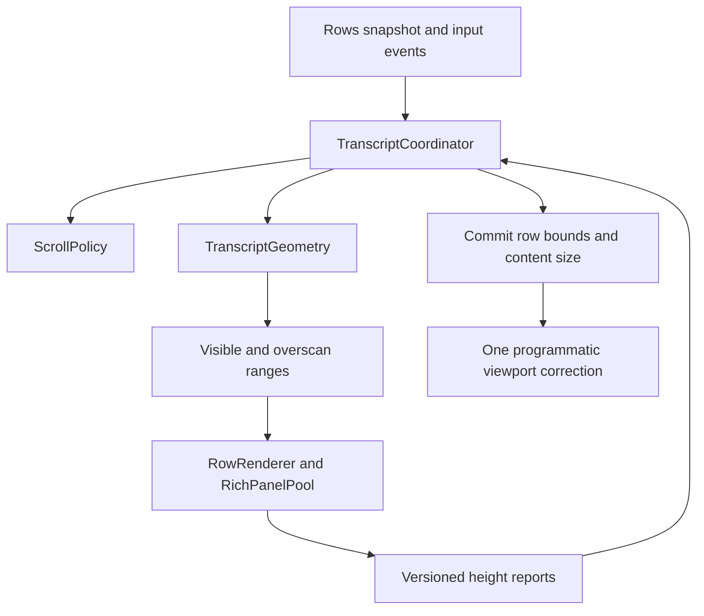

# JetBrains transcript virtualization refactoring guide

Baseline: `6067564b4`, 2026-11-14. Status: implementation proposal based on code review. Implementation status is recorded below; remaining policies are proposals. [한국어](JETBRAINS_TRANSCRIPT_REFACTOR.ko.md).


## Implementation status

The working implementation extracts `TranscriptGeometry`, `ScrollPolicy`, `TranscriptCoordinator`, and `HeightReports`. Size queries return committed geometry. Local row IDs survive text revisions and draft completion; replay resets their allocation. Session reading positions also retain row anchors. Overscan is directional and bounded to 128 additional rows per side, with retention inside its guard range. Rich preparation prioritizes visible and nearby rows while keeping four browsers.

Browser reports now include document tokens, request generations, measured width, and sequence numbers. Replaced/disposed panels and stale widths are rejected. The coordinator commits scrollbar bounds and position together, and user navigation invalidates queued corrections.

A later anchor correction replaces a queued one. When two rows above the reader grew in the same EDT tick, only the first correction was applied and the reading position ended off by the second growth (850 in the test where 920 was expected). Until a correction is committed, the reading position is the anchor it targets, not the viewport position. Tail following and `restore` requests keep their priority.

The height-report contract was checked once in an isolated sandbox IDE (2026-11-14). Page `innerWidth` 1276 plus the 14px inset equalled the panel width 1290, so reports were accepted. Four reports from the previous request generation, arriving just after a document swap, were rejected. While scrolling up and clicking diagram nodes and cases during a streamed answer, there were no anchor corrections and no temporary-shrink restores. The measurement leaves out the last child's bottom margin, so the page `scrollHeight` was 16px larger than the panel; no text was clipped. The performance targets in section 9 (EDT layout time, memory at ten thousand rows) were not measured.

Migration safeguards remain: the 700ms temporary-shrink hold, 1500ms completion grace, `StreamingHeight`, and bounded three-pass Swing measurement. Reports wait for fonts, images, and Mermaid, with an estimated-height fallback after 2.5 seconds. Focused and text-selected offscreen rows remain attached separately. Browser lifetime management stays in `RichAnswer`; extracting a separate `RichPanelPool` and validating live JCEF performance targets remain follow-up work. They are not claimed complete by the unit tests. Browser height caches remain provisional initial estimates; reports are validated before updating layout.

## 1. Decision and scope

Refactor the design. Keep virtualization, but separate the process that commits row heights from the process that chooses the viewport position. Moving the entire transcript into one DOM or rendering every row continuously is outside this change. Long conversations still need bounded resource use. Preserve Swing input, copying, focus behavior, and the IDE Markdown integration.

The recent fixes are useful. `f1df9c668` cancels a held position restore after user navigation; `541bde9c7` and `6067564b4` address height changes caused by wrapping and BoxLayout caches. However, size queries, layout, scroll correction, and redraw still call into each other. This document does not claim to have reproduced every possible defect. It separates observed code structure from risks that need validation.

The objectives are:

- Preserve the row being read and the position within it. New user navigation cancels older corrections.
- Distinguish following a streaming answer, reading a completed answer, and explicitly jumping to the latest position.
- Prepare rows outside the viewport to reduce attachment and measurement work at scroll boundaries.
- Prevent delayed browser height reports from changing another session, document revision, or width.
- Make geometry and event ordering reproducible without launching an IDE.

## 2. Observed code structure

Paths are relative to `clients/jetbrains/plugin/`. Symbols are included so the references survive changes to line numbers.

| Location | Observed behavior | Reason to refactor |
|---|---|---|
| `intellij/.../ui/VirtualTranscript.kt`: `getPreferredSize`, `measure` | A size query lays out descendants, changes caches, and calls `changed()`. Measurement takes up to three passes. | A size query can schedule another redraw. Query frequency controls work. |
| Same file: `rekey`, `doLayout` | Both row changes and height changes write `viewport.viewPosition`. | Several corrections can participate in one data update. |
| `intellij/.../ui/TailScroll.kt` | Separate listeners and `invokeLater` move to the end. It tracks a 1500ms grace period and navigation counts. | Movement is scheduled separately from geometry calculation. Their order needs joint validation. |
| `intellij/.../ui/MagiToolWindow.kt`: `redrawLog` | Creates keys, selects ranges, retains browsers, reuses rows, lays out components, and updates following. | Local changes have a wide effect. |
| Same file: `ReadingPosition` | Stores an absolute pixel position and following state per session. | Replayed content with another width, font, or height estimate can put different content at that position. |
| `intellij/.../ui/RichAnswer.kt`: `measurer` | JS reports a numeric height, accepted on the EDT using the then-current `holder.width`. | The report does not identify its document generation or measured width. Stale reports need an explicit rejection contract. |
| `intellij/.../ui/StreamingHeight.kt` | Retains the maximum height while streaming and dampens alternating reports within 1000ms. | It lacks enough information to distinguish a real collapse or width change from temporary reflow. |
| `core/.../usecase/RowText.kt`: `foldKey`, plus `redrawLog.identity` | Some keys include a content hash. `rekey` suffixes duplicate keys by occurrence. | Row identity must be independent of content revisions to preserve height, selection, and anchors. |

`Rows` owns the full conversation model. Virtualization must not discard its rows. Preserve the focus protection in `TranscriptViewport.scrollRectToVisible` and the full-transcript access used by `Copying`.

Reviewed implementation: [VirtualTranscript](../clients/jetbrains/plugin/intellij/src/main/kotlin/dev/sayaya/magi/ide/ui/VirtualTranscript.kt) · [TailScroll](../clients/jetbrains/plugin/intellij/src/main/kotlin/dev/sayaya/magi/ide/ui/TailScroll.kt) · [MagiToolWindow](../clients/jetbrains/plugin/intellij/src/main/kotlin/dev/sayaya/magi/ide/ui/MagiToolWindow.kt) · [RichAnswer](../clients/jetbrains/plugin/intellij/src/main/kotlin/dev/sayaya/magi/ide/ui/RichAnswer.kt) · [StreamingHeight](../clients/jetbrains/plugin/intellij/src/main/kotlin/dev/sayaya/magi/ide/ui/StreamingHeight.kt) · [TranscriptViewport](../clients/jetbrains/plugin/intellij/src/main/kotlin/dev/sayaya/magi/ide/ui/TranscriptViewport.kt)

## 3. Overscan and browser preparation

The current code already renders outside the exact viewport. `range()` attaches every row up to 30 rows; above that it adds `max(viewport height, 320px)` on each side. However, `RichAnswer.KEEP` is 4. Attached Swing rows and retained Markdown browsers have different ranges. Increasing row overscan alone does not guarantee that browsers are ready.

The following are starting settings, not measured optimum values. Adjust them using performance results.

| Area | Initial policy | Constraint |
|---|---|---|
| Visible range | Current position and viewport height | Always include it. |
| Attached row range | Two screens on each side when stationary; three ahead and one behind during movement | Also bound row count and EDT time. Account for velocity during fast scrolling, with a maximum. |
| Retention range | One additional screen beyond the attached range | Detach only outside it to reduce reconstruction when moving back and forth at a boundary. |
| Browser preparation | Visible rows first, then nearby rows in the direction of travel | Initially preserve the four-browser limit. Measure RAM and creation latency before increasing it. |
| One very large row | Retain one RowId even when it spans many screens | Do not introduce nested scrolling by clipping it. Measure large-browser limits separately. |

Extra overscan cannot stabilize alternating heights or stale reports. Implement the height contract and scroll ownership changes below as well. When the JCEF budget is exhausted, keep a stable-size placeholder or the existing lightweight presentation and correct the anchor once on promotion. Do not imply that an unavailable diagram is ready.

Retain rows containing focus or text selection. When that conflicts with the browser budget, prioritize the active row and defer other preparation. Preservation must not create unbounded browsers.

## 4. Proposed responsibilities

The names are proposals. The number of classes is not an objective; the responsibility boundaries are.

| Component | Owns | Does not do |
|---|---|---|
| `TranscriptGeometry` | Ordered RowIds, heights, cumulative offsets, range calculation | Swing access, scrolling, callbacks |
| `ScrollPolicy` | Follow intent, actual end position, navigation generation, reading anchor | Component measurement |
| `TranscriptCoordinator` | Event coalescing, layout transactions, sole ownership of programmatic scroll correction | Row content rendering |
| `RowRenderer` | Swing measurement at a specified width or asynchronous height requests | Viewport writes |
| `RichPanelPool` | Browser preparation, reuse, disposal, request generations | Direct transcript height changes |
| `VirtualTranscript` | Returns committed size and applies row bounds | Measurement during queries, reading-position decisions |



Do not reimplement all native Swing wheel and scrollbar behavior. Observe user movement as policy input; the Coordinator owns subsequent programmatic corrections. Route focus movement through `scrollRectToVisible` into an explicit reveal request, or classify its cause. An unexplained viewport change must not resume following.

## 5. Identity and measurement contract

Build `RowId` from session identity, source event/message identity, row role, and a stable part identifier where needed. Do not use a content hash or current list index. For legacy events without an ID, assign one when `Rows` creates the row and define a rule reproducible during replay of the same transcript. If one message produces several rows, test the stability of their roles and part identifiers. Do not begin with a daemon protocol change solely for this refactor.

Represent content changes through `contentRevision`. Include font, theme, scale, width, folding, and renderer kind in `layoutRevision` or the measurement key. Duplicate IDs should fail development tests. Silently adding `#2` cannot guarantee identity after insertion.

A browser height report contains at least:

```text
sessionEpoch, rowId, contentRevision, layoutRevision,
panelGeneration, requestId, measuredWidth, height, phase
```

`phase` distinguishes pending preparation from usable layout for the current document. Track DOM, font, image, and Mermaid readiness separately from later reflow. Readiness must not prevent subsequent height reports. Define CSS-pixel to Swing-coordinate conversion and rounding in one place, with scale tests.

The Coordinator accepts reports only when the session, document, panel generation, and width match the current request. Ignore responses from replaced panels, old widths, and disposed views. Reject reordered responses within a generation too. Check lifetime before posting a callback to the EDT and again when applying it.

Use `Estimated`, `Measured`, and `Pending` height states. While a replacement document is preparing, the last valid height may remain provisional; a height from another width is not a measured value for the new width. Permanent shrinkage and folding must eventually commit their real height. If readiness or failure never arrives, time out into an estimated presentation and diagnostic report without scheduling endless retries.

Measure Swing text explicitly at its assigned width. Keep the current three-pass loop as a bounded migration mechanism. If it does not converge, return the last valid height or an estimate with a diagnostic, without triggering endless redraws on identical input. Remove invalidation of every descendant tree on every size query.

## 6. Reading anchors and layout transactions

Store a reading anchor as `(rowId, offsetWithinRow, viewportOffset)`: a point in a particular row and where it appeared in the viewport. Use it across session changes too. Wait until replay supplies that ID before restoring it; navigation in the meantime cancels the restore.

If the row disappears, choose the next surviving row in the previous snapshot, or the previous surviving row if there is no next one. Fix this choice in tests. Do not substitute whichever row now occupies the old index. If a real shrink removes the offset, clamp it to the row end. Use measurement state to identify temporary shrinkage instead of deciding from a 700ms interval alone.

An update follows this sequence:

1. Collect snapshots, navigation, width changes, and height reports. Keep only one pending EDT task.
2. Capture the current anchor and navigation generation. Apply streaming state before computing ranges.
3. Apply RowId changes and valid height reports to the pure model.
4. Calculate attachment and browser preparation ranges. Measure only dirty rows and merge synchronous results into this transaction.
5. Commit content size and row bounds. Swing notifications during this work are not new user input.
6. If the navigation generation still matches, apply the anchor or end target once, clamped to the available range.
7. Schedule another update only for relevant pixel changes or new input. A future asynchronous report starts a new transaction.

`getPreferredSize()` returns only committed content size. Keep `range()` a query too. Arrays and prefix sums are sufficient initially; introduce a partial-sum data structure only if measurements at 10,000 rows justify it. Store cumulative heights as `Long` and specify the limit and fallback when converting to Swing's `Int` coordinates.

## 7. Following policy

Separate `followIntent`, `isAtEnd`, `turnOpen`, `pendingReveal`, and `navigationEpoch`. The latest-position button uses actual end position. Attachment ranges use the current viewport and explicit movement targets.

| Event | Behavior |
|---|---|
| Token arrives with follow intent during an open turn | Commit the new total height, then retain the end position. |
| User moves upward or begins dragging | Cancel following and pending corrections; increment the navigation generation. |
| User moves down and actually reaches the end | Enable follow intent. Height changes alone must not enable it. |
| Latest-position button | Request an explicit end position. Later navigation wins. |
| Turn ends | Enter normal reading. Track already-requested rendering completion by turn generation, with a time limit. |
| Node/case selection or folding in a completed Mermaid diagram | Preserve the reading anchor. Old follow intent alone must not pull to the end. |
| Session change or view disposal | Invalidate earlier scheduled work and height reports. |

Tag all pending work with session and navigation generations. Cover keys, scrollbar movement, the latest-position button, accessibility reveal, and session restoration as well as wheel events. Verify that JCEF text selection, horizontal scrolling, and zoom gestures are not wrongly converted to transcript vertical movement.

## 8. Implementation sequence

Validate each step in a separate commit. Existing reproduction tests must pass before proceeding.

1. **Capture the baseline.** Preserve regression tests and real logs. Add session, width, navigation generation, row ID, height-change cause, and correction counts to diagnostics. Do not log message content.
2. **Extract the pure model.** Introduce RowId and Geometry behind an adapter to the existing UI. Test identity through content changes, duplicates, deletion, and replay first.
3. **Separate measurement.** Remove size-getter side effects and measure explicitly dirty rows. Retain the bounded three-pass policy inside the renderer during migration.
4. **Version asynchronous reports.** Replace numeric RichAnswer messages with generation/width reports. Update panel lifetimes and height cache keys together.
5. **Unify scrolling ownership.** Extract TailScroll policy and move direct writes from `rekey` and `doLayout` into the Coordinator. Connect per-session logical anchors.
6. **Expand overscan.** Separate attachment, retention, and browser preparation ranges; add directional policy. Compare memory and EDT time.
7. **Remove old paths.** Remove duplicate timers, corrections, and measurement caches. Delete only the parts of `StreamingHeight` heuristics replaced by the new contract. A regression must allow reverting the last step independently.

Never run two scroll controllers concurrently. If old and new paths are selectable, enable only one per view. Installation and restart tests belong in a separate sandbox, not the user's active IDE.

## 9. Validation and completion criteria

At `6067564b4`, this review session ran `TailScrollTest`, `TranscriptReflowTest`, `VirtualTranscriptAnchorTest`, and `TranscriptDumpReplayTest`: all 24 tests passed. These are baseline regression results, not validation of the proposed design.

| Layer | Required scenarios | Pass condition |
|---|---|---|
| Pure model | Insert, delete, revise, resize, duplicates, empty list, cumulative-height limit | Ranges and positions agree with a slow reference calculation. |
| Event ordering | Reports before/after navigation, reordered responses, previous-session reports, disposal | Stale reports and corrections cannot move the view. Use a fake clock. |
| Swing | Long System/council/StreamingMarkdown rows; font, width, scale, folding changes | Identical input does not alternate heights. Unchanged queries perform no measurement or scheduling. |
| Virtualization | 31, 1,000, and 10,000 rows; fast scrolling both ways; boundary oscillation; one huge answer | No visible-range gaps or unnecessary reconstruction inside retention bounds. |
| State preservation | Session changes, reconnect, history, selection, copy, Tab, chips, Mermaid cases | Return to the same content; new user input takes priority. |
| Real JCEF | Delayed images, hide/show, document replacement, changing diagram notes, native/JS wheel | Input delivery and rendering generations match; no blank viewport or stolen focus. |

Move policy tests away from private-field reflection and real sleeps. Keep Swing integration tests, but record intermediate height and position transitions instead of checking only after repeated `flush()` calls. A correct final position is insufficient if intermediate frames jump.

Completion criteria follow. Performance numbers are proposed targets; record the reference machine and viewport before adjusting them.

- Anchor error is zero in pure calculations and at most one logical pixel after Swing rounding. Test clamping caused by real deletion or shrinkage separately.
- At most one programmatic correction occurs per transaction. Once input stops and rendering is ready, the system does not keep scheduling itself.
- Retain offscreen transcript data, but attached rows, browsers, and timers must not grow in proportion to total history. Dispose related resources when the view closes.
- Initially target p95 EDT layout time of 16ms or less in reference scenarios. Measure JCEF response latency separately; also report maximum duration and tasks exceeding 50ms.
- Compare memory, browser creation counts, and layouts per second at 10,000 rows against the baseline. Report the cost of expanded overscan numerically.
- Preserve EN/KO tooltips, latest/stop/resume buttons, keyboard use, and copying. This documentation task did not install a plugin.

## 10. Request for the implementer

> Refactor transcript virtualization from `6067564b4` in the sequence described here. Start with pure tests for RowId, Geometry, and ScrollPolicy. Remove size-query side effects and distributed position corrections. Manage row overscan separately from JCEF preparation. Preserve existing reproduction tests and validate intermediate-frame stability, reordered height reports, and user-navigation priority. Distinguish measurements from estimates in the report. Do not install or restart the user's active IDE plugin.
