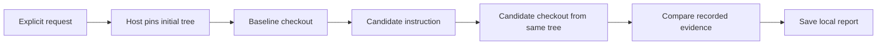

# S² Engine: local experiments and memory delivery

[English](S2_ENGINE.md) · [한국어](S2_ENGINE.ko.md) · [Docs](README.md)

Status: implementation with pinned verification, repeated trials and controlled reuse. Deterministic tests exercise the real plugin, host snapshots and memory delivery. They do not establish a model-quality improvement.

## Install and run

`plugins/s2-engine` is an optional Lua plugin. It is not embedded or installed automatically. Build the updated core with `go build -o /tmp/magi-s2-engine ./cmd/magi`. Copy the plugin directory into your user plugin directory, or supply a parent directory containing just this plugin with `--plugins <directory>`. Avoid passing the repository's entire `plugins` directory: that loads other plugins too.

Open `/subagents`, enable `s2_compare`, and start a new conversation so its frozen tool catalog includes the tool. You can also explicitly request a local coding comparison. Example arguments:

```json
{"task":"Fix the parser's empty-field handling and run its tests","guidance":"Read the existing parser tests before changing the parser","max_steps":20,"timeout":300}
```

Existing `harness-lab` preferences are read as compatibility aliases for the corresponding `s2_*` tools; new saves use only the S² Engine names.

Both executions receive the same task, tools, step allowance and timeout. Omit `guidance` to request a proposal from the baseline evidence. `proposal_attempts` bounds proposal refinement to 1–3 attempts; duplicate or invalid proposals are discarded, and the accepted proposal attempts are recorded in the report before one candidate execution. This is a bounded refinement loop, not a generated success score. When refinement yields several distinct proposals and a pinned verifier is present, the executor tries them in order and stops at the first verifier pass; every attempted candidate remains in the report, together with `selection_rule=first independent verifier pass; no generated score`. Without a verifier, only the first candidate runs and qualitative review remains advisory. A proposal of `null` preserves the baseline and records `unchanged`. An optional `hypothesis` describes the expected behavioral difference. `prior_report` accepts an earlier completed comparison ID from this workspace as uncertain evidence for proposal generation.

## Execution and ownership



The plugin owns proposal and comparison policy. Legacy `magi.spawn{trial=true}` without a checkpoint branch provides a common source snapshot for one tool invocation, separate Git clones and private scratch directories. It returns the source tree hash and executor model/provider. The host removes the common source when the tool returns; trial checkouts remain available for inspection. Trial results cannot be passed to `merge_child`.

Each experiment changes one instruction block. It does not mutate the tool catalog, install generated plugins, or run a population of recursive candidates. Trial tools are limited to `read`, `grep`, `glob`, `list`, `write`, `edit`, `multiedit` and `bash`. Live plugin context and shared-memory retrieval are excluded. Global and project AGENTS instructions are captured once. Explicit background bash requests are refused; OS sandbox network permission is disabled where supported. Existing deny rules and approval requirements still apply. Trial shells now require an enforcing OS sandbox, exclude shared writable caches and protect Git metadata; unsupported platforms refuse shell execution instead of falling back to unconfined execution. Trials also refuse configured lifecycle hooks because those hooks do not yet inherit the branch restriction.

This isolates checkout inputs, not the entire operating system. Shell commands can have external effects on platforms without an enforcing sandbox. Do not use this tool to repeat deployments, account actions or live Office/browser operations. Dependencies and ignored build output are not copied. A test requiring them may need local setup in each checkout. A multi-command experiment is not an atomic snapshot of external services or user edits.

## Evidence and results

Each report records the original task, instruction change, hypothesis, snapshot, model/provider, commit ranges, tool evidence, step counts, limits and start/finish times. Report IDs are random. `s2_report{"id":"<report ID>"}` reads a report in the current workspace. Reports live in the existing local plugin store; the report-reader tool does not cross workspace boundaries. Reports are not automatically published to shared memory. Provider-reported input, output and cached tokens, call counts and elapsed milliseconds are recorded for execution and analysis. Missing usage makes `tokens_known=false`; partial totals remain visible. Monetary cost stays `unknown`.

The comparison returns `baseline`, `candidate` or `inconclusive`, with an observed-effect claim. The host-independent report always records `attribution=confounded` and `verified=false`: one pair cannot establish causality or transferability. Truncated evidence forces an inconclusive result. Missing tool records, snapshot/model mismatches, invalid judgments, execution errors and exhausted budgets produce an incomplete report. Comparison preferences never promote a skill. Repeat and evaluate changes on separate tasks before adopting them.

Engram additionally retains up to 100 recent learning-evidence records per workspace. `/engram-evidence` shows the latest ten: change, claimed conversational evidence, source and host outcome. Their attribution is always `confounded`; the analyzer cannot change it. Existing verified-turn requirements for skill creation remain intact. Updates use compare-and-exchange, preserve malformed state and log persistence conflicts instead of overwriting another writer.

## Independent checks and controlled reuse

Set `verify_path` to a pre-existing relative shell script. Before the model runs, the host captures its bytes and SHA256 from the common source snapshot. After execution, the host runs those bytes through the usual bash permission and sandbox gates. Editing the checkout copy cannot replace the verifier. Missing, refused or interrupted checks never count as passes. Keep the script self-contained: imported helpers and tests in the checkout can still be edited, so a pass only establishes what this script actually checks.

`repetitions` accepts 1–3 training pairs. `holdouts` accepts up to two distinct task/verifier pairs, which are withheld from proposal generation; guidance is fixed before these tasks run. Subsequent pairs alternate execution order. Repeated or held-out evaluation requires a main verifier, and oversized requests are rejected before execution. For example, add `"verify_path":"verify.sh","repetitions":2,"holdouts":[{"task":"Fix a separate parser case","verify_path":"verify-other.sh"}],"max_steps":10` to the arguments above.

The assessment records actual pass/fail counts. A candidate becomes `eligible` only after at least two training pairs, improvement in training and a separate task, and no observed regression. Truncated evidence blocks eligibility. Any baseline pass followed by a candidate failure marks `regressed` and keeps the baseline preference. These conditions are an adoption policy, not a measured success probability. Reports still retain `verified=false` and `attribution=confounded`.

When a new comparison starts, the plugin automatically retrieves up to five recent adopted reports whose task, guidance or applicability text shares literal terms with the new task. These reports are advisory evidence for proposal and comparison; their guidance is not silently applied. The report records the consulted IDs, so later review can see what influenced the analysis. `reuse_report` remains the explicit way to make one adopted guidance the candidate.

`s2_validate` rechecks a report before review: every measured run has metrics, aggregated call and usage counts match the runs, pinned verifier digests are present, and adoption history is coherent. It returns `valid=false` on inconsistency and never repairs or adopts a report. It cannot establish correctness or generalization. `s2_search` searches the latest 100 indexed report IDs using a literal task/guidance/applicability filter and returns up to ten completed reports, newest first. Supply `applies_when` to record applicability conditions. A human can run `/s2-engine-adopt REPORT_ID reason` for eligible guidance; the command reruns report consistency checks before changing adoption state or `/s2-engine-withdraw REPORT_ID reason` to withdraw it. Both keep an audit history and use compare-and-exchange. Adoption permits explicit `reuse_report` in a later experiment; it does not change global instructions or publish shared skills. Withdrawn reports cannot be reused.

Council prompts now request evidence, limitations and uncertainty in words. New model responses do not supply a numeric confidence field; legacy confidence remains readable for historical compatibility and is omitted from the TUI, web and IDE vote displays. Experiment judgments retain only preference, observed effect and reason, discarding unsolicited score fields. Measured tokens, duration and verifier outcomes remain numeric where appropriate.

## Parallel candidate execution

Set `execution_mode="parallel"` for disposable coding clones when the candidate set has more than one entry. The host uses `spawn_all`; each candidate gets its own trial checkout and scratch space, and measured metrics remain per candidate. The bounded child budget still applies. Checkpoint branches and holdouts remain sequential in this mode until their application adapters expose independent handles. The resource rule is isolation, not the file type: independent Office file copies or Figma page copies with independent handles can use the same scheduler once those adapters are wired.

## Checkpoint branches and final cleanup

Enable `s2_checkpoint` alongside `s2_compare` in `/subagents`, then start a new conversation. Begin a session-owned tree with `s2_checkpoint{"action":"begin","kind":"git"}` for code or `kind="directory"` for local document/assets. Git checkpoints include uncommitted Git-visible files in a private repository; execution branches are detached Git worktrees sharing only that private metadata. Directory checkpoints copy regular files, including binary Office documents. Symlinks and special files are refused. Empty directories are not part of the snapshot.

On supported hosts comparisons use checkpoint branches by default; the first comparison begins a Git or directory tree automatically. `"checkpoint":true` requires this path explicitly, and `false` selects the legacy disposable-clone path (Git only). Every execution gets a different host-issued branch ID and writes only inside that branch plus its private temporary area. The report records each run's `branch`. Trial tools remain the local file/bash allowlist: this interface does not yet redirect live Office automation or remote Figma document IDs. Those tools remain unavailable to a trial. Directory isolation alone cannot authorize writes to remote documents.

Select an artifact with `s2_checkpoint{"action":"adopt","branch":"<run branch ID>"}`. This freezes a new checkpoint from that branch; future forks start there. Busy branches, stale siblings and already sealed branches cannot be adopted. Artifact selection is separate from `/s2-engine-adopt`, which adopts an instruction for later explicit reuse. Selecting an artifact does not claim the instruction generalizes.

Call `s2_checkpoint{"action":"finish"}` after choosing the final artifact. This only requests publication. After the host recognizes genuine top-level completion, it checks that the original has not changed, backs up affected files, applies the selected file changes without altering the original Git index or refs, and verifies hashes and permissions. Successful publication removes all temporary worktrees, snapshots, backups and the private repository. A small manifest with branch selection history remains as the audit record. Another `begin` starts a new tree after cleanup.

Original divergence blocks publication and retains the branches. Cancellation or an unverified turn also retains them. Failed publication rolls back applied changes; unexpected concurrent edits are preserved and require recovery. Publication is a journaled sequence of file replacements, not an atomic transaction across external applications or simultaneous editors. File/directory type replacements require manual resolution. Keep the original document closed while publishing; this version does not manage application handles.

Manifests live under `<session-store>/checkpoints/<session ID>`. After restarting, use `begin` to reopen the existing manifest, inspect `status`, and use `recover` for interrupted publication. Recovery restores backed-up files only when current values match either the original or the attempted publication; it refuses unexpected edits. Then review, `reopen` or request `finish` again. Completed publication and cleanup retries are idempotent. With no configured session-store path, checkpoints use process-local temporary storage and automatic restart discovery is unavailable.

## Memory delivery

Memory hints now track ID and a fingerprint of returned text/tags. Corrections to an existing ID can be announced again. A newer revision replaces a queued older hint, and hints absent from the latest retrieval are dropped. Successful compaction opens another delivery window: the next ordinary retrieval can announce relevant matches again, at most three per model step. It does not inject every stored memory or rewrite the frozen system prefix. Session delivery receipts remain in memory; this change does not add a persistent cross-process delivery ledger or memory replication protocol.

The design references are [Harness²](https://github.com/google-research/harness2) for execution comparisons, and the local `oh-my-openagent/packages/memory-core` recall ledger and `omo-senpi` projection pin for revision-aware delivery and compaction boundaries. That repository's Engram server is a separate memory-sharing service. It is not magi's learning plugin. No source from its memory module or sharing server is copied, and no server integration is added here. Existing Unicode search and managed-memory withdrawal are reused.

## Verification

```sh
go test ./internal/app ./internal/adapter/plugin/lua ./internal/adapter/experience/git ./internal/arch
go test -race ./internal/app ./internal/adapter/plugin/lua
node clients/vscode/tools/transcript-test.mjs
```

Tests cover pinned uncommitted inputs despite later parent/sibling edits, blocked trial merging, absent live context, plugin persistence and workspace scoping, unsupported hosts, invalid budgets, missing/truncated evidence, conservative learning attribution, corrected memory hints and post-compaction delivery. Additional tests cover pinned verifier tampering, repeated/held-out ordering, regression rejection, adoption/withdrawal and missing usage. Real-model quality and transfer still require separate experiments.

### Recorded checks, 2026-10-24

App, Lua, experience-store, architecture and plugin tests passed. The complete app/Lua race suites passed; the new cases also passed a separate race run. Core build and scoped vet passed. The integration case uses the actual Lua plugin, app loop, JSONL store, Git clones, builtin write and foreground bash; its executor and comparison model responses are scripted.

The transcript asset check and asks, autocomplete, accessibility and Markdown bundles passed. Accessibility reported zero violations. Layout timed out waiting for the existing `#select-model`; diff failed its existing expanded-argument header-order assertion. Council UI changes now omit legacy numeric confidence and retain decisions and qualitative rationale. The CLI suite also failed the existing `TestShimSalvagesATruncatedToolCall`, `TestShimSaysWhyACallWasNotRun` and `TestCodexUsageDoesNotDoubleCountTheCache`; running only the unchanged shim test sources reproduced those failures without the changed app/Lua code. These failures remain unresolved.

The VS Code suite passed 642 tests with seven skips; JetBrains core tests and IntelliJ compilation passed, as did the web coding module GWT compilation. Checkpoint scenarios also passed for Git worktrees and directory copies, including actual Lua/app/bash execution, next-generation forks, final cleanup, conflicts, restart loading and interrupted-publication recovery. macOS sandbox execution refused writes outside the branch and to its Git metadata. Both Mermaid blocks parse. The standard EN/KO parity check passed, and the new pair has matching sections, diagrams and code examples. The repository-wide documentation audit still reports existing MANUAL omissions for `browser` and `companion_call`. No live model benchmark or external memory-server connection was run.

## File resources, context and application lifetime

A single Office file can use `s2_checkpoint{"action":"begin","kind":"file","path":"documents/report.docx"}`. The relative path must stay inside the session workspace and must not traverse symlinks. Only this file is copied into branches, promoted to the next checkpoint and published. Other branch outputs and neighboring original files are excluded. The returned `resource` is the exact copy path. Verifier scripts are pinned separately and never published as part of the document.

Checkpoint branches inherit the same model-visible message history and system text captured before the branching tool call. Existing compaction summaries and runtime references are copied without additional summarization. In-flight tool calls are not copied without their results. Each child has its own session log. Adopting a branch continues that branch's history; final disposal persists it as `checkpoint.context` in the parent while retaining the original audit transcript. Images are copied into durable context storage before temporary workspaces disappear. Independent auto-compaction is disabled for these child executions, so a provider context limit can stop an oversized run instead of silently generating a different history.

The application adapter contract owns the exact copy handle: `OpenCopy`, `SaveAndClose`, and `ConfirmClosed`. Adoption, completion and cleanup refuse unconfirmed close operations and retain the copies. After restart, an application-managed tree requires its adapter again; file deletion success is never treated as proof that Office closed a document. These lifecycle contracts and failure scenarios are tested with an injected adapter. Production Office COM/Office.js opening, binding and closing are not yet wired, so current Office support is file-based execution, not live app automation.

Figma now has its own `figma_checkpoint` page-copy tool. See the client [checkpoint workflow](../clients/figma/README.md#checkpoint-pages). It supports isolated text/frame edits and host-confirmed publication, but does not yet run the generic harness comparison's child sessions over Figma tools. Its Plugin API tests use a simulated Figma document; live account acceptance remains outstanding.


When `s2_compare` is enabled, the host schedules one comparison per turn after an edit followed by a completed shell check, or a repeated failed command with an intervening edit. The model does not have to request S². The host also retrieves recent workspace reports once after tool work and supplies them as advisory evidence for the next procedure. Each automatic comparison uses disposable coding clones, one proposal, at most 12 steps and 120 seconds per execution. It does not require a verifier script; without one, the qualitative comparison cannot establish verified improvement. The parent model composes its next procedure from the recorded contrasts and applies task fixes through ordinary tools. Artifacts and reusable instructions are not automatically adopted. Disabled tools, child agents and trials do not enter this host loop. This is bounded task-level orchestration, not the full eight-component optimizer in upstream Harness².
